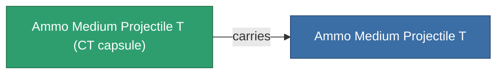

<!-- Generated by tools/generate from the live database (source: entitydefaults definition 5927, aggregatevalues via aggregatefields).
     Do not edit by hand; regenerate instead. -->

# Ammo Medium Projectile T

|  |  |
|---|---|
| 定義 | `def_ammo_medium_projectile_t` |
| 階級 | – |
| 耐久 | 100 |
| 容量 | 1 |
| 質量 | 0.2 |
| 分類 | Ammo / Projectiles |
| 備註 | toxic ammo med |

## 統計

| 欄位 | 值 |
|---|---|
| damage_chemical | 12 |
| damage_explosive | 2 |
| damage_kinetic | 2 |
| damage_thermal | 2 |
| damage_toxic | 40 |

## 運輸艙

A transport capsule (CT) exists for this item — it is how the item moves between players and zones.

<!-- production:generated -->
## 生產

**由組件 5個生產** — 組裝組件來製造它（完整列表見[配方](/zh-TW/content/recipes/)）:

**藍圖:** [Ammo Medium Projectile T Cprg](/zh-TW/content/items/ammo-medium-projectile-t-cprg/)

<svg class="prod-card-icon" aria-hidden="true"><use href="#mi-grid"/></svg><a class="prod-card-name" href="/zh-TW/content/items/axicoline/">Axicoline</a>

需要: <b>200</b>

<svg class="prod-card-icon" aria-hidden="true"><use href="#mi-grid"/></svg><a class="prod-card-name" href="/zh-TW/content/items/phlobotil/">Phlobotil</a>

需要: <b>200</b>

<svg class="prod-card-icon" aria-hidden="true"><use href="#mi-grid"/></svg><a class="prod-card-name" href="/zh-TW/content/items/polynitrocol/">Polynitrocol</a>

需要: <b>200</b>

<svg class="prod-card-icon" aria-hidden="true"><use href="#mi-grid"/></svg><a class="prod-card-name" href="/zh-TW/content/items/polynucleit/">Polynucleit</a>

需要: <b>200</b>

<svg class="prod-card-icon" aria-hidden="true"><use href="#mi-grid"/></svg><a class="prod-card-name" href="/zh-TW/content/items/titanium/">Titanium</a>

需要: <b>200</b>

