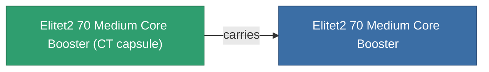

<!-- Generated by tools/generate from the live database (source: entitydefaults definition 5951, aggregatevalues via aggregatefields).
     Do not edit by hand; regenerate instead. -->

# Elitet2 70 Medium Core Booster

|  |  |
|---|---|
| 定義 | `def_elitet2_70_medium_core_booster` |
| 階級 | T2 (special) |
| 耐久 | 100 |
| 容量 | 1 |
| 質量 | 135 |
| 分類 | Modules / Enhancements |
| 備註 | elite module |

## 統計

| 欄位 | 值 |
|---|---|
| core_usage | 0 |
| cpu_usage | 22 |
| cycle_time | 10.5k |
| powergrid_usage | 214 |
| reactor_radiation_modifier | 0.95 |

## 運輸艙

A transport capsule (CT) exists for this item — it is how the item moves between players and zones.

## 購買地點

Fixed-price vendors that sell this item (see the [Item shop](/zh-TW/content/shop/) for the full catalog).

| Vendor | Qty | Credits | UniCoin |
|---|---|---|---|
| Daoden outpost | ∞ | 250M | 10k |

<!-- production:generated -->
## 生產

**由組件 2個生產** — 組裝組件來製造它（完整列表見[配方](/zh-TW/content/recipes/)）:

**藍圖:** [Elitet2 70 Medium Core Booster Cprg](/zh-TW/content/items/elitet2-70-medium-core-booster-cprg/)

<svg class="prod-card-icon" aria-hidden="true"><use href="#mi-grid"/></svg><a class="prod-card-name" href="/zh-TW/content/items/material-boss-z70/">Material Boss Z70</a>

需要: <b>300</b>

<svg class="prod-card-icon" aria-hidden="true"><use href="#mi-grid"/></svg><a class="prod-card-name" href="/zh-TW/content/items/named1-medium-core-booster/">Shoxit Parter I. medium energy injector</a>

需要: <b>1</b>

