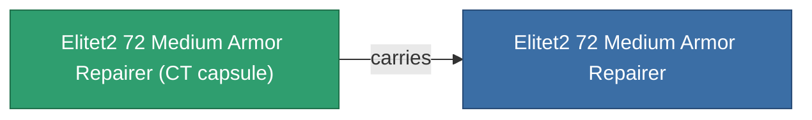

<!-- Generated by tools/generate from the live database (source: entitydefaults definition 6044, aggregatevalues via aggregatefields).
     Do not edit by hand; regenerate instead. -->

# Elitet2 72 Medium Armor Repairer

|  |  |
|---|---|
| 定義 | `def_elitet2_72_medium_armor_repairer` |
| 階級 | T2 (special) |
| 耐久 | 100 |
| 容量 | 1.5 |
| 質量 | 506.25 |
| 分類 | Modules / Repair |
| 備註 | elite module |

## 統計

| 欄位 | 值 |
|---|---|
| armor_max | 245 |
| armor_repair_amount | 200 |
| core_usage | 278 |
| cpu_usage | 43 |
| cycle_time | 13.5k |
| powergrid_usage | 87 |

## 運輸艙

A transport capsule (CT) exists for this item — it is how the item moves between players and zones.

## 購買地點

Fixed-price vendors that sell this item (see the [Item shop](/zh-TW/content/shop/) for the full catalog).

| Vendor | Qty | ICS Coin | Credits |
|---|---|---|---|
| Daoden outpost | ∞ | 2.5k | 375M |

<!-- production:generated -->
## 生產

**由組件 2個生產** — 組裝組件來製造它（完整列表見[配方](/zh-TW/content/recipes/)）:

**藍圖:** [Elitet2 72 Medium Armor Repairer Cprg](/zh-TW/content/items/elitet2-72-medium-armor-repairer-cprg/)

<svg class="prod-card-icon" aria-hidden="true"><use href="#mi-grid"/></svg><a class="prod-card-name" href="/zh-TW/content/items/material-boss-z72/">Material Boss Z72</a>

需要: <b>300</b>

<svg class="prod-card-icon" aria-hidden="true"><use href="#mi-tree"/></svg><a class="prod-card-name" href="/zh-TW/content/items/named1-medium-armor-repairer/">Vautrell medium armor repairer</a>

需要: <b>1</b>

