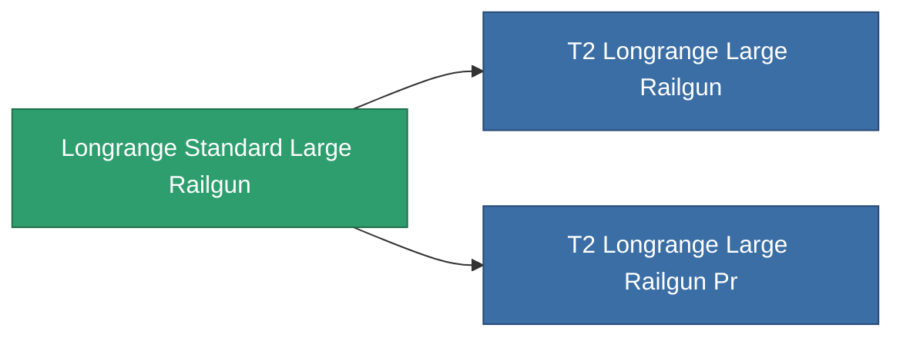

<!-- Generated by tools/generate from the live database (source: entitydefaults definition 1001, aggregatevalues via aggregatefields).
     Do not edit by hand; regenerate instead. -->

# Longrange Standard Large Railgun

|  |  |
|---|---|
| 定義 | `def_longrange_standard_large_railgun` |
| 階級 | T1 |
| 耐久 | 100 |
| 容量 | 1.5 |
| 質量 | 1300 |
| 分類 | Modules / Weapons |

## 統計

| 欄位 | 值 |
|---|---|
| accuracy | 42 |
| core_usage | 18.9 |
| cpu_usage | 100 |
| cycle_time | 10k |
| damage_modifier | 3 |
| falloff | 25.5 |
| optimal_range | 46 |
| powergrid_usage | 277.5 |

<!-- production:generated -->
## 生產

**由組件 6個生產** — 組裝組件來製造它（完整列表見[配方](/zh-TW/content/recipes/)）:

**藍圖:** [Longrange Standard Large Railgun Cprg](/zh-TW/content/items/longrange-standard-large-railgun-cprg/)

<svg class="prod-card-icon" aria-hidden="true"><use href="#mi-grid"/></svg><a class="prod-card-name" href="/zh-TW/content/items/axicol/">Cryoperine</a>

需要: <b>75</b>

<svg class="prod-card-icon" aria-hidden="true"><use href="#mi-grid"/></svg><a class="prod-card-name" href="/zh-TW/content/items/axicoline/">Axicoline</a>

需要: <b>150</b>

<svg class="prod-card-icon" aria-hidden="true"><use href="#mi-grid"/></svg><a class="prod-card-name" href="/zh-TW/content/items/chollonin/">Chollonin</a>

需要: <b>75</b>

<svg class="prod-card-icon" aria-hidden="true"><use href="#mi-grid"/></svg><a class="prod-card-name" href="/zh-TW/content/items/polynitrocol/">Polynitrocol</a>

需要: <b>150</b>

<svg class="prod-card-icon" aria-hidden="true"><use href="#mi-grid"/></svg><a class="prod-card-name" href="/zh-TW/content/items/specimen-sap-item-flux/">Specimen Sap Item Flux</a>

需要: <b>10</b>

<svg class="prod-card-icon" aria-hidden="true"><use href="#mi-grid"/></svg><a class="prod-card-name" href="/zh-TW/content/items/titanium/">Titanium</a>

需要: <b>150</b>

## 用於生產

**2個物品的組件** — 所有在製造中使用它的物品:

