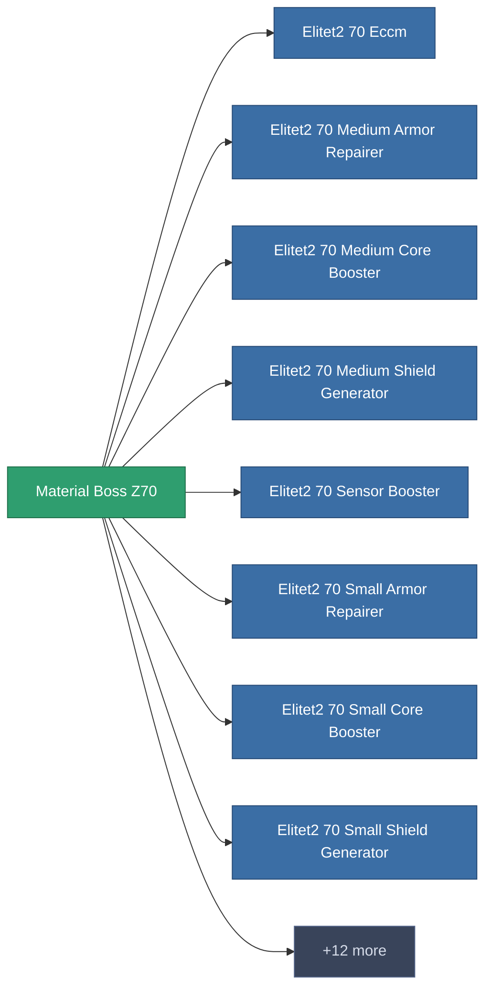

<!-- Generated by tools/generate from the live database (source: entitydefaults definition 5995, aggregatevalues via aggregatefields).
     Do not edit by hand; regenerate instead. -->

# Material Boss Z70

|  |  |
|---|---|
| 定義 | `def_material_boss_z70` |
| 階級 | – |
| 耐久 | 100 |
| 容量 | 0.01 |
| 質量 | 0.5 |
| 分類 | Materials |
| 備註 | elite module |

_無統計 — 此物品沒有聚合值。_

<!-- production:generated -->
## 用於生產

**20個物品的組件** — 使用它可以生產的內容示例（完整列表見[配方](/zh-TW/content/recipes/)）。

