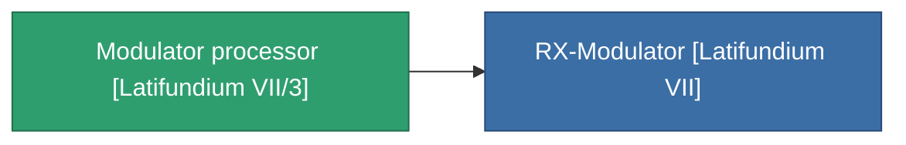

<!-- Generated by tools/generate from the live database (source: entitydefaults definition 3824, aggregatevalues via aggregatefields).
     Do not edit by hand; regenerate instead. -->

# Modulator processor [Latifundium VII/3]

|  |  |
|---|---|
| 定義 | `def_missionitem_tm_ii_level01_exp3_07_t03` |
| 階級 | – |
| 耐久 | 100 |
| 容量 | 0.01 |
| 質量 | 50 |
| 分類 | Mission items |

_無統計 — 此物品沒有聚合值。_

<!-- production:generated -->
## 用於生產

**1個物品的組件** — 所有在製造中使用它的物品:

