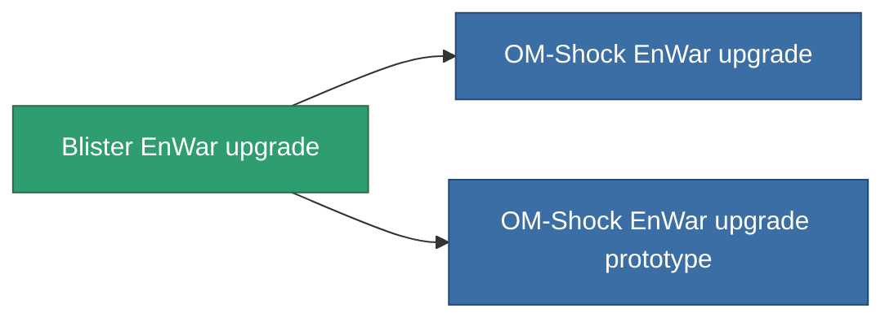

<!-- Generated by tools/generate from the live database (source: entitydefaults definition 4583, aggregatevalues via aggregatefields).
     Do not edit by hand; regenerate instead. -->

# Blister EnWar upgrade

|  |  |
|---|---|
| 定義 | `def_named1_energy_warfare_upgrade` |
| 階級 | T2 |
| 耐久 | 100 |
| 容量 | 1 |
| 質量 | 225 |
| 分類 | Modules / Enhancements |
| Tier line | [Standard EnWar upgrade](/zh-TW/content/items/standard-energy-warfare-upgrade/) (T1) → **Blister EnWar upgrade** (T2) → [OM-Shock EnWar upgrade](/zh-TW/content/items/named2-energy-warfare-upgrade/) (T3) → [XT-Shock EnWar upgrade](/zh-TW/content/items/named3-energy-warfare-upgrade/) (T4) |

## 統計

| 欄位 | 值 |
|---|---|
| core_usage_energy_neutralizers_modifier | 1.1 |
| cpu_usage | 23 |
| energy_neutralized_amount_modifier | 1.2 |
| energy_vampired_amount_modifier | 1.1 |
| powergrid_usage | 41 |

<!-- production:generated -->
## 生產

**由組件 8個生產 ，研究等級 6** — 組裝組件來製造它（完整列表見[配方](/zh-TW/content/recipes/)）:

**藍圖:** [Blister EnWar upgrade CT](/zh-TW/content/items/named1-energy-warfare-upgrade-cprg/)

<svg class="prod-card-icon" aria-hidden="true"><use href="#mi-grid"/></svg><a class="prod-card-name" href="/zh-TW/content/items/axicol/">Cryoperine</a>

需要: <b>150</b>

<svg class="prod-card-icon" aria-hidden="true"><use href="#mi-grid"/></svg><a class="prod-card-name" href="/zh-TW/content/items/axicoline/">Axicoline</a>

需要: <b>50</b>

<svg class="prod-card-icon" aria-hidden="true"><use href="#mi-grid"/></svg><a class="prod-card-name" href="/zh-TW/content/items/phlobotil/">Phlobotil</a>

需要: <b>50</b>

<svg class="prod-card-icon" aria-hidden="true"><use href="#mi-crystal"/></svg><a class="prod-card-name" href="/zh-TW/content/items/robotshard-common-basic/">Damaged common fragment</a>

需要: <b>15</b>

<svg class="prod-card-icon" aria-hidden="true"><use href="#mi-crystal"/></svg><a class="prod-card-name" href="/zh-TW/content/items/robotshard-pelistal-basic/">Damaged pelistal fragment</a>

需要: <b>15</b>

<svg class="prod-card-icon" aria-hidden="true"><use href="#mi-grid"/></svg><a class="prod-card-name" href="/zh-TW/content/items/standard-energy-warfare-upgrade/">Standard EnWar upgrade</a>

需要: <b>1</b>

<svg class="prod-card-icon" aria-hidden="true"><use href="#mi-grid"/></svg><a class="prod-card-name" href="/zh-TW/content/items/titanium/">Titanium</a>

需要: <b>50</b>

<svg class="prod-card-icon" aria-hidden="true"><use href="#mi-grid"/></svg><a class="prod-card-name" href="/zh-TW/content/items/vitricyl/">Vitricyl</a>

需要: <b>150</b>

## 用於生產

**2個物品的組件** — 所有在製造中使用它的物品:

