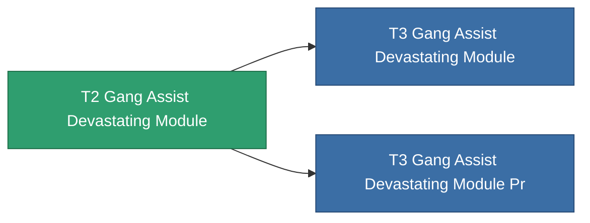

<!-- Generated by tools/generate from the live database (source: entitydefaults definition 2598, aggregatevalues via aggregatefields).
     Do not edit by hand; regenerate instead. -->

# T2 Gang Assist Devastating Module

|  |  |
|---|---|
| 定義 | `def_named1_gang_assist_devastating_module` |
| 階級 | T2 |
| 耐久 | 100 |
| 容量 | 0.2 |
| 質量 | 50 |
| 分類 | Modules / Enhancements |
| Tier line | [Standard Gang Assist Devastating Module](/zh-TW/content/items/standard-gang-assist-devastating-module/) (T1) → **T2 Gang Assist Devastating Module** (T2) → [T3 Gang Assist Devastating Module](/zh-TW/content/items/named2-gang-assist-devastating-module/) (T3) → [T4 Gang Assist Devastating Module](/zh-TW/content/items/named3-gang-assist-devastating-module/) (T4) |
| 備註 | devastating chancet novel |

## 統計

| 欄位 | 值 |
|---|---|
| core_usage | 31 |
| cpu_usage | 78 |
| cycle_time | 10k |
| default_effect_range | 100 |
| effect_devastating_chance_modifier | 1.02 |
| powergrid_usage | 31 |

<!-- production:generated -->
## 生產

**由組件 3個生產 ，研究等級 5** — 組裝組件來製造它（完整列表見[配方](/zh-TW/content/recipes/)）:

**藍圖:** [T2 Gang Assist Devastating Module Cprg](/zh-TW/content/items/named1-gang-assist-devastating-module-cprg/)

<svg class="prod-card-icon" aria-hidden="true"><use href="#mi-crystal"/></svg><a class="prod-card-name" href="/zh-TW/content/items/robotshard-nuimqol-basic/">Damaged nuimqol fragment</a>

需要: <b>15</b>

<svg class="prod-card-icon" aria-hidden="true"><use href="#mi-crystal"/></svg><a class="prod-card-name" href="/zh-TW/content/items/robotshard-thelodica-basic/">Damaged thelodica fragment</a>

需要: <b>15</b>

<svg class="prod-card-icon" aria-hidden="true"><use href="#mi-panel"/></svg><a class="prod-card-name" href="/zh-TW/content/items/standard-gang-assist-devastating-module/">Standard Gang Assist Devastating Module</a>

需要: <b>1</b>

## 用於生產

**2個物品的組件** — 所有在製造中使用它的物品:

