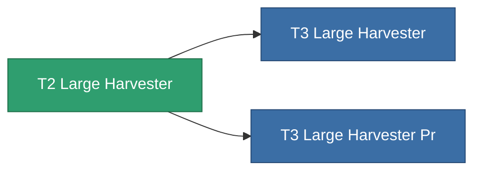

<!-- Generated by tools/generate from the live database (source: entitydefaults definition 8863, aggregatevalues via aggregatefields).
     Do not edit by hand; regenerate instead. -->

# T2 Large Harvester

|  |  |
|---|---|
| 定義 | `def_named1_large_harvester` |
| 階級 | T2 |
| 耐久 | 100 |
| 容量 | 2.5 |
| 質量 | 1500 |
| 分類 | Modules / Harvesting |
| Tier line | [Standard Large Harvester](/zh-TW/content/items/standard-large-harvester/) (T1) → **T2 Large Harvester** (T2) → [T3 Large Harvester](/zh-TW/content/items/named2-large-harvester/) (T3) → [T4 Large Harvester](/zh-TW/content/items/named3-large-harvester/) (T4) |

## 統計

| 欄位 | 值 |
|---|---|
| core_usage | 135 |
| cpu_usage | 432 |
| cycle_time | 12k |
| powergrid_usage | 1.215k |

<!-- production:generated -->
## 生產

**由組件 4個生產** — 組裝組件來製造它（完整列表見[配方](/zh-TW/content/recipes/)）:

**藍圖:** [T2 Large Harvester Cprg](/content/items/named1-large-harvester-cprg/)

<svg class="prod-card-icon" aria-hidden="true"><use href="#mi-grid"/></svg><a class="prod-card-name" href="/zh-TW/content/items/axicol/">Cryoperine</a>

需要: <b>600</b>

<svg class="prod-card-icon" aria-hidden="true"><use href="#mi-crystal"/></svg><a class="prod-card-name" href="/zh-TW/content/items/robotshard-common-basic/">Damaged common fragment</a>

需要: <b>120</b>

<svg class="prod-card-icon" aria-hidden="true"><use href="#mi-grid"/></svg><a class="prod-card-name" href="/zh-TW/content/items/standard-large-harvester/">Standard Large Harvester</a>

需要: <b>1</b>

<svg class="prod-card-icon" aria-hidden="true"><use href="#mi-grid"/></svg><a class="prod-card-name" href="/zh-TW/content/items/titanium/">Titanium</a>

需要: <b>2.4k</b>

## 用於生產

**2個物品的組件** — 所有在製造中使用它的物品:

