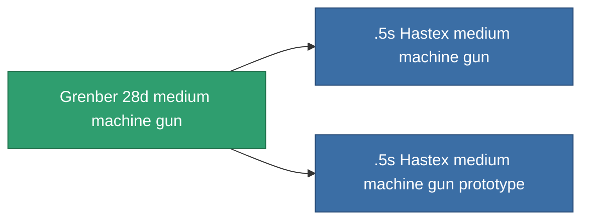

<!-- Generated by tools/generate from the live database (source: entitydefaults definition 843, aggregatevalues via aggregatefields).
     Do not edit by hand; regenerate instead. -->

# Grenber 28d medium machine gun

|  |  |
|---|---|
| 定義 | `def_named1_medium_autocannon` |
| 階級 | T2 |
| 耐久 | 100 |
| 容量 | 1.2 |
| 質量 | 450 |
| 分類 | Modules / Weapons |
| Tier line | [Standard medium machine gun](/zh-TW/content/items/standard-medium-autocannon/) (T1) → **Grenber 28d medium machine gun** (T2) → [.5s Hastex medium machine gun](/zh-TW/content/items/named2-medium-autocannon/) (T3) → [Torrex-G17 medium machine gun](/zh-TW/content/items/named3-medium-autocannon/) (T4) |

## 統計

| 欄位 | 值 |
|---|---|
| accuracy | 17 |
| core_usage | 1 |
| cpu_usage | 8 |
| cycle_time | 4k |
| damage_modifier | 1.6 |
| falloff | 20 |
| least_optimal | 3 |
| optimal_range | 12.5 |
| powergrid_usage | 105 |

<!-- production:generated -->
## 生產

**由組件 3個生產 ，研究等級 4** — 組裝組件來製造它（完整列表見[配方](/zh-TW/content/recipes/)）:

**藍圖:** [Grenber 28d medium machine gun CT](/zh-TW/content/items/named1-medium-autocannon-cprg/)

<svg class="prod-card-icon" aria-hidden="true"><use href="#mi-grid"/></svg><a class="prod-card-name" href="/zh-TW/content/items/axicoline/">Axicoline</a>

需要: <b>200</b>

<svg class="prod-card-icon" aria-hidden="true"><use href="#mi-grid"/></svg><a class="prod-card-name" href="/zh-TW/content/items/standard-medium-autocannon/">Standard medium machine gun</a>

需要: <b>1</b>

<svg class="prod-card-icon" aria-hidden="true"><use href="#mi-grid"/></svg><a class="prod-card-name" href="/zh-TW/content/items/titanium/">Titanium</a>

需要: <b>100</b>

## 用於生產

**2個物品的組件** — 所有在製造中使用它的物品:

