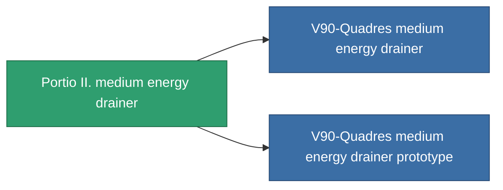

<!-- Generated by tools/generate from the live database (source: entitydefaults definition 747, aggregatevalues via aggregatefields).
     Do not edit by hand; regenerate instead. -->

# Portio II. medium energy drainer

|  |  |
|---|---|
| 定義 | `def_named1_medium_energy_vampire` |
| 階級 | T2 |
| 耐久 | 100 |
| 容量 | 1 |
| 質量 | 470 |
| 分類 | Modules / Shield |
| Tier line | [Standard medium energy drainer](/zh-TW/content/items/standard-medium-energy-vampire/) (T1) → **Portio II. medium energy drainer** (T2) → [V90-Quadres medium energy drainer](/zh-TW/content/items/named2-medium-energy-vampire/) (T3) → [Filch-AM medium energy drainer](/zh-TW/content/items/named3-medium-energy-vampire/) (T4) |

## 統計

| 欄位 | 值 |
|---|---|
| core_usage | 15 |
| cpu_usage | 53 |
| cycle_time | 10k |
| energy_dispersion | 10 |
| energy_vampired_amount | 90 |
| falloff | 0 |
| optimal_range | 25 |
| powergrid_usage | 165 |

<!-- production:generated -->
## 生產

**由組件 6個生產 ，研究等級 5** — 組裝組件來製造它（完整列表見[配方](/zh-TW/content/recipes/)）:

**藍圖:** [Portio II. medium energy drainer CT](/content/items/named1-medium-energy-vampire-cprg/)

<svg class="prod-card-icon" aria-hidden="true"><use href="#mi-grid"/></svg><a class="prod-card-name" href="/zh-TW/content/items/axicol/">Cryoperine</a>

需要: <b>400</b>

<svg class="prod-card-icon" aria-hidden="true"><use href="#mi-grid"/></svg><a class="prod-card-name" href="/zh-TW/content/items/axicoline/">Axicoline</a>

需要: <b>200</b>

<svg class="prod-card-icon" aria-hidden="true"><use href="#mi-crystal"/></svg><a class="prod-card-name" href="/zh-TW/content/items/robotshard-common-basic/">Damaged common fragment</a>

需要: <b>30</b>

<svg class="prod-card-icon" aria-hidden="true"><use href="#mi-crystal"/></svg><a class="prod-card-name" href="/zh-TW/content/items/robotshard-pelistal-basic/">Damaged pelistal fragment</a>

需要: <b>30</b>

<svg class="prod-card-icon" aria-hidden="true"><use href="#mi-grid"/></svg><a class="prod-card-name" href="/zh-TW/content/items/standard-medium-energy-vampire/">Standard medium energy drainer</a>

需要: <b>1</b>

<svg class="prod-card-icon" aria-hidden="true"><use href="#mi-grid"/></svg><a class="prod-card-name" href="/zh-TW/content/items/titanium/">Titanium</a>

需要: <b>200</b>

## 用於生產

**2個物品的組件** — 所有在製造中使用它的物品:

