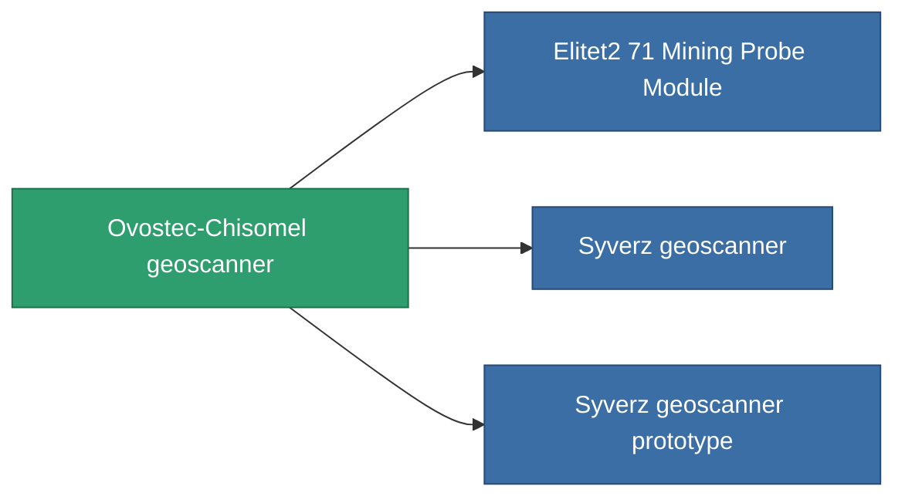

<!-- Generated by tools/generate from the live database (source: entitydefaults definition 780, aggregatevalues via aggregatefields).
     Do not edit by hand; regenerate instead. -->

# Ovostec-Chisomel geoscanner

|  |  |
|---|---|
| 定義 | `def_named1_mining_probe_module` |
| 階級 | T2 |
| 耐久 | 100 |
| 容量 | 1 |
| 質量 | 180 |
| 分類 | Modules / Enhancements |
| Tier line | [Standard geoscanner](/zh-TW/content/items/standard-mining-probe-module/) (T1) → **Ovostec-Chisomel geoscanner** (T2) → [Syverz geoscanner](/zh-TW/content/items/named2-mining-probe-module/) (T3) → [Eksplor-q3000 geoscanner](/zh-TW/content/items/named3-mining-probe-module/) (T4) |

## 統計

| 欄位 | 值 |
|---|---|
| core_usage | 50 |
| cpu_usage | 40 |
| cycle_time | 15k |
| mining_probe_accuracy | 0.5 |
| powergrid_usage | 45 |

<!-- production:generated -->
## 生產

**由組件 4個生產 ，研究等級 2** — 組裝組件來製造它（完整列表見[配方](/zh-TW/content/recipes/)）:

**藍圖:** [Ovostec-Chisomel geoscanner CT](/content/items/named1-mining-probe-module-cprg/)

<svg class="prod-card-icon" aria-hidden="true"><use href="#mi-grid"/></svg><a class="prod-card-name" href="/zh-TW/content/items/axicol/">Cryoperine</a>

需要: <b>350</b>

<svg class="prod-card-icon" aria-hidden="true"><use href="#mi-crystal"/></svg><a class="prod-card-name" href="/zh-TW/content/items/robotshard-common-basic/">Damaged common fragment</a>

需要: <b>30</b>

<svg class="prod-card-icon" aria-hidden="true"><use href="#mi-grid"/></svg><a class="prod-card-name" href="/zh-TW/content/items/standard-mining-probe-module/">Standard geoscanner</a>

需要: <b>1</b>

<svg class="prod-card-icon" aria-hidden="true"><use href="#mi-grid"/></svg><a class="prod-card-name" href="/zh-TW/content/items/titanium/">Titanium</a>

需要: <b>50</b>

## 用於生產

**3個物品的組件** — 所有在製造中使用它的物品:

