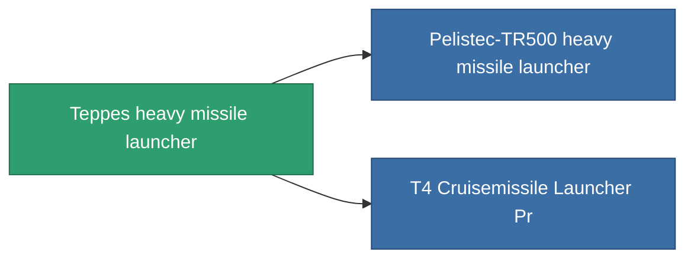

<!-- Generated by tools/generate from the live database (source: entitydefaults definition 856, aggregatevalues via aggregatefields).
     Do not edit by hand; regenerate instead. -->

# Teppes heavy missile launcher

|  |  |
|---|---|
| 定義 | `def_named2_cruisemissile_launcher` |
| 階級 | T3 |
| 耐久 | 100 |
| 容量 | 1.5 |
| 質量 | 1000 |
| 分類 | Modules / Weapons |
| Tier line | [Standard heavy missile launcher](/zh-TW/content/items/standard-cruisemissile-launcher/) (T1) → [Aqwit Imperator heavy missile launcher](/zh-TW/content/items/named1-cruisemissile-launcher/) (T2) → **Teppes heavy missile launcher** (T3) → [Pelistec-TR500 heavy missile launcher](/zh-TW/content/items/named3-cruisemissile-launcher/) (T4) |

## 統計

| 欄位 | 值 |
|---|---|
| accuracy | 1 |
| core_usage | 15 |
| cpu_usage | 105 |
| cycle_time | 12k |
| damage_modifier | 1.4 |
| module_missile_range_modifier | 1.1 |
| powergrid_usage | 240 |

<!-- production:generated -->
## 生產

**由組件 9個生產** — 組裝組件來製造它（完整列表見[配方](/zh-TW/content/recipes/)）:

**藍圖:** [T3 Cruisemissile Launcher Cprg](/zh-TW/content/items/named2-cruisemissile-launcher-cprg/)

<svg class="prod-card-icon" aria-hidden="true"><use href="#mi-grid"/></svg><a class="prod-card-name" href="/zh-TW/content/items/hydrobenol/">Hydrobenol</a>

需要: <b>150</b>

<svg class="prod-card-icon" aria-hidden="true"><use href="#mi-star"/></svg><a class="prod-card-name" href="/zh-TW/content/items/named1-cruisemissile-launcher/">Aqwit Imperator heavy missile launcher</a>

需要: <b>1</b>

<svg class="prod-card-icon" aria-hidden="true"><use href="#mi-grid"/></svg><a class="prod-card-name" href="/zh-TW/content/items/phlobotil/">Phlobotil</a>

需要: <b>150</b>

<svg class="prod-card-icon" aria-hidden="true"><use href="#mi-crystal"/></svg><a class="prod-card-name" href="/zh-TW/content/items/robotshard-common-advanced/">Functional common fragment</a>

需要: <b>30</b>

<svg class="prod-card-icon" aria-hidden="true"><use href="#mi-crystal"/></svg><a class="prod-card-name" href="/zh-TW/content/items/robotshard-common-basic/">Damaged common fragment</a>

需要: <b>30</b>

<svg class="prod-card-icon" aria-hidden="true"><use href="#mi-crystal"/></svg><a class="prod-card-name" href="/zh-TW/content/items/robotshard-pelistal-advanced/">Functional pelistal fragment</a>

需要: <b>30</b>

<svg class="prod-card-icon" aria-hidden="true"><use href="#mi-crystal"/></svg><a class="prod-card-name" href="/zh-TW/content/items/robotshard-pelistal-basic/">Damaged pelistal fragment</a>

需要: <b>30</b>

<svg class="prod-card-icon" aria-hidden="true"><use href="#mi-grid"/></svg><a class="prod-card-name" href="/zh-TW/content/items/specimen-sap-item-flux/">Specimen Sap Item Flux</a>

需要: <b>25</b>

<svg class="prod-card-icon" aria-hidden="true"><use href="#mi-grid"/></svg><a class="prod-card-name" href="/zh-TW/content/items/titanium/">Titanium</a>

需要: <b>150</b>

## 用於生產

**2個物品的組件** — 所有在製造中使用它的物品:

