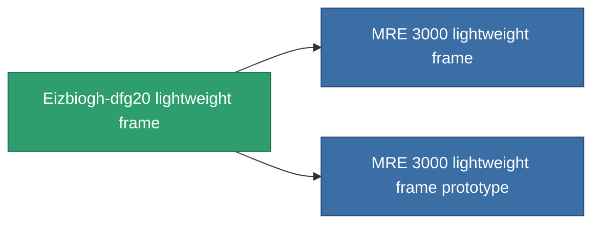

<!-- Generated by tools/generate from the live database (source: entitydefaults definition 1403, aggregatevalues via aggregatefields).
     Do not edit by hand; regenerate instead. -->

# Eizbiogh-dfg20 lightweight frame

|  |  |
|---|---|
| 定義 | `def_named2_mass_reductor` |
| 階級 | T3 |
| 耐久 | 100 |
| 容量 | 0.5 |
| 質量 | 2 |
| 分類 | Modules / Enhancements |
| Tier line | [Standard lightweight frame](/zh-TW/content/items/standard-mass-reductor/) (T1) → [MR1000-Boogey lightweight frame](/zh-TW/content/items/named1-mass-reductor/) (T2) → **Eizbiogh-dfg20 lightweight frame** (T3) → [MRE 3000 lightweight frame](/zh-TW/content/items/named3-mass-reductor/) (T4) |

## 統計

| 欄位 | 值 |
|---|---|
| armor_max_modifier | 0.725 |
| cpu_usage | 6 |
| massiveness | -0.25 |
| powergrid_usage | 3 |
| speed_max_modifier | 1.2 |

<!-- production:generated -->
## 生產

**由組件 8個生產 ，研究等級 5** — 組裝組件來製造它（完整列表見[配方](/zh-TW/content/recipes/)）:

**藍圖:** [Eizbiogh-dfg20 lightweight frame CT](/zh-TW/content/items/named2-mass-reductor-cprg/)

<svg class="prod-card-icon" aria-hidden="true"><use href="#mi-grid"/></svg><a class="prod-card-name" href="/zh-TW/content/items/alligior/">Alligior</a>

需要: <b>175</b>

<svg class="prod-card-icon" aria-hidden="true"><use href="#mi-grid"/></svg><a class="prod-card-name" href="/zh-TW/content/items/axicol/">Cryoperine</a>

需要: <b>25</b>

<svg class="prod-card-icon" aria-hidden="true"><use href="#mi-grid"/></svg><a class="prod-card-name" href="/zh-TW/content/items/espitium/">Espitium</a>

需要: <b>25</b>

<svg class="prod-card-icon" aria-hidden="true"><use href="#mi-grid"/></svg><a class="prod-card-name" href="/zh-TW/content/items/named1-mass-reductor/">MR1000-Boogey lightweight frame</a>

需要: <b>1</b>

<svg class="prod-card-icon" aria-hidden="true"><use href="#mi-grid"/></svg><a class="prod-card-name" href="/zh-TW/content/items/plasteosine/">Plasteosine</a>

需要: <b>175</b>

<svg class="prod-card-icon" aria-hidden="true"><use href="#mi-crystal"/></svg><a class="prod-card-name" href="/zh-TW/content/items/robotshard-common-advanced/">Functional common fragment</a>

需要: <b>20</b>

<svg class="prod-card-icon" aria-hidden="true"><use href="#mi-crystal"/></svg><a class="prod-card-name" href="/zh-TW/content/items/robotshard-common-basic/">Damaged common fragment</a>

需要: <b>20</b>

<svg class="prod-card-icon" aria-hidden="true"><use href="#mi-grid"/></svg><a class="prod-card-name" href="/zh-TW/content/items/titanium/">Titanium</a>

需要: <b>200</b>

## 用於生產

**2個物品的組件** — 所有在製造中使用它的物品:

