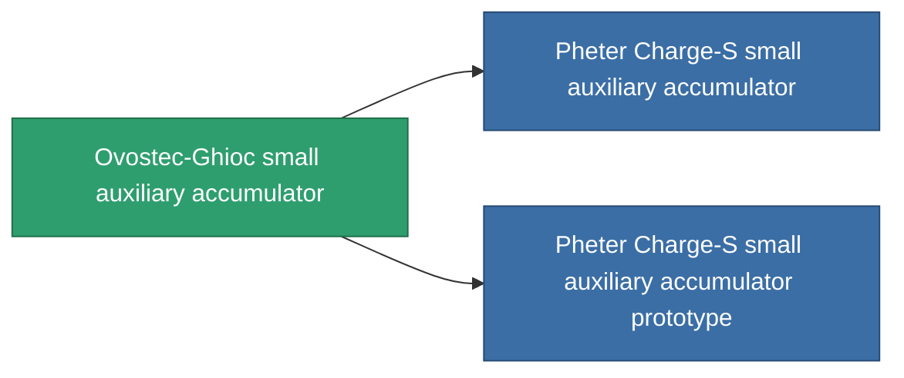

<!-- Generated by tools/generate from the live database (source: entitydefaults definition 814, aggregatevalues via aggregatefields).
     Do not edit by hand; regenerate instead. -->

# Ovostec-Ghioc small auxiliary accumulator

|  |  |
|---|---|
| 定義 | `def_named2_small_core_battery` |
| 階級 | T3 |
| 耐久 | 100 |
| 容量 | 0.5 |
| 質量 | 100 |
| 分類 | Modules / Power |
| Tier line | [Standard small auxiliary accumulator](/zh-TW/content/items/standard-small-core-battery/) (T1) → [Co-Fuse small auxiliary accumulator](/zh-TW/content/items/named1-small-core-battery/) (T2) → **Ovostec-Ghioc small auxiliary accumulator** (T3) → [Pheter Charge-S small auxiliary accumulator](/zh-TW/content/items/named3-small-core-battery/) (T4) |

## 統計

| 欄位 | 值 |
|---|---|
| core_max | 85 |
| cpu_usage | 37 |
| powergrid_usage | 15 |

<!-- production:generated -->
## 生產

**由組件 6個生產 ，研究等級 5** — 組裝組件來製造它（完整列表見[配方](/zh-TW/content/recipes/)）:

**藍圖:** [Ovostec-Ghioc small auxiliary accumulator CT](/content/items/named2-small-core-battery-cprg/)

<svg class="prod-card-icon" aria-hidden="true"><use href="#mi-grid"/></svg><a class="prod-card-name" href="/zh-TW/content/items/axicol/">Cryoperine</a>

需要: <b>100</b>

<svg class="prod-card-icon" aria-hidden="true"><use href="#mi-grid"/></svg><a class="prod-card-name" href="/zh-TW/content/items/espitium/">Espitium</a>

需要: <b>100</b>

<svg class="prod-card-icon" aria-hidden="true"><use href="#mi-grid"/></svg><a class="prod-card-name" href="/zh-TW/content/items/named1-small-core-battery/">Co-Fuse small auxiliary accumulator</a>

需要: <b>1</b>

<svg class="prod-card-icon" aria-hidden="true"><use href="#mi-crystal"/></svg><a class="prod-card-name" href="/zh-TW/content/items/robotshard-common-advanced/">Functional common fragment</a>

需要: <b>20</b>

<svg class="prod-card-icon" aria-hidden="true"><use href="#mi-crystal"/></svg><a class="prod-card-name" href="/zh-TW/content/items/robotshard-common-basic/">Damaged common fragment</a>

需要: <b>20</b>

<svg class="prod-card-icon" aria-hidden="true"><use href="#mi-grid"/></svg><a class="prod-card-name" href="/zh-TW/content/items/titanium/">Titanium</a>

需要: <b>100</b>

## 用於生產

**2個物品的組件** — 所有在製造中使用它的物品:

