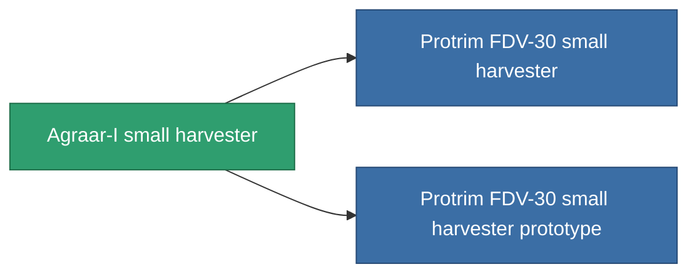

<!-- Generated by tools/generate from the live database (source: entitydefaults definition 808, aggregatevalues via aggregatefields).
     Do not edit by hand; regenerate instead. -->

# Agraar-I small harvester

|  |  |
|---|---|
| 定義 | `def_named2_small_harvester` |
| 階級 | T3 |
| 耐久 | 100 |
| 容量 | 1 |
| 質量 | 400 |
| 分類 | Modules / Harvesting |
| Tier line | [Standard small harvester](/zh-TW/content/items/standard-small-harvester/) (T1) → [MHA 400-'Avalon' small harvester](/zh-TW/content/items/named1-small-harvester/) (T2) → **Agraar-I small harvester** (T3) → [Protrim FDV-30 small harvester](/zh-TW/content/items/named3-small-harvester/) (T4) |

## 統計

| 欄位 | 值 |
|---|---|
| core_usage | 19 |
| cpu_usage | 42 |
| cycle_time | 14k |
| optimal_range | 3 |
| powergrid_usage | 32 |

<!-- production:generated -->
## 生產

**由組件 6個生產 ，研究等級 3** — 組裝組件來製造它（完整列表見[配方](/zh-TW/content/recipes/)）:

**藍圖:** [Agraar-I small harvester CT](/zh-TW/content/items/named2-small-harvester-cprg/)

<svg class="prod-card-icon" aria-hidden="true"><use href="#mi-grid"/></svg><a class="prod-card-name" href="/zh-TW/content/items/axicol/">Cryoperine</a>

需要: <b>25</b>

<svg class="prod-card-icon" aria-hidden="true"><use href="#mi-grid"/></svg><a class="prod-card-name" href="/zh-TW/content/items/espitium/">Espitium</a>

需要: <b>25</b>

<svg class="prod-card-icon" aria-hidden="true"><use href="#mi-grid"/></svg><a class="prod-card-name" href="/zh-TW/content/items/named1-small-harvester/">MHA 400-'Avalon' small harvester</a>

需要: <b>1</b>

<svg class="prod-card-icon" aria-hidden="true"><use href="#mi-crystal"/></svg><a class="prod-card-name" href="/zh-TW/content/items/robotshard-common-advanced/">Functional common fragment</a>

需要: <b>20</b>

<svg class="prod-card-icon" aria-hidden="true"><use href="#mi-crystal"/></svg><a class="prod-card-name" href="/zh-TW/content/items/robotshard-common-basic/">Damaged common fragment</a>

需要: <b>20</b>

<svg class="prod-card-icon" aria-hidden="true"><use href="#mi-grid"/></svg><a class="prod-card-name" href="/zh-TW/content/items/titanium/">Titanium</a>

需要: <b>150</b>

## 用於生產

**2個物品的組件** — 所有在製造中使用它的物品:

