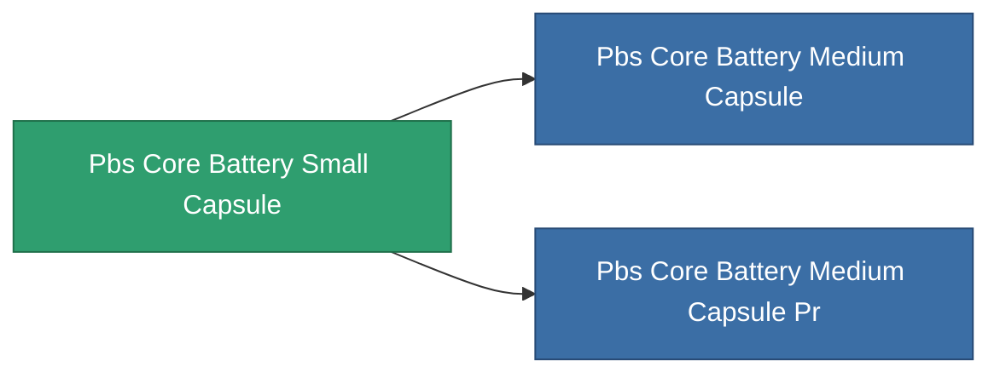

<!-- Generated by tools/generate from the live database (source: entitydefaults definition 5124, aggregatevalues via aggregatefields).
     Do not edit by hand; regenerate instead. -->

# Pbs Core Battery Small Capsule

|  |  |
|---|---|
| 定義 | `def_pbs_core_battery_small_capsule` |
| 階級 | T1 |
| 耐久 | 100 |
| 容量 | 125 |
| 質量 | 125000 |
| 分類 | Special & other / Miscellaneous |

## 統計

| 欄位 | 值 |
|---|---|
| armor_max | 50k |
| core_max | 14.112M |
| resist_chemical | 30 |
| resist_explosive | 30 |
| resist_kinetic | 30 |
| resist_thermal | 30 |
| signature_radius | 40 |
| stealth_strength | 50 |

<!-- production:generated -->
## 生產

**由組件 4個生產** — 組裝組件來製造它（完整列表見[配方](/zh-TW/content/recipes/)）:

**藍圖:** [Standard energy battery foundation CT](/zh-TW/content/items/pbs-core-battery-small-capsule-cprg/)

<svg class="prod-card-icon" aria-hidden="true"><use href="#mi-grid"/></svg><a class="prod-card-name" href="/zh-TW/content/items/axicol/">Cryoperine</a>

需要: <b>5.0k</b>

<svg class="prod-card-icon" aria-hidden="true"><use href="#mi-grid"/></svg><a class="prod-card-name" href="/zh-TW/content/items/espitium/">Espitium</a>

需要: <b>5.0k</b>

<svg class="prod-card-icon" aria-hidden="true"><use href="#mi-grid"/></svg><a class="prod-card-name" href="/zh-TW/content/items/titanium/">Titanium</a>

需要: <b>2.0k</b>

<svg class="prod-card-icon" aria-hidden="true"><use href="#mi-grid"/></svg><a class="prod-card-name" href="/zh-TW/content/items/unimetal/">Briochit</a>

需要: <b>2.0k</b>

## 用於生產

**2個物品的組件** — 所有在製造中使用它的物品:

