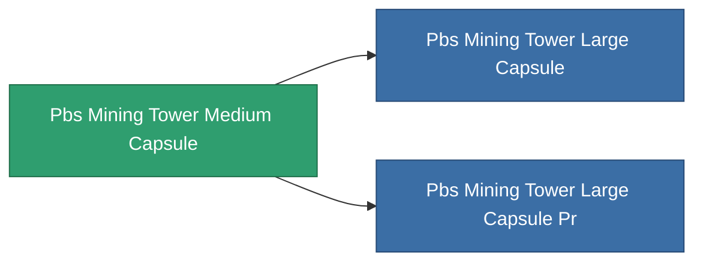

<!-- Generated by tools/generate from the live database (source: entitydefaults definition 4735, aggregatevalues via aggregatefields).
     Do not edit by hand; regenerate instead. -->

# Pbs Mining Tower Medium Capsule

|  |  |
|---|---|
| 定義 | `def_pbs_mining_tower_medium_capsule` |
| 階級 | T2 |
| 耐久 | 100 |
| 容量 | 15 |
| 質量 | 15000 |
| 分類 | Special & other / Miscellaneous |

## 統計

| 欄位 | 值 |
|---|---|
| armor_max | 125k |
| core_max | 27.5k |
| resist_chemical | 75 |
| resist_explosive | 75 |
| resist_kinetic | 75 |
| resist_thermal | 75 |
| signature_radius | 37.5 |
| stealth_strength | 50 |

<!-- production:generated -->
## 生產

**由組件 10個生產** — 組裝組件來製造它（完整列表見[配方](/zh-TW/content/recipes/)）:

**藍圖:** [Advanced mining outpost foundation CT](/zh-TW/content/items/pbs-mining-tower-medium-capsule-cprg/)

<svg class="prod-card-icon" aria-hidden="true"><use href="#mi-grid"/></svg><a class="prod-card-name" href="/zh-TW/content/items/alligior/">Alligior</a>

需要: <b>2.5k</b>

<svg class="prod-card-icon" aria-hidden="true"><use href="#mi-grid"/></svg><a class="prod-card-name" href="/zh-TW/content/items/axicol/">Cryoperine</a>

需要: <b>625</b>

<svg class="prod-card-icon" aria-hidden="true"><use href="#mi-grid"/></svg><a class="prod-card-name" href="/zh-TW/content/items/espitium/">Espitium</a>

需要: <b>1.2k</b>

<svg class="prod-card-icon" aria-hidden="true"><use href="#mi-grid"/></svg><a class="prod-card-name" href="/zh-TW/content/items/gamma-buildblock/">Coalimin</a>

需要: <b>1.2k</b>

<svg class="prod-card-icon" aria-hidden="true"><use href="#mi-grid"/></svg><a class="prod-card-name" href="/zh-TW/content/items/gamma-defblock/">Bochilum</a>

需要: <b>1.2k</b>

<svg class="prod-card-icon" aria-hidden="true"><use href="#mi-grid"/></svg><a class="prod-card-name" href="/zh-TW/content/items/gamma-energyblock/">Tiraizin</a>

需要: <b>625</b>

<svg class="prod-card-icon" aria-hidden="true"><use href="#mi-home"/></svg><a class="prod-card-name" href="/zh-TW/content/items/pbs-mining-tower-small-capsule/">Pbs Mining Tower Small Capsule</a>

需要: <b>1</b>

<svg class="prod-card-icon" aria-hidden="true"><use href="#mi-grid"/></svg><a class="prod-card-name" href="/zh-TW/content/items/plasteosine/">Plasteosine</a>

需要: <b>1.2k</b>

<svg class="prod-card-icon" aria-hidden="true"><use href="#mi-grid"/></svg><a class="prod-card-name" href="/zh-TW/content/items/titanium/">Titanium</a>

需要: <b>1.2k</b>

<svg class="prod-card-icon" aria-hidden="true"><use href="#mi-grid"/></svg><a class="prod-card-name" href="/zh-TW/content/items/unimetal/">Briochit</a>

需要: <b>2.5k</b>

## 用於生產

**2個物品的組件** — 所有在製造中使用它的物品:

