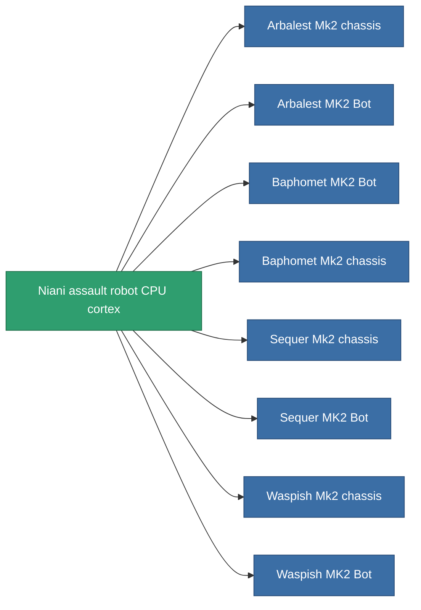

<!-- Generated by tools/generate from the live database (source: entitydefaults definition 2944, aggregatevalues via aggregatefields).
     Do not edit by hand; regenerate instead. -->

# Niani assault robot CPU cortex

|  |  |
|---|---|
| 定義 | `def_reactore_core_assault` |
| 階級 | – |
| 耐久 | 100 |
| 容量 | 1 |
| 質量 | 2000 |
| 分類 | Materials |

_無統計 — 此物品沒有聚合值。_

<!-- production:generated -->
## 用於生產

**8個物品的組件** — 所有在製造中使用它的物品:

