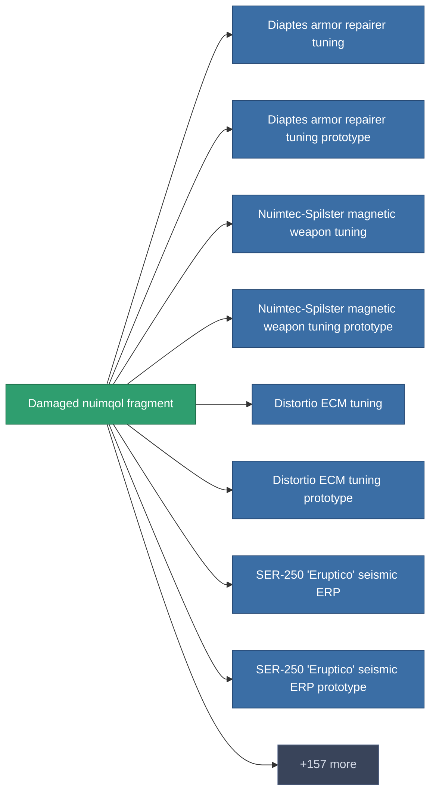

<!-- Generated by tools/generate from the live database (source: entitydefaults definition 1986, aggregatevalues via aggregatefields).
     Do not edit by hand; regenerate instead. -->

# Damaged nuimqol fragment

|  |  |
|---|---|
| 定義 | `def_robotshard_nuimqol_basic` |
| 階級 | – |
| 耐久 | 100 |
| 容量 | 0.01 |
| 質量 | 1 |
| 分類 | Materials |

_無統計 — 此物品沒有聚合值。_

<!-- production:generated -->
## 生產

**由組件 3個生產** — 組裝組件來製造它（完整列表見[配方](/zh-TW/content/recipes/)）:

<svg class="prod-card-icon" aria-hidden="true"><use href="#mi-grid"/></svg><a class="prod-card-name" href="/zh-TW/content/items/chollonin/">Chollonin</a>

需要: <b>1</b>

<svg class="prod-card-icon" aria-hidden="true"><use href="#mi-grid"/></svg><a class="prod-card-name" href="/zh-TW/content/items/polynitrocol/">Polynitrocol</a>

需要: <b>1</b>

<svg class="prod-card-icon" aria-hidden="true"><use href="#mi-grid"/></svg><a class="prod-card-name" href="/zh-TW/content/items/statichnol/">Statichnol</a>

需要: <b>1</b>

## 用於生產

**165個物品的組件** — 使用它可以生產的內容示例（完整列表見[配方](/zh-TW/content/recipes/)）。

