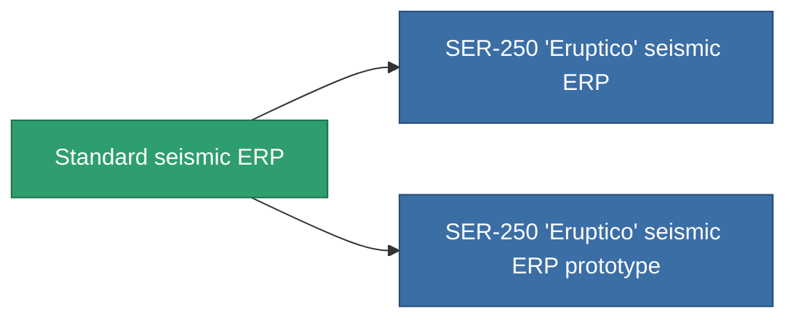

<!-- Generated by tools/generate from the live database (source: entitydefaults definition 3301, aggregatevalues via aggregatefields).
     Do not edit by hand; regenerate instead. -->

# Standard seismic ERP

|  |  |
|---|---|
| 定義 | `def_standard_explosive_kers` |
| 階級 | T1 |
| 耐久 | 100 |
| 容量 | 1 |
| 質量 | 500 |
| 分類 | Modules / Enhancements |
| Tier line | **Standard seismic ERP** (T1) → [SER-250 'Eruptico' seismic ERP](/zh-TW/content/items/named1-explosive-kers/) (T2) → [SER-300 'Devactico' seismic ERP](/zh-TW/content/items/named2-explosive-kers/) (T3) → [365p-CSD seismic ERP](/zh-TW/content/items/named3-explosive-kers/) (T4) |

## 統計

| 欄位 | 值 |
|---|---|
| chemical_damage_to_core_modifier | 0.2 |
| cpu_usage | 50 |
| explosive_damage_to_core_modifier | 0.5 |
| kinetic_damage_to_core_modifier | 0.1 |
| powergrid_usage | 15 |
| thermal_damage_to_core_modifier | 0.1 |

<!-- production:generated -->
## 生產

**由組件 5個生產 ，研究等級 5** — 組裝組件來製造它（完整列表見[配方](/zh-TW/content/recipes/)）:

**藍圖:** [Standard seismic ERP CT](/content/items/standard-explosive-kers-cprg/)

<svg class="prod-card-icon" aria-hidden="true"><use href="#mi-grid"/></svg><a class="prod-card-name" href="/zh-TW/content/items/axicol/">Cryoperine</a>

需要: <b>200</b>

<svg class="prod-card-icon" aria-hidden="true"><use href="#mi-grid"/></svg><a class="prod-card-name" href="/zh-TW/content/items/chollonin/">Chollonin</a>

需要: <b>200</b>

<svg class="prod-card-icon" aria-hidden="true"><use href="#mi-grid"/></svg><a class="prod-card-name" href="/zh-TW/content/items/plasteosine/">Plasteosine</a>

需要: <b>100</b>

<svg class="prod-card-icon" aria-hidden="true"><use href="#mi-grid"/></svg><a class="prod-card-name" href="/zh-TW/content/items/statichnol/">Statichnol</a>

需要: <b>100</b>

<svg class="prod-card-icon" aria-hidden="true"><use href="#mi-grid"/></svg><a class="prod-card-name" href="/zh-TW/content/items/titanium/">Titanium</a>

需要: <b>200</b>

## 用於生產

**2個物品的組件** — 所有在製造中使用它的物品:

