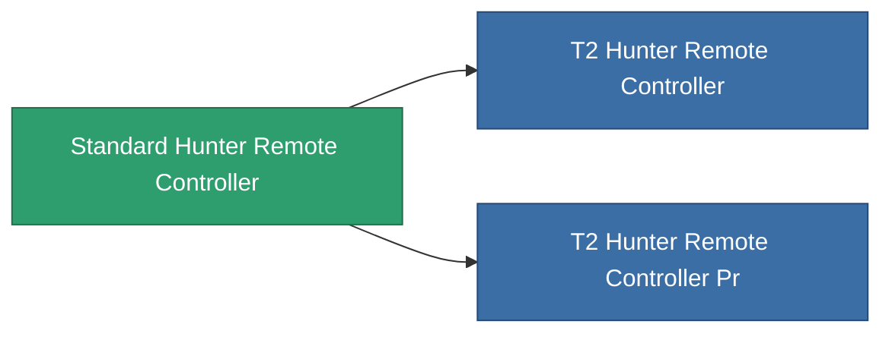

<!-- Generated by tools/generate from the live database (source: entitydefaults definition 8977, aggregatevalues via aggregatefields).
     Do not edit by hand; regenerate instead. -->

# Standard Hunter Remote Controller

|  |  |
|---|---|
| 定義 | `def_standard_hunter_remote_controller` |
| 階級 | T1 |
| 耐久 | 100 |
| 容量 | 100 |
| 質量 | 500 |
| 分類 | Modules / Remote control |
| Tier line | **Standard Hunter Remote Controller** (T1) → [T2 Hunter Remote Controller](/zh-TW/content/items/named1-hunter-remote-controller/) (T2) → [T3 Hunter Remote Controller](/zh-TW/content/items/named2-hunter-remote-controller/) (T3) → [T4 Hunter Remote Controller](/zh-TW/content/items/named3-hunter-remote-controller/) (T4) |
| 備註 | Deploys an autonomous hunter drone -- PvE ammo hunts Niani NPCs, PvP ammo hunts hostile-standing players. |

## 統計

| 欄位 | 值 |
|---|---|
| core_usage | 150 |
| cpu_usage | 250 |
| cycle_time | 5k |
| detection_range | 100 |
| powergrid_usage | 65 |
| remote_control_bandwidth_max | 1 |
| remote_control_lifetime | 1.8M |
| remote_control_operational_range | 150 |

<!-- production:generated -->
## 生產

**由組件 4個生產 ，研究等級 5** — 組裝組件來製造它（完整列表見[配方](/zh-TW/content/recipes/)）:

**藍圖:** [Standard Hunter Remote Controller Cprg](/content/items/standard-hunter-remote-controller-cprg/)

<svg class="prod-card-icon" aria-hidden="true"><use href="#mi-grid"/></svg><a class="prod-card-name" href="/zh-TW/content/items/axicol/">Cryoperine</a>

需要: <b>250</b>

<svg class="prod-card-icon" aria-hidden="true"><use href="#mi-grid"/></svg><a class="prod-card-name" href="/zh-TW/content/items/axicoline/">Axicoline</a>

需要: <b>200</b>

<svg class="prod-card-icon" aria-hidden="true"><use href="#mi-grid"/></svg><a class="prod-card-name" href="/zh-TW/content/items/espitium/">Espitium</a>

需要: <b>200</b>

<svg class="prod-card-icon" aria-hidden="true"><use href="#mi-grid"/></svg><a class="prod-card-name" href="/zh-TW/content/items/titanium/">Titanium</a>

需要: <b>200</b>

## 用於生產

**2個物品的組件** — 所有在製造中使用它的物品:

