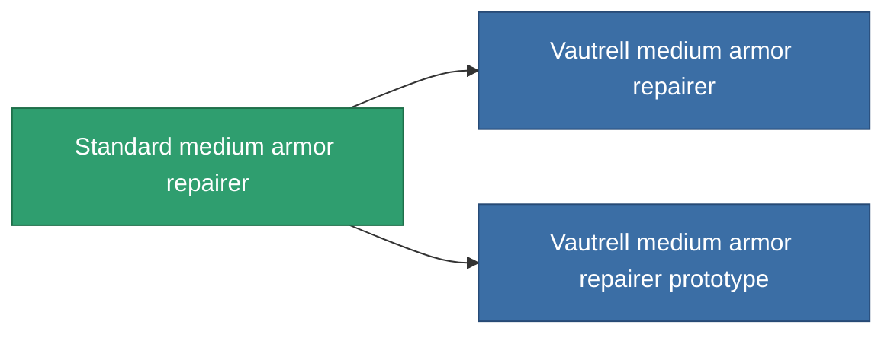

<!-- Generated by tools/generate from the live database (source: entitydefaults definition 19, aggregatevalues via aggregatefields).
     Do not edit by hand; regenerate instead. -->

# Standard medium armor repairer

|  |  |
|---|---|
| 定義 | `def_standard_medium_armor_repairer` |
| 階級 | T1 |
| 耐久 | 100 |
| 容量 | 1.5 |
| 質量 | 750 |
| 分類 | Modules / Repair |
| Tier line | **Standard medium armor repairer** (T1) → [Vautrell medium armor repairer](/zh-TW/content/items/named1-medium-armor-repairer/) (T2) → [FO-150 'Reparator' medium armor repairer](/zh-TW/content/items/named2-medium-armor-repairer/) (T3) → [CRC40 medium armor repairer](/zh-TW/content/items/named3-medium-armor-repairer/) (T4) |

## 統計

| 欄位 | 值 |
|---|---|
| armor_repair_amount | 180 |
| core_usage | 330 |
| cpu_usage | 50 |
| cycle_time | 15k |
| powergrid_usage | 100 |

<!-- production:generated -->
## 生產

**由組件 5個生產 ，研究等級 4** — 組裝組件來製造它（完整列表見[配方](/zh-TW/content/recipes/)）:

**藍圖:** [Standard medium armor repairer CT](/content/items/standard-medium-armor-repairer-cprg/)

<svg class="prod-card-icon" aria-hidden="true"><use href="#mi-grid"/></svg><a class="prod-card-name" href="/zh-TW/content/items/axicol/">Cryoperine</a>

需要: <b>50</b>

<svg class="prod-card-icon" aria-hidden="true"><use href="#mi-grid"/></svg><a class="prod-card-name" href="/zh-TW/content/items/chollonin/">Chollonin</a>

需要: <b>50</b>

<svg class="prod-card-icon" aria-hidden="true"><use href="#mi-grid"/></svg><a class="prod-card-name" href="/zh-TW/content/items/plasteosine/">Plasteosine</a>

需要: <b>200</b>

<svg class="prod-card-icon" aria-hidden="true"><use href="#mi-grid"/></svg><a class="prod-card-name" href="/zh-TW/content/items/statichnol/">Statichnol</a>

需要: <b>200</b>

<svg class="prod-card-icon" aria-hidden="true"><use href="#mi-grid"/></svg><a class="prod-card-name" href="/zh-TW/content/items/titanium/">Titanium</a>

需要: <b>100</b>

## 用於生產

**2個物品的組件** — 所有在製造中使用它的物品:

