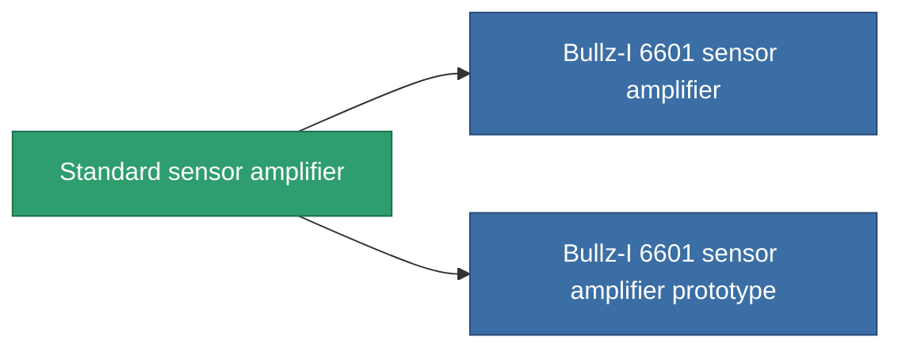

<!-- Generated by tools/generate from the live database (source: entitydefaults definition 43, aggregatevalues via aggregatefields).
     Do not edit by hand; regenerate instead. -->

# Standard sensor amplifier

|  |  |
|---|---|
| 定義 | `def_standard_sensor_booster` |
| 階級 | T1 |
| 耐久 | 100 |
| 容量 | 0.5 |
| 質量 | 100 |
| 分類 | Modules / Sensors & scanning |
| Tier line | **Standard sensor amplifier** (T1) → [Bullz-I 6601 sensor amplifier](/zh-TW/content/items/named1-sensor-booster/) (T2) → [Desenspure sensor amplifier](/zh-TW/content/items/named2-sensor-booster/) (T3) → [Ambassador SU-I sensor amplifier](/zh-TW/content/items/named3-sensor-booster/) (T4) |

## 統計

| 欄位 | 值 |
|---|---|
| core_usage | 10 |
| cpu_usage | 15 |
| cycle_time | 10k |
| effect_sensor_booster_locking_range_modifier | 1.35 |
| effect_sensor_booster_locking_time_modifier | 0.8 |
| powergrid_usage | 5 |

<!-- production:generated -->
## 生產

**由組件 2個生產 ，研究等級 3** — 組裝組件來製造它（完整列表見[配方](/zh-TW/content/recipes/)）:

**藍圖:** [Standard sensor amplifier CT](/zh-TW/content/items/standard-sensor-booster-cprg/)

<svg class="prod-card-icon" aria-hidden="true"><use href="#mi-grid"/></svg><a class="prod-card-name" href="/zh-TW/content/items/axicol/">Cryoperine</a>

需要: <b>400</b>

<svg class="prod-card-icon" aria-hidden="true"><use href="#mi-grid"/></svg><a class="prod-card-name" href="/zh-TW/content/items/titanium/">Titanium</a>

需要: <b>50</b>

## 用於生產

**2個物品的組件** — 所有在製造中使用它的物品:

