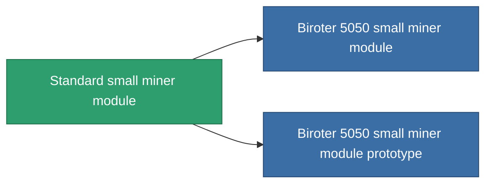

<!-- Generated by tools/generate from the live database (source: entitydefaults definition 53, aggregatevalues via aggregatefields).
     Do not edit by hand; regenerate instead. -->

# Standard small miner module

|  |  |
|---|---|
| 定義 | `def_standard_small_driller` |
| 階級 | T1 |
| 耐久 | 100 |
| 容量 | 1 |
| 質量 | 400 |
| 分類 | Modules / Enhancements |
| Tier line | **Standard small miner module** (T1) → [Biroter 5050 small miner module](/zh-TW/content/items/named1-small-driller/) (T2) → [Sublimator Low-D small miner module](/zh-TW/content/items/named2-small-driller/) (T3) → [Scraper-990 small miner module](/zh-TW/content/items/named3-small-driller/) (T4) |

## 統計

| 欄位 | 值 |
|---|---|
| core_usage | 17 |
| cpu_usage | 40 |
| cycle_time | 15.5k |
| optimal_range | 3 |
| powergrid_usage | 30 |

<!-- production:generated -->
## 生產

**由組件 2個生產 ，研究等級 1** — 組裝組件來製造它（完整列表見[配方](/zh-TW/content/recipes/)）:

**藍圖:** [Standard small miner module CT](/zh-TW/content/items/standard-small-driller-cprg/)

<svg class="prod-card-icon" aria-hidden="true"><use href="#mi-grid"/></svg><a class="prod-card-name" href="/zh-TW/content/items/axicol/">Cryoperine</a>

需要: <b>50</b>

<svg class="prod-card-icon" aria-hidden="true"><use href="#mi-grid"/></svg><a class="prod-card-name" href="/zh-TW/content/items/titanium/">Titanium</a>

需要: <b>150</b>

## 用於生產

**2個物品的組件** — 所有在製造中使用它的物品:

