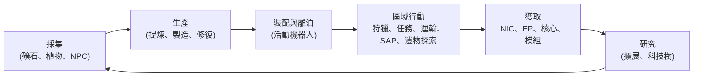

# 遊戲中可執行的操作

所有玩家操作，依系統分類。指令名稱即為伺服器端的識別碼——客戶端會以自身的 UI 呈現這些操作。各操作的詳細說明位於各系統頁面。

遊戲的核心循環：賺取與消費，沿著階梯向上攀升。

## 系統

| 系統 | 頁面 | 涵蓋內容 |
|---|---|---|
| 入門指南 | [getting-started](/zh-TW/features/getting-started/) | 建立／選擇角色、首台機器人、帳號基礎 |
| 移動 | [movement](/zh-TW/features/movement/) | 區域、泊靠、排隊、傳送、火花跳躍、閘門 |
| 採集 | [gathering](/zh-TW/features/gathering/) | 掃描、採收、資源收集 |
| 戰鬥 | [combat](/zh-TW/features/combat/) | 戰鬥、傷害類型、干擾、警報、擊殺報告、SOS |
| NPC 與 PVE 狩獵 | [npcs](/zh-TW/features/npcs/) | NPC 等級與陣營、弱點、生成類型、TAP、戰術 |
| 探索 | [exploration](/zh-TW/features/exploration/) | 遺物與聖物 |
| 機器人与裝配 | [robots](/zh-TW/features/robots/) | 選擇機器人、模組、彈藥、預設、染色 |
| 模組與裝配 | [modules](/zh-TW/features/modules/) | 模組家族與裝配原則 |
| 火花 | [sparks](/zh-TW/features/sparks/) | 火花授權、切換、能力加成 |
| 研究 | [research](/zh-TW/features/research/) | 擴展（技能樹）、EP、科技樹 |
| 角色 | [character](/zh-TW/features/character/) | 角色視窗：擴展分頁（技能樹）與火花 |
| 生產 | [production](/zh-TW/features/production/) | 生產線、提煉、修復、再加工、原型、CPRG |
| 市場與交易 | [market](/zh-TW/features/market/) | 市場訂單、直接交易、物品商店、信用點 |
| 群組 | [groups](/zh-TW/features/groups/) | 公司、聯盟、幫派（艦隊） |
| 電力基地站 | [pbs](/zh-TW/features/pbs/) | PBS 結構、領地、連接 |
| 任務 | [missions](/zh-TW/features/missions/) | 野外任務、代理人、終端機 |
| 運輸 | [transport](/zh-TW/features/transport/) | 基地間物品運輸 |
| 物品與庫存 | [items](/zh-TW/features/items/) | 容器、堆疊、物品名稱、兌換品、禮包 |
| 社交 | [social](/zh-TW/features/social/) | 郵件、頻道、好友、聲望、黃頁、新聞、投票 |
| 入侵 | [intrusion](/zh-TW/features/intrusion/) | NPC 據點突襲模式 |
| 前哨站與 SAP | [outposts](/zh-TW/features/outposts/) | 前哨站所有權、穩定度、四種 SAP 類型 |
| 近距探測器 | [probes](/zh-TW/features/probes/) | 區域監控探測器 |
| 伺服器與參考 | [server](/zh-TW/features/server/) | 伺服器資訊、高得分、參考資料、購買 |
| 常見問題 | [faq](/zh-TW/features/faq/) | 教學、陣營選擇、起步、術語 |
| 世界觀 | [lore](/zh-TW/features/lore/) | 背景設定：Nia、Nians、辛迪加 |
| 客戶端與 PC 設定 | [client-setup](/zh-TW/features/client-setup/) | 執行客戶端、多開、UI 縮放 |

### 參考

| 頁面 | 涵蓋內容 |
|---|---|
| [客戶端 UI 概覽](/zh-TW/features/ui/) | EVE 風格介面：頂欄、部署／泊靠按鈕、操作分類、離泊狀態面板，以及本 wiki 使用的慣例 |

實體屬性表位於自動生成的 [Content](/content/) 區段。

## 完整操作清單

### 入門與帳號

| 操作 | 指令 |
|---|---|
| 建立角色 | `characterCreate` |
| 選擇（扮演）角色 | `characterSelect` |
| 刪除角色 | `characterDelete` |
| 重命名角色 | `characterRename` |
| 檢查名稱是否可用 | `characterCheckNick` |
| 請求初始機器人 | `requestStarterRobot` |
| 請求初始箱 | `requestInfiniteBox` |
| 新角色設定資料 | `characterWizardData` |
| 檢視我的個人檔案 | `characterGetMyProfile` |
| 檢視其他角色的個人檔案 | `characterGetProfiles` |
| 搜尋角色 | `characterSearch` |
| 列出角色 | `characterList` |
| 取得／設定角色設定 | `characterSettingsGet`、`characterSettingsSet` |
| 設定頭像 | `characterSetAvatar` |
| 設定心情訊息 | `characterSetMoodmessage` |
| 為角色設定私人備註 | `characterSetNote` / `characterGetNote` |
| 設定／清除主基地 | `characterSetHomeBase`、`characterClearHomeBase` |
| 在自有角色間轉帳信用點 | `characterTransferCredit` |
| 封鎖／允許角色交易 | `characterSetBlockTrades` |
| 變更帳號電子郵件／密碼 | `changeSessionEmail`、`changeSessionPassword` |
| 檢視活動 EP 歷史 | `accountEpForActivityHistory` |
| 檢視帳號交易歷史 | `accountGetTransactionHistory` |
| 登出／連線維護 | `signOut`、`connectionStart`、`connectionEnd`、`ping`、`quit`、`isOnline`、`transferData`、`welcome` |
| 誰線上 | `getCharactersOnline`、`getAccountsWithCharacters` |
| 角色歷史 | `characterNickHistory`、`characterCorporationHistory`、`characterTransactionHistory`、`characterListNpcDeath` |

### 移動與區域

| 操作 | 指令 |
|---|---|
| 泊靠基地／PBS | `dock` |
| 離泊 | `undock` |
| 強制泊靠（緊急） | `forceDock` |
| 查看區域進入排隊 | `zoneGetQueueInfo` |
| 設定排隊長度偏好 | `zoneSetQueueLength` |
| 取消排隊等待 | `zoneCancelEnterQueue` |
| 取得區域資訊 | `getZoneInfo` |
| 列出區域的星區 | `zoneSectorList` |
| 列出區域建築 | `zoneGetBuildings` |
| 發送 SOS（呼叫救援） | `zoneSOS` |
| 列出可用傳送 | `teleportList` |
| 使用傳送 | `teleportUse` |
| 傳送至區域物件 | `teleportToZoneObject` |
| 列出傳送頻道 | `teleportGetChannelList` |
| 查詢全球傳送頻道 | `teleportQueryWorldChannels` |
| 列出火花電量 | `sparkList` |
| 切換活躍火花 | `sparkChange` |
| 移除火花 | `sparkRemove` |
| 解鎖火花 | `sparkUnlock` |
| 列出／設定／使用／刪除火花傳送 | `sparkTeleportList`、`sparkTeleportSet`、`sparkTeleportUse`、`sparkTeleportDelete` |
| 重命名閘門 | `gateSetName` |
| 基地資訊／所有權／設施／我在基地的物品 | `baseGetInfo`、`baseGetOwnershipInfo`、`baseListFacilities`、`baseGetMyItems` |
| 設定基地泊靠權限 | `baseSetDockingRights` |

### 採集與掃描

| 操作 | 指令 |
|---|---|
| 掃描區域（礦石／植物／可部署掃描） | `zoneUploadScanResult` |
| 列出我的礦物掃描結果 | `mineralScanResultList` |
| 從掃描結果建立物品 | `mineralScanResultCreateItem` |
| 刪除掃描結果 | `mineralScanResultDelete` |
| 在容器間移動掃描結果 | `mineralScanResultMove` |
| 從物品上傳掃描資料 | `mineralScanResultUploadFromItem` |
| 統計區域上的物品（可見性檢查） | `itemCountOnZone`、`itemCount` |
| 自助服務機：檢視／提交物品 | `kioskInfo`、`kioskSubmitItem` |
| 使用物品（通用——含可採收物） | `useItem` |

### 戰鬥

| 操作 | 指令 |
|---|---|
| 開啟／解除戰鬥警報 | `alarmStart`（警報結束由伺服器驅動） |
| 檢視我的擊殺報告 | `getMyKillReports` |
| 檢視我的高得分 | `getMyHighScores` |
| 檢視伺服器高得分 | `getHighScores` |

### 機器人与裝配

| 操作 | 指令 |
|---|---|
| 選擇活躍機器人 | `selectActiveRobot` |
| 清空機器人（卸載全部） | `robotEmpty` |
| 取得機器人資訊 | `getRobotInfo` |
| 取得機器人裝配資訊 | `getRobotFittingInfo` |
| 裝備模組 | `equipModule` |
| 移除模組 | `removeModule` |
| 替換模組 | `changeModule` |
| 裝備彈藥 | `equipAmmo` |
| 替換彈藥 | `changeAmmo` |
| 卸載彈藥 | `unEquipAmmo` |
| 設定機器人染色 | `setRobotTint` |
| 儲存／列出／套用／刪除裝配預設 | `fittingPresetSave`、`fittingPresetList`、`fittingPresetApply`、`fittingPresetDelete` |

### 研究（擴展與科技樹）

| 操作 | 指令 |
|---|---|
| 列出擴展分類 | `extensionCategoryList` |
| 取得所有擴展 | `extensionGetAll` |
| 列出已習得擴展 | `extensionLearntList` |
| 列出前置需求 | `extensionPrerequireList` |
| 以點數購買擴展 | `extensionBuyForPoints` |
| 購買 EP 加成 | `extensionBuyEpBoost` |
| 取得可用點數 | `extensionGetAvailablePoints` |
| 取得點數參數 | `extensionGetPointParameters` |
| 擴展歷史 | `extensionHistory` |
| 移除一級擴展 | `extensionRemoveLevel` |
| 重設角色擴展 | `extensionResetCharacter` |
| 釋放已鎖定 EP | `extensionFreeLockedEp` |
| 檢視活動 EP 日誌 | `epForActivityDailyLog` |
| 取得研究等級 | `getResearchLevels` |
| 科技樹：研究節點 | `techTreeResearch` |
| 科技樹：解鎖節點 | `techTreeUnlock` |
| 科技樹：捐贈 | `techTreeDonate` |
| 科技樹：資訊／日誌 | `techTreeInfo`、`techTreeGetLogs` |

### 生產

| 操作 | 指令 |
|---|---|
| 列出生產線 | `productionLineList` |
| 啟動生產線 | `productionLineStart` |
| 校準生產線 | `productionLineCalibrate` |
| 設定生產線輪數 | `productionLineSetRounds` |
| 刪除生產線 | `productionLineDelete` |
| 查詢生產線下一輪 | `productionQueryLineNextRound` |
| 取消生產 | `productionCancel` |
| 提煉（查詢＋執行） | `productionRefine`、`productionRefineQuery` |
| 修復（查詢＋執行） | `productionRepair`、`productionRepairQuery` |
| 再加工（查詢＋執行） | `productionReprocess`、`productionReprocessQuery` |
| 研究組件（查詢＋執行） | `productionResearch`、`productionResearchQuery` |
| 原型（啟動＋查詢） | `productionPrototypeStart`、`productionPrototypeQuery` |
| 合併研究套件（執行＋查詢） | `productionMergeResearchKitsMulti`、`productionMergeResearchKitsMultiQuery` |
| 鍛造 CPRG（執行＋查詢） | `productionCPRGForge`、`productionCPRGForgeQuery` |
| CPRG 資訊 | `productionCPRGInfo` |
| 從生產線取得 CPRG（取得＋查詢） | `productionGetCPRGFromLine`、`productionGetCPRGFromLineQuery` |
| 生產保險：購買／列出／查詢／刪除 | `productionInsuranceBuy`、`productionInsuranceList`、`productionInsuranceQuery`、`productionInsuranceDelete` |
| 列出生產組件 | `productionComponentsList` |
| 設施資訊／描述 | `productionFacilityInfo`、`productionFacilityDescription` |
| 進行中的項目（我的／公司的） | `productionInProgress`、`productionInProgressCorporation` |
| 生產歷史 | `productionHistory` |
| 生產伺服器資訊 | `productionServerInfo` |

### 市場與交易

| 操作 | 指令 |
|---|---|
| 建立賣出訂單 | `marketCreateSellOrder` |
| 建立買入訂單 | `marketCreateBuyOrder` |
| 修改訂單 | `marketModifyOrder` |
| 取消物品／訂單 | `marketCancelItem` |
| 直接購買物品 | `marketBuyItem` |
| 列出市場物品 | `marketItemList` |
| 列出我可購買的物品 | `marketAvailableItems` |
| 列出指定範圍內的物品 | `marketItemsInRange` |
| 列出我的市場物品 | `marketGetMyItems` |
| 市場資訊 | `marketGetInfo` |
| 平均價格（市場／定義／全球） | `marketGetAveragePrices`、`marketGetDefinitionAveragePrice`、`marketGlobalAveragePrices` |
| 變更市場稅率／檢視稅率日誌 | `marketTaxChange`、`marketTaxLogList` |
| 開始交易 | `tradeBegin` |
| 設定／撤回我的報價 | `tradeSetOffer`、`tradeRetractOffer` |
| 接受交易 | `tradeAccept` |
| 取消交易 | `tradeCancel` |
| 交易完成／狀態 | `tradeFinished`、`tradeState` |
| 物品商店：列出／購買 | `itemShopList`、`itemShopBuy` |
| 轉帳信用點給其他角色 | `characterTransferCredit` |

### 群組（公司、聯盟、幫派）

| 操作 | 指令 |
|---|---|
| 建立公司 | `corporationCreate` |
| 申請加入／邀請加入公司 | `corporationApply`、`corporationCharacterInvite` |
| 接受申請／列出申請 | `corporationAcceptApplication`、`corporationListApplications` |
| 我的申請：列出／刪除 | `corporationListMyApplications`、`corporationDeleteMyApplication` |
| 刪除申請（官員） | `corporationDeleteApplication` |
| 回覆邀請 | `corporationInviteReply` |
| 離開／取消離開 | `corporationLeave`、`corporationCancelLeave` |
| 移除成員／設定成員角色 | `corporationRemoveMember`、`corporationSetMemberRole` |
| 放棄我所有角色 | `corporationDropRoles` |
| 將成員設為中立 | `corporationSetMembersNeutral` |
| 公司資訊／我的資訊／搜尋 | `corporationInfo`、`corporationGetMyInfo`、`corporationSearch` |
| 公司聲望／聲譽 | `corporationGetMyStandings`、`corporationGetReputation` |
| 向公司捐贈／從公司撥款 | `corporationDonate`、`corporationPayOut` |
| 轉帳公司信用點 | `corporationTransfer` |
| 重命名／設定顏色／設定資訊 | `corporationRename`、`corporationSetColor`、`corporationSetInfo` |
| 取得代表 | `corporationGetDelegates` |
| CEO 接管狀態／志願擔任 CEO | `corporationCEOTakeOverStatus`、`corporationVolunteerForCEO` |
| 公司投票：啟動／設定議題／列出／投票／刪除 | `corporationVoteStart`、`corporationVoteSetTopic`、`corporationVoteList`、`corporationVoteCast`、`corporationVoteDelete` |
| 佈告欄：啟動／列出／新文章／發佈／管理／刪除 | `corporationBulletinStart`、`corporationBulletinList`、`corporationBulletinNewEntries`、`corporationBulletinEntry`、`corporationBulletinModerate`、`corporationBulletinDelete`、`corporationBulletinEntryDelete`、`corporationBulletinDetails` |
| 機庫：租賃／繳租／租金／關閉 | `corporationRentHangar`、`corporationHangarPayRent`、`corporationHangarRentPrice`、`corporationHangarClose` |
| 機庫：列出（全部／在基地） | `corporationHangarListAll`、`corporationHangarListOnBase` |
| 機庫：資料夾（建立／刪除） | `corporationHangarFolderCreate`、`corporationHangarFolderDelete` |
| 機庫：設定存取權限／設定名稱 | `corporationHangarSetAccess`、`corporationHangarSetName` |
| 機庫日誌：列出／設定／清除 | `corporationHangarLogList`、`corporationHangarLogSet`、`corporationHangarLogClear` |
| 公司文件：設定／建立／列出／開啟／刪除／轉交／租賃／監控／取消監控／更新內容／註冊列表／註冊設定 | `corporationDocumentConfig`、`corporationDocumentCreate`、`corporationDocumentList`、`corporationDocumentOpen`、`corporationDocumentDelete`、`corporationDocumentTransfer`、`corporationDocumentRent`、`corporationDocumentMonitor`、`corporationDocumentUnmonitor`、`corporationDocumentUpdateBody`、`corporationDocumentRegisterList`、`corporationDocumentRegisterSet` |
| 歷史：日誌／成員角色／公司角色／角色／名稱／交易 | `corporationLogHistory`、`corporationMemberRoleHistory`、`corporationRoleHistory`、`corporationNameHistory`、`corporationTransactionHistory` |
| 聯盟資訊／預設值／角色歷史 | `allianceGetMyInfo`、`allianceGetDefaults`、`allianceRoleHistory` |
| 幫派（艦隊）：建立／刪除／資訊 | `gangCreate`、`gangDelete`、`gangInfo` |
| 幫派：邀請／回覆／踢出／離開 | `gangInvite`、`gangInviteReply`、`gangKick`、`gangLeave` |
| 幫派：設定領袖／設定角色 | `gangSetLeader`、`gangSetRole` |

### 電力基地站（PBS）與領地

| 操作 | 指令 |
|---|---|
| 取得 PBS 網路 | `PBSGetNetwork` |
| PBS 節點資訊 | `PBSNodeInfo` |
| 重命名 PBS 節點 | `PBSRenameNode` |
| 建立／斷開 PBS 連接 | `PBSMakeConnection`、`PBSBreakConnection` |
| 設定連接權重 | `PBSSetConnectionWeight` |
| 設定 PBS 線上狀態 | `PBSSetOnline` |
| 設定 PBS 效果 | `PBSSetEffect` |
| 檢查部署（我能否在此部署？） | `PBSCheckDeployment` |
| 列出我的領地 | `PBSGetTerritories` |
| 設定領地可見性 | `PBSSetTerritoryVisibility` |
| 設定聲望限制 | `PBSSetStandingLimit` |
| 設定增援偏移 | `PBSSetReinforceOffset` |
| 取得／設定報銷資訊 | `PBSGetReimburseInfo`、`PBSSetReimburseInfo` |
| 向 PBS 餵入物品 | `PBSFeedableInfo`、`PBSFeedItems` |
| 設定基地拆解 | `PBSSetBaseDeconstruct` |
| PBS 日誌 | `PBSGetLog` |

### 任務

| 操作 | 指令 |
|---|---|
| 開始任務 | `missionStart` |
| 從區域開始任務 | `missionStartFromZone` |
| 中止任務 | `missionAbort` |
| 交付（任務交付） | `missionDeliver` |
| 任務資料／選項／補給 | `missionData`、`missionGetOptions`、`missionGetSupply` |
| 列出任務代理人 | `missionListAgents` |
| 列出我進行中的任務 | `missionListRunning` |
| 任務日誌 | `missionLogList` |
| 為任務添加參與者 | `missionPlayerAddsParticipant` |
| 野外終端機資訊 | `fieldTerminalInfo` |

### 運輸（物品運輸）

| 操作 | 指令 |
|---|---|
| 提交運輸 | `transportAssignmentSubmit` |
| 接取運輸（作為運載者） | `transportAssignmentTake` |
| 列出運輸 | `transportAssignmentList` |
| 列出運輸內容 | `transportAssignmentListContent` |
| 運輸的容器資訊 | `transportAssignmentContainerInfo` |
| 交付運輸 | `transportAssignmentDeliver` |
| 領取我的運輸 | `transportAssignmentRetrieve` |
| 取消／放棄運輸 | `transportAssignmentCancel`、`transportAssignmentGiveUp` |
| 運輸是否進行中？ | `transportAssignmentRunning` |
| 運輸日誌 | `transportAssignmentLog` |

### 物品與庫存

| 操作 | 指令 |
|---|---|
| 列出容器 | `listContainer` |
| 打包物品（放入袋子／箱子） | `packItems` |
| 解包物品 | `unpackItems` |
| 堆疊物品 | `stackItems`、`stackTo`、`stackSelection` |
| 拆分數量 | `unStackAmount` |
| 在容器間移動物品 | `relocateItems` |
| 丟棄物品 | `trashItems` |
| 重命名物品 | `setItemName` |
| 使用物品 | `useItem` |
| 使用抽獎物品 | `useLotteryItem` |
| 兌換品：列出／兌換／啟用 | `redeemableItemList`、`redeemableItemRedeem`、`redeemableItemActivate` |
| 禮包：列出／兌換 | `goodiePackList`、`goodiePackRedeem` |
| 開啟禮物 | `giftOpen` |
| 報銷物品 | `ReimburseItem` |

### 社交

| 操作 | 指令 |
|---|---|
| 郵件：列出／開啟／發送／刪除／新郵件數／已用資料夾／移至資料夾／刪除資料夾 | `mailList`、`mailOpen`、`mailSend`、`mailDelete`、`mailNewCount`、`mailUsedFolders`、`mailMoveToFolder`、`mailDeleteFolder` |
| 群發郵件（公司）：發送／列出／開啟／刪除／新郵件數 | `massMailSend`、`massMailList`、`massMailOpen`、`massMailDelete`、`massMailNewCount` |
| 好友：發送／回覆／確認／刪除／封鎖／列出 | `socialFriendRequest`、`socialFriendRequestReply`、`socialConfirmPendingFriendRequest`、`socialDeleteFriend`、`socialBlockFriend`、`socialGetMyList` |
| 聊天頻道：建立／加入／離開／發言 | `channelCreate`、`channelJoin`、`channelLeave`、`channelTalk` |
| 頻道：列出（全部／我的） | `channelList`、`channelMyList`、`channelListAll` |
| 頻道：踢出／封禁／解封／角色／靜音／密碼／主題／通知 | `channelKick`、`channelBan`、`channelRemoveBan`、`channelModifyMemberRole`、`channelGlobalMute`、`channelGetMutedCharacters`、`channelGetBannedMembers`、`channelSetPassword`、`channelSetTopic`、`channelNotification` |
| 直接聊天 | `chat` |
| 聲望：列出／歷史 | `standingList`、`standingHistory` |
| 設定聲望（允許時） | `setStanding` |
| 預設聲望（聯盟／公司） | `getStandingForDefaultAlliances`、`getStandingForDefaultCorporations` |
| 黃頁：取得／提交／刪除／搜尋 | `yellowPagesGet`、`yellowPagesSubmit`、`yellowPagesDelete`、`yellowPagesSearch` |
| 新聞：分類／列出／新文章數 | `newsCategory`、`getNews`、`freshNewsCount` |
| 投票：檢視／回答 | `pollGet`、`pollAnswer` |

### 入侵

| 操作 | 指令 |
|---|---|
| 提交 SAP 物品 | `intrusionSAPSubmitItem` |
| 取得 SAP 物品資訊 | `intrusionSAPGetItemInfo`、`intrusionSAPItemInfo` |
| 設定防禦閾值 | `intrusionSetDefenseThreshold` |
| 設定據點效果加成 | `intrusionSiteSetEffectBonus` |
| 升級設施 | `intrusionUpgradeFacility` |
| 據點資訊 | `getIntrusionSiteInfo` |
| 日誌：我的／公開／我的據點／穩定度 | `getIntrusionLog`、`getIntrusionPublicLog`、`getIntrusionMySitesLog`、`getIntrusionStabilityLog` |
| 穩定度加成閾值 | `getStabilityBonusThresholds` |
| 設定據點訊息 | `setIntrusionSiteMessage` |

### 近距探測器

| 操作 | 指令 |
|---|---|
| 列出我的探測器 | `proximityProbeList` |
| 探測器註冊資訊 | `proximityProbeGetRegistrationInfo` |
| 為探測器設定註冊 | `proximityProbeRegisterSet` |
| 移除探測器註冊 | `proximityProbeRemove` |
| 命名探測器 | `proximityProbeSetName` |

### 伺服器與參考

| 操作 | 指令 |
|---|---|
| 伺服器資訊 | `serverInfoGet`、`systemInfo` |
| 高得分（伺服器／我的） | `getHighScores`、`getMyHighScores` |
| 裂隙列表 | `getRifts` |
| 參考資料：效果／列舉／實體預設值／聚合欄位／定義設定／距離 | `getEffects`、`getEnums`、`getEntityDefaults`、`getAggregateFields`、`getDefinitionConfigUnits`、`getDistances` |
| 物品摘要（客戶端參考資料） | `getItemSummary` |
| 列出伺服器指令（客戶端參考） | `getCommands` |
| 商店：列出產品／啟動交易／完成交易 | `steamGetProducts`、`steamStartTransaction`、`steamFinishTransaction` |