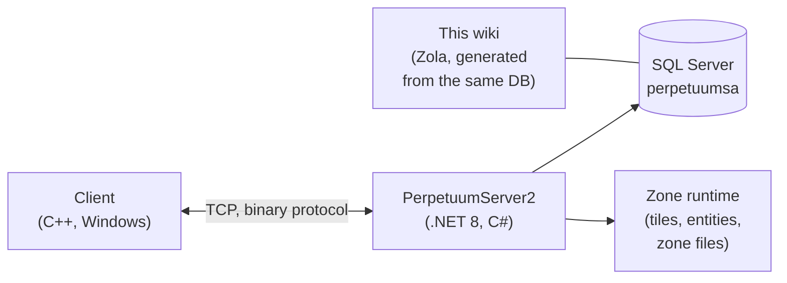

# 開發者首頁

從開發者／DevOps 的角度，概述遊戲的運作方式。
專用的深入頁面正在製作中——目前此頁作為導覽使用。

## 各組件

- **客戶端** — Perpetuum 遊戲客戶端（Windows；執行方式請見 [客戶端與 PC 設定](/zh-TW/features/client-setup/)，含 Linux）。透過二進位 TCP 協定與伺服器通訊；每個玩家操作都是一個具名的*指令*（與本 wiki 在[動作清單](/zh-TW/features/#wan-zheng-cao-zuo-qing-dan)中使用的名稱相同）。
- **伺服器（PerpetuumServer2）** — C#/.NET 8 程式碼庫。單一程序運行整個伺服器：連線層、遊戲邏輯（機器人、區域、任務、市場、生產、研究），以及區域執行環境（逐格更新每個區域的地形世界：地形、實體、傳送點）。
- **資料庫** — SQL Server，資料庫 `perpetuumsa`。包含靜態遊戲內容（實體預設值、配方、擴充、科技樹、商店、傳送點描述）以及所有動態狀態（角色、機器人、容器、市場、區域狀態）。
- **區域檔案** — 區域為格狀網格（海拔層＋控制層，每格 2 位元組），以 `.gbf` 壓縮檔發布並可逐區編輯；詳見[區域檔案格式](/zh-TW/formats/zone-files/)。
- **參考資料** — 客戶端在啟動時從伺服器下載屬性資料表（詳見[伺服器與參考資料](/zh-TW/features/server/)）。

## 執行方式

- 伺服器透過 Docker Compose 與 SQL Server 一同運行（`perpetuumserver2` 專案）；本 wiki 的生成器讀取的正是該資料庫容器。
- 靜態內容會針對 **plantrules** 規則檔進行驗證；本 wiki 的 C# 生成器（`make generate`）運行在同一生態系中並讀取同一個資料庫，因此本站上所有生成的資料表都反映伺服器即時資料。
- 本 wiki 上的區域傳送點地圖是根據遊戲本身使用的高海拔層渲染而成。

## 下一步

- **[格式](/zh-TW/formats/)** — 開發者欄位參考：每個屬性欄位的儲存方式（資料庫欄位、規則檔金鑰、二進位層位元組）與消費方式，附實例說明。
- **[伺服器與參考資料](/zh-TW/features/server/)** — 元系統：伺服器資訊、排行榜、客戶端下載的參考資料，以及遊戲內商店。

> 更多開發者頁面（協定、區域生命週期、部署）已列入計畫——此頁將作為這些頁面的入口。