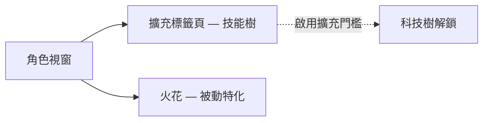

# 角色

**角色視窗**（頂部工具列 → **角色**，左上角）是角色成長進度的所在：個人檔案、信用點、**擴充**（技能）與設定。此頁面上的所有內容都是針對單一角色的——一個帳號可以擁有多個角色，每個角色都有各自獨立的技能樹。UI 位置請參閱[客戶端 UI 概覽](/zh-TW/features/ui/)。

## 擴充

**擴充標籤頁**是角色的技能樹：針對單一角色的技能等級，可解鎖遊戲內容並調整屬性——最重要的是駕駛機器人類別所需的**啟用擴充**。1 級需要信用點，之後每級需要擴充點（EP），且前置條件會限制解鎖路徑。

- [主要分類](/content/extensions/#categories) — 15 個分類一覽：哪些分類會開啟哪些分類（點擊方塊可跳轉至其卡片）
- [各分類擴充](/content/extensions/#table) — 所有擴充：等級、價格、加成、前置條件
- EP 與科技樹的運作方式：[研究](/zh-TW/features/research/)

## 火花

你的**火花**是安裝在角色上的奈米機器人特化——當其處於啟用狀態時，其加成會應用於你駕駛的每一台機器人。切換火花需要消耗資源；授權會限制較高層級的解鎖。詳細資訊請參閱[火花](/zh-TW/features/sparks/)。