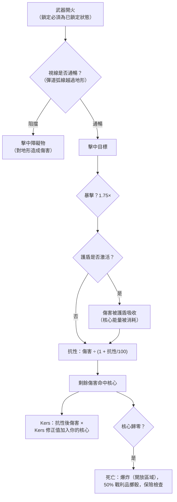

# 戰鬥

戰鬥發生在**區域**中，使用你當前激活的機器人。你可以與其他玩家（PvP）、NPC 以及敵對結構體交戰。本頁涵蓋伺服器端已確認的機制；詳細的傷害/配置交互請參見[機器人与配置](/zh-TW/features/robots/)。

> UI 位置遵循[客戶端 UI 概覽](/zh-TW/features/ui/)：你的機器人**護盾/裝甲/機體和
> 能量**顯示在未停泊狀態面板上。戰鬥中的目標鎖定和武器
> 控制尚未詳細記錄。

## 進入戰鬥

- 你只能在**未停泊**時戰鬥——你就是你激活的機器人。
- 在開放（PvP）區域中對另一名玩家開火會使攻擊者獲得
  **PvP 標記**。回擊或對已標記玩家使用
  支援模組也會使你獲得標記。標記持續**5 分鐘**
  （`effect_pvp` 定義，300,000 毫秒），並會隨每次新的攻擊
  行為刷新。
- 標記生效期間：
  - 你**無法使用傳送**（包括移動傳送），且
  - 你**無法正常停泊**——唯一的出路是**強制停泊**，它刻意
    不受標記限制。

## 你可以攻擊的目標

- **其他玩家的機器人**（PvP）。
- **NPC**——區域 NPC 被組織為**群組**（具有共享行為的群體）。
- 區域中的**敵對結構體/可部署物**。

## 當你的機器人被摧毀時

你的機器人被**摧毀**，一個**戰利品容器**出現在它死亡的位置。戰利品
按物品逐個擲骰，每次擲骰 50%：

| 項目 | 結果 |
|---|---|
| 每個已配置的**模組** | 50% 機率掉落**損壞**狀態（可修復）；否則被摧毀 |
| 每個模組裝載的**彈藥** | 50% 機率掉落（僅在模組掉落時） |
| **貨物**（包/箱） | 內容物作為戰利品掉落，包本身被摧毀 |
| 貨物中的其他**可堆疊物品** | 50% 機率掉落，數量隨機減少（其餘被摧毀） |
| 你的**塗料/染色** | 50% 機率作為塗料物品掉落 |
| **機器人本身** | 被摧毀——除非有生效的**保險**，在此情況下賠付以信用點形式支付給你（機器人仍然消失） |

**保險**（在基地的保險設施購買，需停泊——見
[生產 → 保險](/zh-TW/features/production/)）為機器人提供**15 天**的保期（加上
延長獎勵天數）。每個機器人有內容定義的**費用**和**賠付**（
`insuranceprices` 表——67 個機器人定義）；費用可通過延長
獎勵減少，並從你的公司錢包支付。初始機器人無法投保。你可以同時持有
1 +（延長獎勵）個機器人的保險。

被擊殺後你將**沒有激活的機器人**。要重新回到遊戲中你可以：

- **選擇另一台**你擁有的、具有所需啟用擴展的機器人，或
- **申請初始機器人**（需停泊）——但被擊殺後有短暫鎖定：
  **被玩家擊殺為 3 分鐘，被 NPC 擊殺為 1 分鐘**。如果是**NPC**
  擊殺了你，基地還會在返回時自動給你一台**免費初始機器人**。

## 逃脫

當戰鬥不利時：

- **強制停泊**——緊急出口。立即將你從區域中拉出並停泊在主基地
  （TMA），即使在戰鬥中也是如此。
- **SOS**——替代出口：在正常的（7 秒）解泊延遲後將你停泊在當前基地。

兩者都是你的安全網；強制停泊是「我快死了」的按鈕。

## 目標鎖定、射程與命中

- **先鎖定。** 武器只能對*已鎖定*的目標開火——且必須在鎖定
  完成後。鎖定目標需要你的機器人的**鎖定時間**（以毫秒為單位的屬性）；
  在鎖定進行中開火會被拒絕。你可以同時持有多個鎖定
  （受**最大鎖定目標數**屬性限制），但只有一個是*主要*目標，
  且某些武器只能對主要目標開火。
- **最佳射程 + 衰減。** 在武器的**最佳射程**內你造成完整
  傷害。超出後，傷害在**衰減**距離內平滑遞減——
  大約在衰減中點時為一半傷害，在邊緣時為零。超出
  最佳射程 + 衰減後你完全不造成傷害。
- **爆炸範圍 vs. 目標尺寸。** 槍械不會「未命中」：槍械的**精度**屬性
  作為爆炸半徑使用，目標的**特徵值**小於它時
  按比例減少傷害。導彈*可以*完全未命中（未命中機率
  來自機器人的導彈精度屬性），但命中時會以
  **爆炸半徑**爆炸——與槍械一樣，小目標受到的
  爆炸傷害較少。
- **暴擊。** 每次射擊擲骰你的**暴擊機率**；暴擊
  將整次命中乘以 1.75×，且每次命中還有 ±10% 的隨機波動。
- **視線。** 射擊沿直線飛行，地形、障礙物和
  植物會阻擋它們。導彈沿弧線飛行，可以越過低矮掩體——但弧線
  有限，所以高地仍然會阻擋。
- **你自己的護盾會阻擋你自己的武器。** 當你的護盾激活時，你的
  武器無法開火。

### 傷害類型

彈藥承載傷害：每種彈藥都有一個或多個傷害類型的數值——
通常是一個主要類型加一個較小的次要類型（導彈彈藥是爆炸
加動能或化學，雷射晶體是熱能加化學，軌道槍彈丸
是動能加熱能）。類型如下：

| 類型 | 說明 |
|---|---|
| **化學** | 槍械和雷射彈藥的常見成分 |
| **動能** | 軌道槍、彈丸和導彈彈藥 |
| **熱能** | 雷射、部分彈丸彈藥 |
| **爆炸** | 導彈 |
| **毒素** | 部分槍械彈藥；僅對植物和地形造成傷害 |
| **電擊** | 特殊效果（如灼燒器）——**穿透護盾** |

進軍傷害按類型被目標對該類型的**抗性**減少：
50% 抗性將傷害減少 50/(50+100) ≈ 33%。抗性僅應用於
*穿透*護盾的傷害——護盾先吸收，且從
護盾能量中支付：命中越重，消耗的能量越多。**Kers** 模組
讓一部分傷害類型在抗性後仍直接燃燒護盾能量。
[自適應合金](/zh-TW/features/modules/#mo-zu-jia-zu)
將你的抗性重新分配至實際命中你的傷害類型。

## 偵測、隱蔽與速度

- **偵測 vs. 隱蔽。** 你可以在一個範圍內看到單位，該範圍隨
  你的**偵測**屬性增大，隨目標的**隱蔽**屬性減小——
  大約 100 m × 偵測 ÷ 隱蔽。已鎖定你的單位對你
  始終可見，無論其隱蔽值如何。隱形模組暫時提高
  你自己的隱蔽值（見[模組](/zh-TW/features/modules/)）；地雷使用專門的
  偵測範圍。
- **Blob。** 某些單位和結構體發出*Blob* 場。當你站在
  發射器半徑內時，你單位上的 Blob 等級上升；在你的兩個 Blob
  閾值屬性之間，它**增加你的鎖定時間**（最高為基礎值的 6 倍）
  並**降低你的鎖定範圍和感測器強度**（最低為一半）。
- **速度。** 最高速度隨質量下降：速度 = 基礎 ×（設計質量 ÷ 實際
  質量）——你配置的每一噸額外模組、裝甲和貨物都會使你變慢。
- **減速效果（"Demob"）。** 蛛網效果降低目標的最高速度。
  效果強度隨目標的**質量等級**縮放——較重的單位
  被減速更嚴重，所以大型慢速目標感受最明顯。

## 警報

**警報**由區域中的**警報開關**（任務相關
結構體）觸發。啟動後：

- 它運行固定的**警報持續時間**（由任務設定；預設較短）。
- 你必須**保持在開關範圍內**整個持續時間——它
  每幾秒檢查一次，離開會取消警報。
- 你同時只能有**一個警報在運行**。

警報與任務內容相關——見[任務](/zh-TW/features/missions/)。

## 擊殺報告

你的戰鬥歷史可以作為**擊殺報告**查看：

- 按**時間範圍**篩選。
- 按**角色**篩選：作為**受害者**、**攻擊者**或**擊殺者**。

使用它們來回顧你是如何死亡的或你摧毀了誰。

## 最高紀錄

- **伺服器最高紀錄**——整個伺服器的最佳成績。
- **我的最高紀錄**——你的個人最佳成績。

## 實用提示

- **不要輕率地死亡**——機器人被摧毀意味著你需要重新配置或
  重新申請時的停機時間。
- **強制停泊是即時的**——如果你處於劣勢，立即前往 TMA；你可以之後再重新配置。
- **PvP 標記鎖定傳送**——規劃你的逃脫路線；你無法從戰鬥中閃現出去。
- **警報是信號**——活動警報意味著該區域有任務事件正在進行。

<!--
開發者備註：2026 年從後端來源重寫；未重用任何社群 wiki 文字。
已驗證對照：
- 鎖定：Zones/Locking/LockHandler.cs（鎖定時間以毫秒計，來自
  AggregateField.locking_time；MaxLockedTargetsProperty；一個主要鎖定；
  鎖定狀態 Inprogress -> Locked），Zones/Locking/Locks/Lock.cs，
  Zones/Locking/LockValidator.cs（死亡/不可鎖定/超出範圍驗證）；
  ZoneSession.cs（武器使用現有鎖定 ID；對未完全 Locked 的武器開火會
  觸發 LockIsInProgress——開火時不會自動鎖定）。
- 傷害：Modules/Weapons/Damage.cs（CalculateDamages：暴擊 = 攻擊者.
  CriticalHitChance，CRITICALHIT_MOD 1.75，隨機 0.9-1.1；衰減 =
  cos(x*PI)/2+0.5，其中 x=(距離-最佳)/衰減；超出最佳+衰減後為零；
  爆炸修正值 = target.SignatureRadius/explosionRadius，限制在 0..1；
  毒素排除在單位傷害之外），Modules/Weapons/WeaponAmmo.cs（每類傷害數值
  存在於彈藥上：damage_chemical/thermal/kinetic/explosive/toxic；
  槍械對植物額外造成 damage_toxic）。
- 武器：Modules/Weapons/FirearmWeaponModule.cs（CheckAccuracy 始終為 false——
  槍械從未未命中；WithExplosionRadius(Accuracy)——精度即為爆炸
  半徑），Modules/Weapons/MissileWeaponModule.cs（未命中條件為 rnd >
  robot.MissileHitChance；missile_miss 屬性），WeaponModule.cs（護盾激活
  => ShieldIsActive 錯誤；開火前進行視線檢查）。
- 抗性：Units/Unit.cs GetResistByDamageType = resist/(resist+100)；
  Zones/DamageProcessors/DamageProcessor.cs（護盾先吸收，從核心支付：
  coreDamage = damage * AbsorbtionModifier；電擊傷害穿透為
  coreDamage；kers = damage * 該類型 kers 修正值，乘以
  (sin(core/coreMax*PI)/2)+0.5，加入目標核心）；
  EffectModules/ShieldGeneratorModule.cs（AbsorbtionModifier =
  max(SigRadius/shieldRadius,1)/shieldAbsorbtion）。
- 傷害類型：Modules/Weapons/DamageType.cs——化學、動能、熱能、
  爆炸、毒素、電擊（無「地震」；導彈傷害為爆炸型）。
  電擊在此後端中僅由 ScorcherModule.cs 產生。
- 偵測：Units/Unit.Visibility.cs（IsDetected：範圍 = 100/max(1,
  target.StealthStrength)*max(1, DetectionStrength)；已鎖定你的單位始終
  可見；地雷偵測範圍獨立）；stealth_strength 屬性包含
  effect_stealth_strength_modifier（隱形模組提高隱蔽值）。
- 速度：Units/UnitProperties/SpeedMaxProperty.cs（speed_max * Mass/ActualMass；
  戰列艦 => 0.05；massiveness/drone/highway 效果修正值）。
- 減速：Modules/EffectModules/WebberModule.cs（effect_demobilizer；effect
  屬性 = 模組值 + target.Massiveness，限制在 1.0——較重目標
  受到完整效果；長程蛛網額外要求視線；精度
  檢查通過最佳射程修正值）。
- Blob：Zones/Blobs/BlobHandler.cs（發射器在
  BlobEmissionRadius 內提高 Blob 等級；在 blob_level_low/high 之間修正值縮放：
  locking_time 修正值 -5，即鎖定時間 x(1+5*m)——滿 Blob 時最高為基礎值 6 倍，max_targeting_range *0.5，
  sensor_strength *0.5）。
- 視線：Zones/LineOfSight.cs（射線檢測 vs 地形阻擋，包含 Plant 標誌；
  導彈彈道弧線：40 m 內最大振幅 16 m）；
  Zones/Terrains/BlockingFlags.cs（Obstacle/Plant/Decor/Island 阻擋）。
與已導入頁面的修正：「地震」傷害類型不存在（存在的是爆炸型）；
「槍械損失傷害而非未命中」已驗證（精度 = 爆炸
半徑）；開火時自動鎖定不在後端中（鎖定必須先建立並完成）；
「干擾」（發射/最低/峰值、發射器、異常退化）
在此後端中無對應——僅在 Services/RiftSystem/Rift.cs 中有一條註解
——該章節已移除；護盾「吸收」基於核心能量，且電擊傷害
可穿透護盾。
開發者檔案：Zones/Locking/*；Zones/Locks 通過 Zones/Locking/Locks/*；
Modules/Weapons/*.cs；Zones/DamageProcessors/*.cs；Units/Unit.Visibility.cs；
Units/Unit.cs；Units/UnitProperties/SpeedMaxProperty.cs；
Modules/EffectModules/ShieldGeneratorModule.cs, WebberModule.cs,
StealthModule.cs；Modules/ScorcherModule.cs；Zones/Blobs/*.cs；
Zones/LineOfSight.cs；Zones/ZoneSession.cs（鎖定/開火封包處理）。
先前已驗證（保持不變）：PvP 標記 = effect_pvp 300000 ms
（effect_pvp 定義），由攻擊/仇恨/支援觸發（Player.cs
ApplyPvPEffect）；阻擋傳送 + 正常停泊（CantDockThisState），ForceDock.cs
無 PvP 檢查；死亡戰利品 50% 擲骰（Player.cs OnUnitDeath，
Services/Looting/LootHelper.cs DROP_CHANCE 0.5）；保險（InsuraceFacility.cs，
InsuranceHelper.cs，insuranceprices 67 個定義）；初始機器人鎖定 PvP 3 分鐘 /
NPC 1 分鐘；警報（Zone/AlarmStart.cs，AlarmSwitch.cs）；擊殺報告
（GetMyKillReports.cs）；最高紀錄（GetHighScores.cs / GetMyHighScores.cs）。
-->