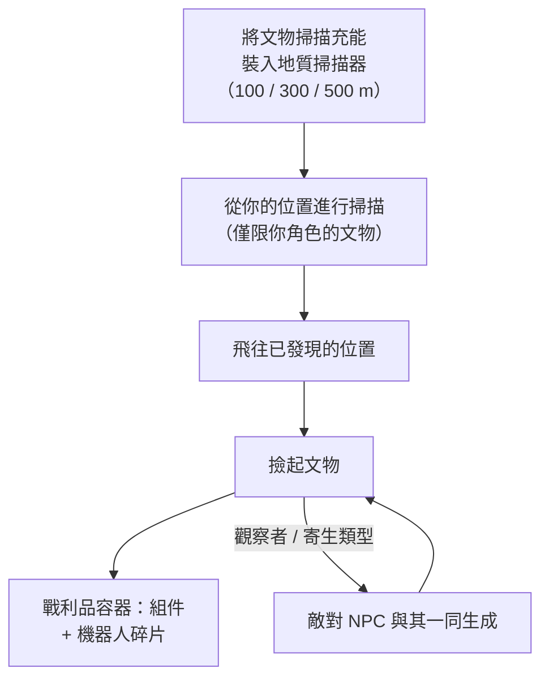

# 探索（文物與遺跡）

探索是在地形中發現隱藏的價值——任何等級下都是強力的單人活動。它分為兩種形式：**文物**，屬於個人且隱藏的；以及**遺跡**，公開且需要爭奪的。

## 文物探索

文物是**按角色**存在的點：伺服器為每個島嶼上的每個角色維護一套獨立的文物集合，因此你找到的只屬於你自己。在掃描之前它們是不可見的。

1. 將**文物掃描充能**裝入地質掃描器模組。有三種不同掃描範圍的充能等級（100 / 300 / 500 m）。
2. 從你的機器人位置進行掃描——掃描器會返回範圍內的文物位置（地質掃描器的精度屬性會縮小報告位置的誤差範圍）。
3. 飛往已發現的位置並撿起文物；該位置會生成一個**戰利品容器**。

兩點使文物探索同時成為戰鬥活動和採集活動：

- 某些文物類型**會與你一同生成 NPC**——「觀察者」和「寄生」變體在文物被發現的瞬間就會吸引敵對單位，因此請駕駛能戰鬥的機器人。
- 戰利品按文物類型隨機生成：模組組件（護甲板、硬化器、發電機、修復器……）和**機器人碎片**——各陣營專屬的研究/生產材料，這正是文物探索成為核心工業職業的原因。

文物類型分級（1–3 級，等級越高戰利品越多），並存在中立和陣營專屬變體。

## 遺跡獵取

遺跡是**開放世界**的：區域會在隨機位置生成它們（大約 90 分鐘的重生週期，帶有隨機分佈），它們是帶有光柱的可見物件，誰先撿起誰就獲得戰利品。戰利品是 NIC 加上**機器人碎片**的隨機抽取，根據遺跡的等級和島嶼的價值層級進行縮放——與文物探索產出的碎片相同。

遺跡類型按島嶼分級（1–3 級，不同等級有不同的 EP 值），並有中立、陣營專屬和工業變體。某些遺跡與[前哨站](/zh-TW/features/outposts/)綁定——SAP 活動會生成專屬的遺跡，存活時間可達 12 小時——而在開放 PvP 島嶼上，生成點位於爭奪地帶，所以要做好遇到其他獵人的準備。

## 任務也會提供報酬

[任務](/zh-TW/features/missions/)也會讓你進行文物相關工作，此時你直接獲得報酬，物品歸僱主所有而非進入你的物品欄。

<!--
本頁於 2026-09-27 完全根據伺服器後端重新撰寫：
Zones/Artifacts/Repositories/ZoneArtifactRepository.cs（按角色的文物
資料列）、Zones/Scanning/Scanners/Scanner.Artifact.cs（掃描範圍 + 精度）、
Zones/Artifacts/Generators/Loot/（按類型的隨機戰利品）、
Services/Relics/RelicManagers/ZoneRelicManager.cs（約 1.5 小時重生 + 隨機
時間窗）及 SAPRelic.cs（12 小時存活期）、
artifacttypes/artifactloot/relictypes/relicloot 資料表、
ammo_artifact_scan_a/b/c（掃描範圍 100/300/500）。
本頁早期版本改編自 Open Perpetuum 社群 wiki（perpetuum.miraheze.org），
現已完全根據後端來源重寫；未沿用任何原文。
-->