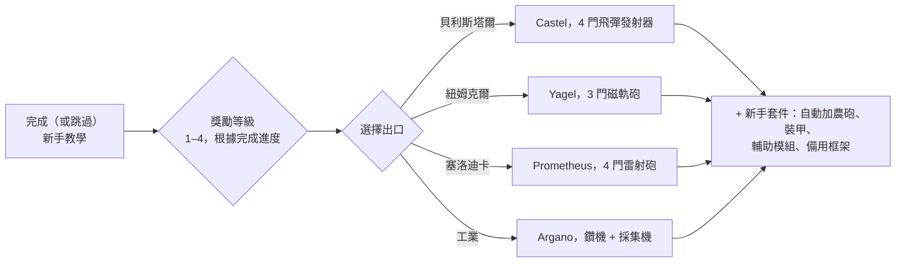

# 常見問題

## 我可以跳過新手教學嗎？

你可以提前離開訓練區，但這將放棄完成教學所獲得的獎勵。當角色退出教學時，伺服器會：

- 發放**初始 NIC**，並根據你在教學中達到的**每個獎勵等級**提供額外獎金（共有四個獎勵等級），
- 將你加入所選種族和學院對應的**預設公司**，
- 授予你的**初始擴展**（技能）和你的**火花**，
- 建立你的**初始機器人**，將你停靠在新維吉尼亞（New Virginia）停靠基地並將其設為你的**母港（home base）** — 即你的機器人被摧毀後的重生基地，
- 將你的**獎勵物品**放入該停靠基地的公共容器中，並向你發送一封歡迎郵件。

## 如何完成新手教學？

按順序完成各項目標；客戶端的**新手清單（Rookie Checklist）**（頂部欄的說明功能表）會追蹤這些目標，並可固定在底部欄。你的完成進度決定了你的獎勵等級，進而決定退出時獲得的獎勵階梯 — 1 級退出僅獲得第一階獎勵，全部完成則獲得全部四個等級的獎勵。

## 每個出口會給我什麼？

你的選擇決定了三件事：你駕駛的**初始機器人**、你獲得的**獎勵物品**，以及你獲得的**預設公司與初始技能**。除此之外的一切 — 任何技能、任何機器人、任何陣營的裝備 — 之後都可以透過 EP 和 NIC 進行訓練與購買，因此這項選擇只是初始套件，而非永久鎖定。

| 出口 | 初始機器人（已配置） | 獎勵主題 |
|---|---|---|
| **貝利斯塔爾（Pelistal）** | Castel — 四門飛彈發射器 | 飛彈 + 自動加農砲 |
| **紐姆克爾（Nuimqol）** | Yagel — 三門磁軌砲 | 磁軌砲彈藥 + 自動加農砲 |
| **塞洛迪卡（Thelodica）** | Prometheus — 四門雷射砲 | 雷射晶體 + 自動加農砲 |
| **工業（Industrial）** | Argano — 兩部鑽機、一部採集機、一個採礦探測器 | 採礦、採集與文物掃描彈藥 |

每個出口還包括一套配有彈藥的小型自動加農砲、裝甲與輔助模組（裝甲修復器、感測器增強器或質量縮減器、核心充能器、傷害加成器）、第二個（空）框架，以及在最高獎勵等級下獲得的防爆牆炸彈膠囊（wall-bomb capsule）。

## 離開教學後我該做什麼？

幾乎所有活動都能賺取用於學習技能的 EP 和購買裝備的 NIC：

- 採礦、採集植物、搜尋文物 — 並在[市場](/zh-TW/features/market/)上出售戰利品。
- 獵殺 NPC 並出售[戰利品](/zh-TW/features/npcs/)。
- 收集或購買材料並[製造](/zh-TW/features/production/)物品。
- 執行[任務](/zh-TW/features/missions/) — 終端或前哨站提供的任何任務都可以由你一人在開放世界中完成。

剛接觸開放世界 PvP？請先閱讀[快速入門中的生存指南](/zh-TW/features/getting-started/#survival)。

## 我可以重返訓練區嗎？

不能。訓練區專為新角色設計，一旦離開就無法再次進入。如果你想重新閱讀任務目標，說明功能表中的新手清單仍可查看，你也可以隨時建立另一個角色並將其保留在教學中作為測試沙盒。

## 縮寫與術語

聊天頻道、市場掛單和配置方案中常見的簡寫。大多數術語都有自己的專屬頁面（在需要處提供了連結） — 物品名稱可在網站搜尋中查找。

| 術語 | 含義 |
|---|---|
| **EP** | [擴展點數（Extension Points）](/zh-TW/features/research/#ep-sources) — 用於升級[擴展（技能）](/zh-TW/features/character/#extensions)的帳號級貨幣（獲取規則請參閱[研究頁面](/zh-TW/features/research/#ep-sources)）。 |
| **NIC** | 尼亞信用點（Nian Credit） — 遊戲內貨幣（角色的 `credit` 餘額）。 |
| **CT** | [CPRG — 校準程序](/zh-TW/features/production/#cprg-calibration-programs) — 生產線在製造前進行校準所需的程序（每種物品一個，具有材料/時間效率屬性）。 |
| **Proto** | 原型物品（Prototype） — 模組/機器人的高階變體，在[原型設施](/zh-TW/features/production/#the-item-lifecycle-the-circular-process)中製造（消耗上一階的樣品；參見[階層進階](/zh-TW/features/production/#tier-progression)）。 |
| **LWF** | 輕型框架（Lightweight frame） — 降低質量的裝甲模組（客戶端命名為「……輕型框架」，例如 *Niani 輕型框架*）。以犧牲裝甲為代價減輕機器人重量。 |
| **TP / tele** | [傳送（Teleport）](/zh-TW/features/movement/) — 在固定點之間或向已部署的移動傳送裝置快速旅行。 |
| **SAP** | 服務存取點（Service Access Point） — 前哨站[穩定度](/zh-TW/features/outposts/)活動。 |
| **Stab** | 武器穩定器（Weapon Stabilizer） — 提升武器命中精準度。 |
| **Demob** | 減速器（Demobilizer） — 減慢其他機器人（及其模組）速度的模組。 |
| **EWar** | 電子戰（Electronic Warfare）模組（干擾、感測器抑制、隱形）。 |
| **EnWar** | 能量戰（Energy Warfare）模組（核心注能器、能量抽取器、中和器、能量傳輸器）。 |
| **Tuning** | 調諧模組（Tuning） — 客戶端中增強其他模組的升級模組名稱 — 武器傷害加成器、採礦與採集機的*工業調諧*、裝甲修復調諧等。 |
| **MK2** | 機器人的升級改型（`_mk2` 框架） — 更高的容量，擁有獨立的研究路線。 |

機器人級別遵循客戶端內的分類 — 請參閱[機器人級別](/zh-TW/content/robots/#robot-classes)下的說明。

<!--
Written from scratch against the server backend, 2026-09-27:
Zones/Teleporting/Strategies/TrainingExitStrategy.cs (exit rewards, NIC,
corporation, extensions, spark, starter robot, home base, reward items),
Zones/Training/Reward/TrainingReward*.cs + trainingrewards/robottemplates
(reward levels 1-4, per-race starter packs and items),
Robots/Robot.Properties.cs (race ids 1=Pelistal, 2=Nuimqol, 3=Thelodica, 5=industrial).
An earlier version of this page was adapted from the Open Perpetuum
community wiki (perpetuum.miraheze.org) and has been fully rewritten from
backend sources; no text was reused.
-->
