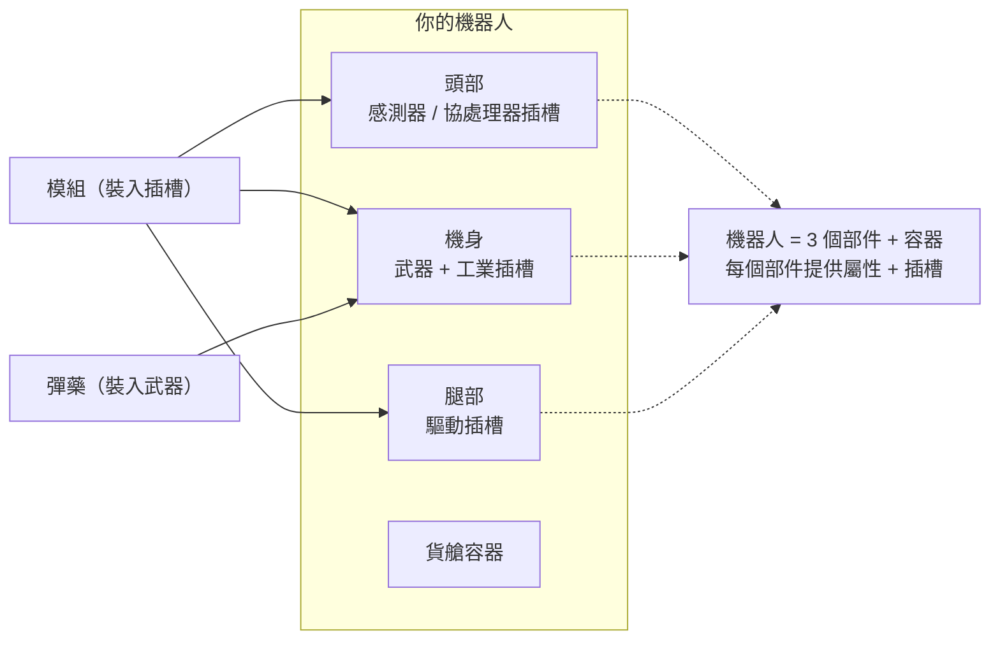

# 裝配

裝配是指將**模組**裝入機器人的部件插槽，以及將**彈藥**裝入武器。所有裝配操作均**僅限停泊時**進行——你無法在區域內進行裝配。

> 介面位置請參閱[客戶端介面概覽](/zh-TW/features/ui/)（頂部工具列的**裝備**分類）。以下機制已與伺服器端確認。

## 裝配模組

機器人擁有多個**部件**（武器、護盾、裝甲、驅動、感測器等），每個部件都有一組**插槽**。

- **裝備模組** — 從容器中取出模組並裝入特定部件插槽。模組類型必須對該機器人類別的該插槽有效。若插槽已被佔用，現有模組將被退回容器。
- **交換模組** — 在同一部件的兩個插槽之間移動模組。
- **移除模組** — 將模組從插槽中取出並放回容器。

伺服器會在每次變更後重新計算機器人的屬性（模組會影響未停泊狀態面板上顯示的數值——請參閱[戰鬥](/zh-TW/features/combat/)）。

## 裝配彈藥

- **裝填彈藥** — 將相容的彈藥裝入已激活的（武器）模組。模組必須**接受該彈藥類型**，且裝填量不超過模組的**彈藥容量**。先前已裝填的彈藥會先退回容器。
- **更換彈藥** — 將已裝填的彈藥更換為其他相容類型。
- **卸除彈藥** — 將已裝填的彈藥退回容器。

## 裝配預設

**預設**是已儲存的裝配方案，可快速重新套用：

- **儲存** — 以名稱儲存機器人目前的裝配方案。
- **列出** — 查看已儲存的預設。
- **套用** — 從容器中將預設套用到（另一台）機器人。
- **刪除** — 移除已儲存的預設。

預設在戰鬥後重新裝配或在不同角色間切換時非常實用。

## 實用提示

- **區域內無法裝配** — 以上所有操作都需要你處於停泊狀態。
- **先完成啟用器擴展** — 未研究的機器人類別無法被選擇或駕駛。
- **彈藥必須與武器匹配** — 不相容的彈藥定義會被拒絕。
- **重新包裝的機器人無法使用** — 選擇或裝配前先解包機器人。
- **使用預設快速重新裝配** — 儲存一套已驗證的配備方案，損失後再套用。

## 插槽分類

機器人的部件（頭部、機身、腿部）提供**插槽**，每個插槽攜帶一組分類標記。模組只有在自身標記是插槽標記的**子集**時才能裝入該插槽。標記分類包括：

`small`、`medium`、`large`、`turret`、`missile`、`melee`、`industrial`、`ew_and_engineering`、`specialized`（專用插槽僅接受專用模組），以及結構性的 `head` / `chassis` / `leg` 插槽。

模組也可以被限制為特定機器人專用，部分模組攜帶**唯一**標記，表示同一時間只能裝配一個該類型的模組。各模組的屬性效果詳見生成的[機器人表格](/content/robots/)。