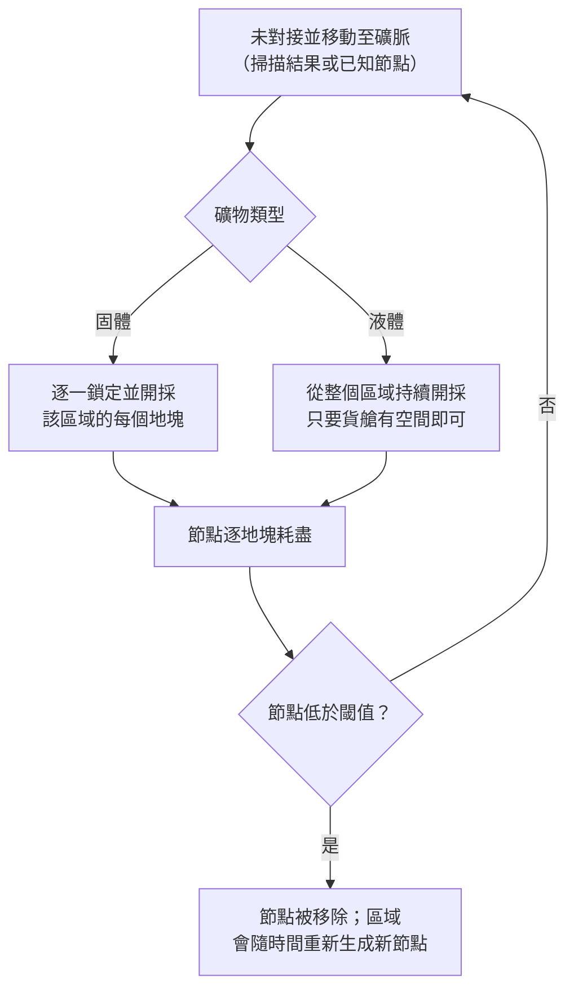
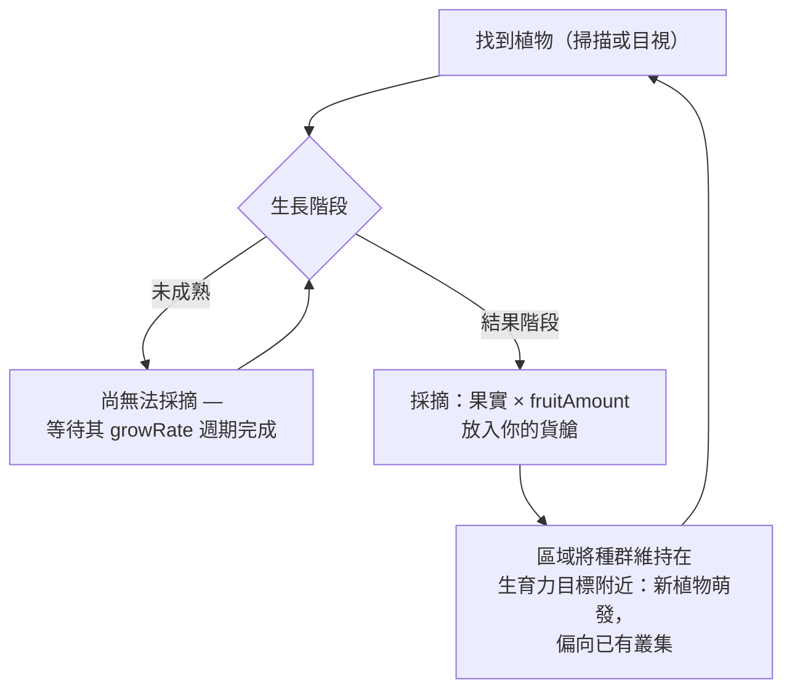
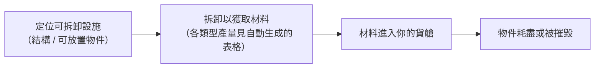

# 採集與掃描

遊戲中的資源來自區域內的三個來源：**礦脈**、**植物**，
以及**可拆卸設施**。本頁說明各來源的運作方式與採集流程。

> 介面位置請參閱[客戶端介面總覽](/zh-TW/features/ui/)：掃描與採集操作位於
> **未對接操作**清單中（在區域內時位於右上角）。各資源類型的產量
> 數字見於自動生成的表格：[內容 → 礦物](/content/ores/) 與
> [內容 → 植物](/content/plants/)。以下機制已與伺服器實作確認一致。

## 基本流程

1. **未對接**並移動至區域內（參見[移動](/zh-TW/features/movement/)）。
2. 使用機器人上的**掃描模組**掃描周圍區域。
3. **採集** — 開採礦物、採摘植物果實，或拆卸可拆卸設施。
4. **對接**並將貨物交付至基地容器。

## 礦脈

- 礦物以**礦脈（節點）**的形式存在於地面中，散佈於整個區域。
- 要發現並記錄它們，需要在當前激活的機器人上裝備**地質掃描模組**。
  掃描會產生**掃描結果**；你隨後需要**上傳**它，它將被儲存到你的
  個人礦物掃描清單中。
- 你儲存的掃描結果可以**列出、移動、刪除，或轉化為物品**
  （即用於加工/生產的「礦物掃描」物品）。

- 礦脈是**有限的**：每個節點含有有限的總量。當節點被開採至低於
  閾值時即被移除，區域會隨時間**重新生成新節點**，直到達到設定的
  上限。節點的放置方式與植物種群的維持機制 — 以實際區域作為
  範例 — 詳見[區域 → 生成](/zones/generation/)。
- **固體與液體礦物。** 固體礦物逐地塊耗盡 — 你需要逐一鎖定並開採
  該區域的每個地塊，直到其被清空。液體礦物則從整個區域抽取，因此
  只要你有貨艙空間，開採器就可以持續運作。這種便利性正是液體礦物
  價值較低的原因：開採所需的技巧與注意力較少。

### 植物與礦物屬性一覽

礦物與植物的行為由各類型的規則資料驅動。對玩家而言重要的欄位：

| 欄位 | 遊戲中的意義 |
|---|---|
| `fertility` | 該類型的常見程度 — 數值越高 = 區域會嘗試維持越多 |
| `growRate` | 植物在每個階段需要經歷多少生長週期才能推進（越高 = 越慢） |
| `spreading` | 該類型是否以叢集（群組）形式生長，還是散佈生長 |
| `killDistance` | 同類型兩株植物之間的最小間距 |
| `slope` / `minSlope` | 植物可生長的坡度 |
| `allowedAltitudeLow/High` | 植物可生長的海拔範圍 |
| `allowedWaterLevelLow/High` | 距海岸的距離範圍（形成海岸植被） |
| `fruitingState` | 植物必須達到的生長階段才能產出（可採摘） |
| `fruitDefinition` / `fruitAmount` | 植物的產出物及基礎產量 |
| `maxAmount` | 加工區域內該類型存在的數量上限 |
| `health` | 每個生長階段的生命值（較高階段可能更堅韌） |
| `damageScale` | 植物的傷害抗性 |
| `playerSeeded` | 該植物僅存在於玩家種植的位置 |
| `onlyOnUnprotectedZone` | 僅在未保護（Beta/Gamma 級）區域生長 |

完整的逐欄位參考（類型、預設值、儲存方式，以及區域 tick 如何使用
這些欄位）詳見[格式 → 植物欄位](/zh-TW/formats/plant-fields/)。

## 植物

- 植物**隨時間生長**，經歷一系列階段。每個階段需要一定數量的
  生長週期（`growRate`）後，植物才會隨機推進到下一階段。
- 植物**只有達到結果階段才會產出果實** — 未成熟的植物無法採摘。
- 區域會將植物種群維持在**生育力目標**附近：如果某片土地的生長
  密度低於其生育力水平，就會長出新的植物；選擇的類型會權衡各物種
  的 `fertility`，而 `spreading` 會使新生長偏向已有的叢集。

- 某些植物是**玩家種植的**（僅存在於玩家花園中），某些則是
  **僅限未保護區域**。
- 植物可以**受損並被摧毀**；其 `health` 和 `damageScale` 決定了
  摧毀它的難度。

## 可拆卸設施

可拆卸設施是區域中放置的物件（結構方面請參見[電力基地站](/zh-TW/features/pbs/)）。
部分可以被**拆卸**以獲取材料。拆卸規則與各類型產量見於自動生成的
表格：[內容 → 礦物](/content/ores/) 與 [內容 → 植物](/content/plants/)。

## 服務亭

**服務亭**是一種任務相關結構：你需要**提交物品**到它（在範圍內）
作為任務的一部分。它本身不是採集來源 — 請參見[任務](/zh-TW/features/missions/)。

## 實用提示

- **掃描需要模組** — 未裝備地質掃描模組，就無法獲得掃描結果。
- **掃描結果屬於你個人** — 它們按角色儲存，不會共享。
- **礦物節點會重生，但速度很慢** — 如果某片區域是空的，代表礦脈
  已耗盡，而非隱藏。重生會恢復節點數量，但並非即時完成。
- **採摘成熟的植物** — 結果階段的植物提供完整產量；較年輕的階段
  不會產出任何東西。

<!-- TODO: only the client UI flow remains (scan screen, harvest interaction, cargo UI) —
     needs a running client. Per-type ore yields are at /content/ores/ and plant fruit
     definitions at /content/plants/ (generated from the live DB).
     Developer notes: Zone/ZoneUploadScanResult.cs (GeoScannerModule required);
     MineralScanResult*.cs (per-character repository);
     Zones/Terrains/Materials/Plants/PlantRule.cs (all plant rule fields);
     Zones/Terrains/NatureCube.cs (GrowPlants, fertility/spreading/killDistance logic);
     Zones/Terrains/Materials/Minerals/MineralLayer.cs (ore node lifecycle);
     Zone/UseItem.cs + UseItemVisitor.cs (IUsableItem harvest path);
     Zone/KioskSubmitItem.cs (mission item submission, range-limited). -->