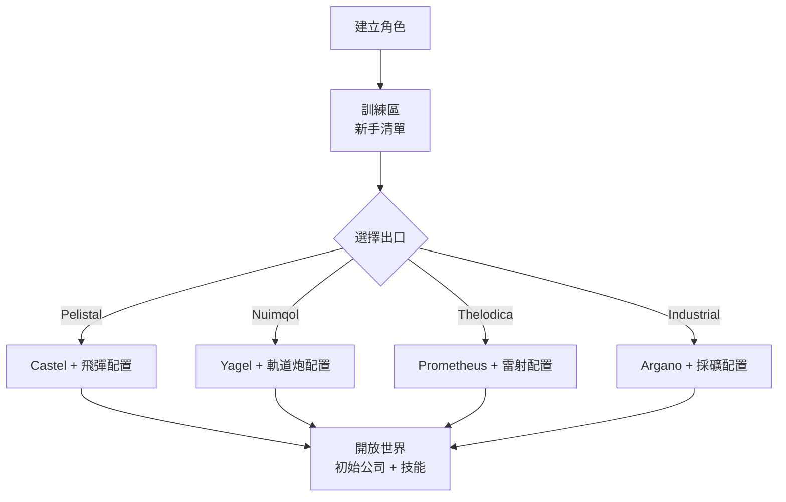

# 快速入門

本頁涵蓋最初的步驟：建立角色、獲得你的第一台機器人，以及你早期會接觸到的角色層級設定。

> 介面位置請參閱[客戶端介面總覽](/zh-TW/features/ui/)。以下機制已與伺服器實作確認。

## 取得遊戲

Perpetuum 在 [Steam](https://store.steampowered.com/app/223410/Perpetuum/) 上免費提供。

  <a class="steam-card-link" href="https://store.steampowered.com/app/223410/Perpetuum/" target="_blank" rel="noopener">
    
    Perpetuum on Steam — 免費遊玩
  </a>

## 先看看影片

來自 Open Perpetuum Project 的教學影片。點擊卡片即可在此播放。

  

    
    &#9654;
    
Perpetuum Online Tutorial Walkthrough. + Extension Advice and lots more.

  

  

    
    &#9654;
    
Syndicate Careers Help — Artifacting

  

  

    
    &#9654;
    
Open Perpetuum Tutorial — How to run multiple clients

  

## 建立角色

- 你可以在建立之前**查詢名稱是否可用**（`characterCheckNick`）。
- **建立角色** — 角色會綁定到你的帳號。一個帳號可以擁有多個角色；你一次只能操作一個。
- **選擇角色**即可開始遊玩。切換角色會取消目前角色的選取狀態。
- 你可以稍後**改名**（名稱必須可用）。
- 你可以**刪除**不再使用的角色。

## 你的第一台機器人

- 在**停泊於基地**時，你可以**申請初始機器人**（基地設施 —
  請參閱[客戶端介面總覽](/zh-TW/features/ui/)了解基地操作的位置）。
  - 基地必須仍有初始機器人的庫存 — 在熱門基地可能會售罄，
    此時申請會失敗。
  - 每個角色申請初始機器人之間有**5 分鐘冷卻時間**。
  - 新機器人會送達基地的公共容器。

- 停泊時你也可以**申請「無限箱」**：一個加入你物品欄的特殊容器，
  費用為 **5,000 信用點**。這是一個便利容器，並非免費資源的來源。

## 角色設定

- **頭像** — 你的角色外觀。
- **心情訊息** — 顯示給其他玩家的一句話。
- **私人備註** — 只有你自己能在自己的角色上看到的備註。
- **主基地** — 設定或清除你的主基地；當遊戲需要將你放置在安全地點時，
  這裡是你的預設停泊點。
- **設定** — 每個角色的個人偏好（取得/設定）。
- **封鎖交易** — 為角色開啟或關閉交易功能。
- **信用點** — 在你自己的角色之間轉帳；查看交易紀錄。
- **帳號層級** — 變更登入電子郵件/密碼，查看帳號的交易紀錄
  及活動 EP 紀錄。

## 離開 / 重新進入

- **登出**會結束本次登入；**選擇角色**會重新開始。
- 如果伺服器將你踢出（例如強制回基地），你會以停泊狀態重新出現 — 請參閱[移動](/zh-TW/features/movement/)。

## 教學

新角色會從訓練區開始，並附有一份**新手清單** — 完成它：
它涵蓋了基本操作，並會發放數台配有模組和彈藥的機器人。你可以
跳過（離港並步行到陣營出口），但會失去獎勵，而且之後
無法再回到訓練區。四個陣營出口分別給你什麼，
請參閱[常見問題](/zh-TW/features/faq/)。

## 生存

Perpetuum 是一個風險與回報並存的沙盒遊戲，當你的機器人被摧毀時你就失去了它 —
無論是否停泊、被玩家還是 NPC 擊毀 — 然後在[主基地](#jiao-se-she-ding)重新出現
（如果你空手抵達，可以在那裡申請一台免費的初始機器人）。以下幾條
規則能讓損失保持在可承受的範圍內：

- **只投入你能承受損失的資源。** 離港就是一場賭注：如果機器人
  被擊毀，它和已配置的模組就沒了（或被撿走）。起飛前，請確認
  這個損失是你承受得起的。
- **了解區域。** 保護區（PvE）島嶼不受玩家攻擊；
  開放 PvP 島嶼是自由混戰，沒有犯罪/懲罰系統。請參閱
  [區域](/zones/)查看地圖。
- **了解 NPC。** 橙色標記只在被激怒時才會攻擊；紅色標記
  在接近時就會攻擊。逃跑並中斷視線可以脫離仇恨。請參閱
  [NPC 與 PvE 狩獵](/zh-TW/features/npcs/)。
- **降低風險，而不只是接受風險。** 用你最好的
  T4 配置機甲去開放 PvP 島嶼，正是機甲被擊毀的方式。便宜、可更換的裝備
  幾次任務就能回本，勝過那台要二十次才能回本的昂貴機器人。
- **建立可持續的循環。** 無論你做什麼 — 任務、採集、狩獵、
  生產、運輸 — 都有人為此支付 NIC。保留備用資產，讓一個壞日子
  不會讓你的收入歸零。

## 接下來要做什麼

1. 選擇你的初始機器人，熟悉[機庫與配置](/zh-TW/features/robots/)介面。
2. 離港並移動到區域中 — 請參閱[移動](/zh-TW/features/movement/)。
3. 掃描地面並開始採集資源 — 請參閱[採集](/zh-TW/features/gathering/)。
4. 研究你的第一批擴充 — 請參閱[研究](/zh-TW/features/research/)。
5. 選擇一條職業道路 — [常見問題](/zh-TW/features/faq/)中有完整清單。

<!-- TODO(Phase 1): 驗證客戶端介面流程（帳號建立畫面、角色精靈）。
     介面模型：參見 features/ui.md（EVE 風格，專案提供）。
     開發者備註：Perpetuum.RequestHandlers.Characters/*（CharacterCreate、
     CharacterSelect、CharacterRename、CharacterSetHomeBase、...）；
     RequestStarterRobot（5 分鐘冷卻、基地庫存）、RequestInfiniteBox
     （5000 信用點、僅限停泊時）。 -->