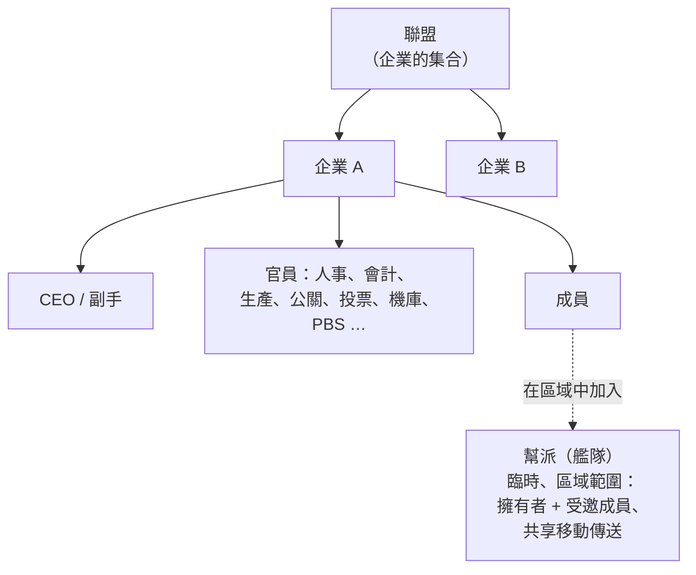

# 群組

共有三種群組：**企業**（你的主要組織）、**聯盟**（企業的集合）以及**幫派**（用於區域遊玩的臨時艦隊）。

> 介面位置請參閱[客戶端介面總覽](/zh-TW/features/ui/)（左上角的**企業**按鈕；**企業儲存**分類；幫派有獨立的視窗）。以下機制均已與伺服器端確認。

## 企業

### 加入與離開
- **建立**企業——需要基礎企業管理擴充（1 級）以及 **250,000 NIC** 的創立費用。你需選擇正式名稱、一個**簡短 ID**（最多 6 個字元，顯示在地形上以辨識你的成員）以及**稅率**——從成員收入（特別是任務報酬）中自動撥入企業帳戶的比例。
- **申請**加入，或**邀請**角色加入。
- **核准申請**／**查看申請列表**（官員）。
- **回覆**你收到的邀請。
- **離開**，或**取消**待處理的離開請求。
- **移除成員**、**設定成員職級**、**放棄自身職級**，或將成員設為中立。

### 職級
企業具有職級層級制度。職級決定你能執行哪些操作——例如解鎖企業科技樹節點、管理機庫或編輯 PBS（請參閱[pbs](/zh-TW/features/pbs/)）。伺服器定義的職級（`CorporationRole`）：

- **CEO**——完全控制權。
- **副 CEO**——二把手。
- **人事經理**——成員管理（申請／邀請／移除）。
- **企業代表**／**聯盟代表**——代表組織行事。
- **會計**——企業資金。
- **生產經理**——企業生產。
- **投票管理員**——投票。
- **公關經理**——公共關係／公告。
- **機庫存取（低／中／高／安全）**——分層機庫權限，對應**機庫移除**層級以及**機庫操作員**職級。
- **檢視 PBS／編輯 PBS**——檢視或修改企業的 PBS 結構。
- **科技樹列表／解鎖**——檢視或解鎖企業科技樹。

幾個典型的權限門檻：成員操作（申請／邀請／移除、設定職級）需要**CEO／副手／人事經理**；公告與公關需要**CEO／副手／公關經理**；企業資金與設施升級需要**CEO／副手／會計**（生產另需**生產經理**）；PBS 部署需要**CEO／副手／編輯 PBS**。

你可以檢視自己與成員的**職級歷史**。機庫空間為租用制（預設伺服器設定：每 7 天 50,000 信用點）。

### 資訊與搜尋
- **企業資訊／我的資訊**——詳細資料與你的成員資格。
- **搜尋**企業。
- **聲望／名聲**——你企業的聲望與名聲。
- **代表**——代表企業行事的角色。

### 資金
- **捐贈**至企業錢包。
- **撥款**自企業錢包。
- **轉帳**於錢包之間。

### 外觀與檔案
- **重新命名**、**設定顏色**、**設定資訊**（公開檔案）。
- **標誌**——最多 5 個符號，取自固定集合，每個可編輯（大小、透明度、層疊）；僅具權限的成員可建立或修改。
- **名稱歷史**——過去的名稱。

### CEO
- **自願參選 CEO**，或查看**CEO 接管狀態**。
- **接管實務**：當 CEO 離線超過 **30 天**後，副手可發起接管——啟動**48 小時倒數**，並在企業視窗中公告。CEO 或任何其他副手可立即**否決**（否決不會阻止下一次嘗試，若 CEO 仍未登入）。若倒數歸零，該副手即成為 CEO 並獲得完整權限。

### 投票
企業可舉行**投票**：
- **發起**投票、**設定議題**、**列出**投票、**投票**、**刪除**投票。

## 公告欄
由企業管理的公告板：
- **開啟**、**列出**條目、查看**新條目**、**發佈**條目、**管理**（編輯／移除他人條目）以及檢視**詳細資訊**。

## 企業機庫（儲存）
基地中的共享企業儲存區域：
- **租用**機庫區段、**繳納租金**、查看**租金價格**、**關閉**。
- **列出**內容（全部或特定基地）。
- **資料夾**——建立／刪除子資料夾。
- **設定存取權限**（誰可以使用）以及**設定名稱**。
- **日誌**——檢視、設定與清除機庫存取日誌。

注意：你**無法從企業機庫中選擇機器人**作為你的活躍機器人（請參閱[robots](/zh-TW/features/robots/)）。

## 企業文件
企業共享的版本化文字文件系統。有兩種文件類型：

- **PBS 計畫**——企業 PBS 網路的計畫／藍圖。
- **地形改造專案**——地形修改專案記錄。

操作：**建立**、**列出**、**開啟**、**更新內容**（版本化）、**刪除**、**轉移**所有權、**續租**（延長有效期）、**監控**／**取消監控**（收到變更通知），以及**註冊列表**（最多 25 名成員）控制誰可以處理該文件。

## 聯盟

聯盟將企業分組：
- **我的聯盟資訊**、**預設聯盟**以及**聯盟職級歷史**。
- 聲望可針對聯盟（請參閱[social](/zh-TW/features/social/)）。

## 幫派（艦隊）

**幫派**是用於區域遊玩的臨時群組（例如共享移動傳送或一起戰鬥）：
- **建立**、**刪除**、**資訊**。
- **邀請**、**回覆**邀請、**踢出**、**離開**。
- **設定隊長**、**設定職級**。

幫派成員資格對**移動傳送**很重要——只有擁有者或幫派成員才能使用（請參閱[movement](/zh-TW/features/movement/)）。

## 實務要點

- **職級決定權限**——大多數官員操作（申請、機庫、PBS、投票）需要對應的職級。
- **企業科技為共享制**——為企業解鎖使用共享點數與倍率（請參閱[research](/zh-TW/features/research/)）。
- **機庫是儲存空間，不是發射台**——你無法從中登出到機器人。
- **幫派是短暫的**——用於區域會話，而非永久組織。
- **聲望跟隨你的企業**——你企業的聲望影響宇宙如何對待你（請參閱[social](/zh-TW/features/social/)）。

<!-- TODO: only the corp UI remains (window layout, role picker).
     Confirmed: CorporationRole enum (21 roles incl. hangar access/remove tiers
     low/medium/high/secure, viewPBS/editPBS, TechTreeList/TechTreeUnlock, delegates);
     permission gates sampled from handlers (membership CEO/Deputy/HRManager;
     bulletin CEO/Deputy/PRManager; money+facility upgrades CEO/Deputy/Accountant;
     production +ProductionManager; PBS CEO/Deputy/editPBS); documents = pbsPlan(1) +
     terraformProject(2) (CorporationDocumentType.cs), versioned, rent extends validity,
     monitor for change notifications, register list max 25 (MAX_REGISTERED_MEMBERS).
     Developer notes: Corporations/* (apply/invite/accept, roles, leave, info, money,
     votes, bulletin, hangar, documents, histories, CEO); AllianceGetMyInfo.cs /
     AllianceGetDefaults.cs / AllianceRoleHistory.cs; Gangs/* (create/invite/kick/leave,
     leader/role). SelectActiveRobot.cs forbids corp-hangar robots. -->