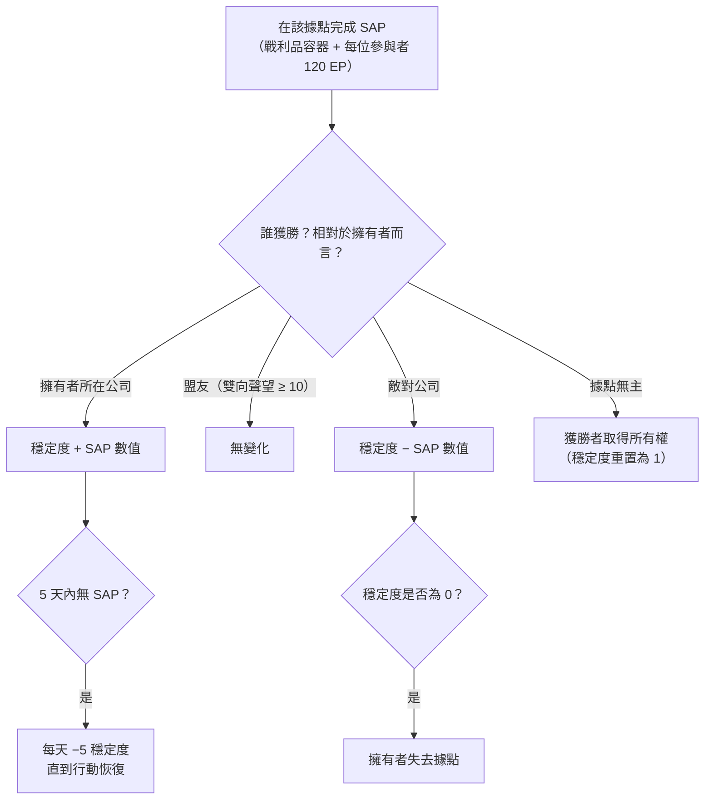

# 入侵

**入侵**是一種以 **NPC 據點** 為核心的模式——由玩家控制或可爭奪的據點，具有
**穩定度**、**防禦** 和 **設施**。你投入物品、提升防禦、
升級設施，以控制據點並獲利。

> 客戶端中「入侵」的正式名稱尚待確認。UI 位置請參閱
> [客戶端 UI 總覽](/zh-TW/features/ui/)。以下機制已與伺服器端確認。

## 據點與穩定度

- **據點資訊** — 入侵據點的詳細資訊。
- **穩定度** — 據點的核心屬性，數值範圍為 **0 至 150**。新擁有者起始值為
  **1**。穩定度驅動一切：
  - **獎勵閾值**（內容，`intrusionsitestabilitythreshold`）：設施獎勵
    在穩定度 **20 / 60 / 80** 時解鎖；一組光環效果（入侵核心、
    偵測、地質掃描、收割者、工業、隱蔽、採礦、修復、訊號——各
    lvl1–3，以及組合 lvl4 效果）在 **10、20、40、50、70、80 和
    100** 時分層解鎖；**停泊權** 在 **50** 時解鎖；防禦節點上限在 **40** 時提升。
  - **生產點** = `穩定度 / 10`（最高 15）——用於升級設施的貨幣
   （每級消耗一點）。
  - **衰減**：若 **5 天** 內沒有成功的 SAP，據點將開始
    **每天損失 5 點穩定度**，直到再次採取行動。
  - **失去**：穩定度降至 **0** 時，擁有者將失去該據點（變為
    無主狀態）。
- **穩定度日誌** — 檢視據點穩定度的變化記錄。

### 誰會改變穩定度

穩定度變化來自已完成的 **SAP**（見下文）和系統衰減。效果
取決於 *誰* 相對於當前擁有者獲勝：

- **擁有者獲勝** → 穩定度 **增加** SAP 的數值。
- **盟友獲勝**（雙向聲望 ≥ 10）→ **無變化**。
- **敵對公司獲勝** → 穩定度 **減少** SAP 的數值。
- **無主據點** → 第一個玩家公司獲勝者 **取得所有權**（穩定度
  重置為 1）。

## SAP（據點攻擊點）

**SAP** 是在據點生成的臨時目標。完成後會在 SAP 位置掉落一個 **戰利品
容器**，改變穩定度，並向每位
參與角色支付 **120 EP**。**NPC 邪教徒也會爭奪 SAP**——如果他們先
達到分數，該 SAP 將計為對你不利。共有四種 SAP 類型：

| SAP | 完成方式 | 穩定度數值 |
|---|---|---|
| **主動駭入** | 對 SAP 使用駭入模組（最多 120 次模組使用） | +15 |
| **被動駭入** | 在 SAP 範圍 5 內停留 **8 分鐘** | +10 |
| **摧毀** | 將 SAP 損毀至死亡（NPC 傷害也計入） | +15 |
| **樣本處理** | 提交 **5–6 個 SAP 樣本**（每批 2–3 個，冷卻 1.5 分鐘，範圍 7） | +15 |

- **提交 SAP 項目** — 在區域內，向樣本處理型 SAP 提交樣本。
- **SAP 項目資訊** — 檢視 SAP 項目數據（你自己的和通用的）。

SAP 樣本是該模式的消耗品；它們同時具有大量的核心價值，因此
也可作為 [PBS 反應爐燃料](/zh-TW/features/pbs/) 使用。

## 防禦與效果

- **設定防禦閾值** — 設定據點的防禦閾值（據點自動防禦
  啟動的條件）。
- **設定效果獎勵** — 設定據點的光環/效果獎勵配置（來自
  穩定度解鎖的光環組）。
- **升級設施** — 改善據點設施：消耗 **1 個生產點**
  （即 10 點穩定度），僅限 CEO / 副總 / 會計，有最高等級上限。
- **設定據點訊息** — 設定據點的公開訊息。

## 日誌

- **我的入侵日誌** — 你的入侵活動記錄。
- **公開日誌** — 公開的入侵動態。
- **我的據點日誌** — 你的據點上的活動。
- **穩定度日誌** — 穩定度變化（見上文）。

## 實用提示

- **穩定度是核心屬性** — 它控制獎勵層級、產生升級
  貨幣，也是敵對 SAP 會剝奪的對象。
- **SAP 是爭奪性的** — NPC 邪教徒會與你競速；失去 SAP 會損失穩定度。
- **不要讓據點閒置** — 5 天內沒有成功的 SAP 就會開始每日
  衰減。
- **日誌記錄一切** — 使用我的/公開/穩定度日誌來追蹤
  你各據點的動態。

<!-- TODO: only the in-client name for "intrusion" and the UI remain.
     Confirmed: stability 0-150, start 1 (Outpost.cs constants); bonus thresholds from
     intrusionsitestabilitythreshold (facility 20/60/80; aura effects 50-74 at tiers
     10/20/40/50/70/80/100; docking rights 50; defense nodes 40); production points =
     stability/10, facility upgrade costs 1 point, CEO/Deputy/Accountant; decay -5/day
     after 5 days idle (OutpostDecay.cs); owner-win +, ally (standing>=10) 0,
     hostile -; unowned -> winner takes it; stability 0 -> ownership lost; 120 EP per
     SAP participant (EP_WINNER, EpForActivityType.Intrusion); 4 SAP types: active
     hacking (120 module uses, +15), passive (8 min in range 5, +10), destruction
     (kill it, +15), specimen processing (5-6 specimens in 2-3 batches, 1.5 min cd,
     range 7, +15; siegeitems table: def_specimen_sap_item 2-3); SAP increase values
     from entitydefaults #increase option; NPC sap guard/invade units contest SAPs.
     Developer notes: Intrusion/IntrusionSAPSubmitItem.cs (SpecimenProcessingSAP,
     zone submit), IntrusionSAPGetItemInfo.cs / IntrusionSapItemInfo.cs,
     IntrusionSetDefenseThreshold.cs, IntrusionSiteSetEffectBonus.cs,
     IntrusionUpgradeFacility.cs, SetIntrusionSiteMessage.cs; GetIntrusionSiteInfo.cs,
     GetIntrusionLog.cs / GetIntrusionPublicLog.cs / GetIntrusionMySitesLog.cs /
     GetIntrusionStabilityLog.cs, GetStabilityBonusThresholds.cs;
     EventProcessors/AffectOutpostStability.cs; Zones/Intrusion/Outpost.cs,
     OutpostDecay.cs, SAP.cs + *SAP.cs subclasses. -->