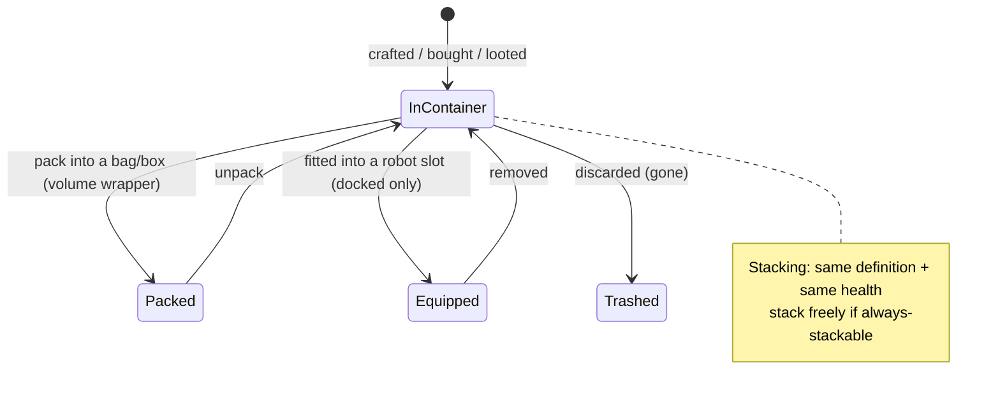

# 物品與庫存

您的**庫存**是一組**容器**（基地的公開容器、機器人的容器、袋子/箱子等）。本頁涵蓋容器內物品的操作。

> 介面位置請參閱[客戶端介面概覽](/zh-TW/features/ui/)。以下機制已與伺服器端確認。

## 容器

- **列出容器** — 檢視容器內容。
- **移動物品** — 在可存取的容器之間移動物品。

存取規則適用：部分容器（公司機庫、機器人庫存、系統容器）受限 — 請參閱[機器人](/zh-TW/features/robots/)和[群組](/zh-TW/features/groups/)。

## 打包與解包

- **打包物品** — 將物品放入袋子/箱子（「體積容器」）中以緊湊方式攜帶。
- **解包物品** — 將物品從袋子/箱子中取出。

打包也是**機器人**壓縮儲存/運輸的方式：伺服器會移除其動態狀態和組件，並標記為*已重新打包*。機器人只有在**未受損**、**未選取**、**未投保**且**庫存為空**時才能被打包。解包會重建並修復機器人。只有內容中標記為*可重新打包*的物品才能被打包；已重新打包的機器人在解包前無法被選取或安裝（請參閱[機器人](/zh-TW/features/robots/)）。

## 堆疊

許多物品可以堆疊。堆疊操作：

- **堆疊物品** / **堆疊至** / **堆疊選取** — 將同類物品合併為一疊（或將一疊移動到另一疊上）。
- **拆分數量** — 從一疊中拆出指定數量。

伺服器只會合併具有**相同定義和相同健康值**的物品。標記為*可自由堆疊*的物品（礦石、彈藥、大多數原材料）可自由堆疊；標記為*不可堆疊*的物品永遠無法堆疊；其餘物品**僅在已重新打包**（已打包）時才能堆疊 — 因此未打包、受損的裝備會保持獨立。

## 命名與使用

- **重新命名物品** — 為物品設定自訂名稱。
- **使用物品** — 啟用可使用物品（依情境而定；在區域中也可與區域物件互動 — 請參閱[採集](/zh-TW/features/gathering/)）。
- **使用抽獎物品** — 開啟/啟用抽獎式物品。

## 丟棄與補償

- **丟棄物品** — 丟棄物品（將被刪除）。
- **補償物品** — 管理員補償流程：建立物品並給予角色，記錄於交易日誌中。玩家無法直接呼叫此功能。

## 特殊物品

- **兌換券** — 列出、**兌換**或**啟用**兌換券（代碼/獎勵）。
- **禮包** — 列出並**兌換**禮包（物品組合包）。
- **開啟禮物** — 禮物包含一件從全伺服器戰利品池中隨機抽取的**隨機**物品（彈藥、原礦、等離子、研究套件、模組、膠囊、塗料、增益劑 — 共 221 種可能定義，各有其數量範圍）。

## 實用提示

- **存取權限依容器而定** — 您只能操作自己擁有或被授權的容器。
- **打包以攜帶更多** — 袋子/箱子讓您緊湊地搬運大量物品。
- **堆疊節省空間** — 合併同類物品；拆分以取出精確所需的數量。
- **丟棄是永久性的** — 已刪除的物品無法恢復。
- **兌換券/禮包為一次性** — 兌換後代碼/物品即被消耗。
- **已打包的機器人處於停用狀態** — 選取或安裝前請先解包。
- **僅已打包物品可堆疊** — 若同類物品無法合併，請先打包（或修復）它們。

<!-- TODO: only the inventory UI remains.
     Confirmed: stacking rules (Item.cs CanStackTo: same ED + same health; AttributeFlags
     alwaysStackable/nonStackable; others must be repackaged); pack rules (ItemPacker.cs:
     robot must be undamaged, not selected, not insured, empty inventory; repackable
     flag); unpack rebuilds + repairs (ItemUnpacker.cs); gifts = random draw from
     giftloots (221 defs: ammo x1500-2000, epriton/fluxore x600-1000, reactor plasma
     x10-20k, research kits, paints, capsules, named3 modules, boosters, respec tokens);
     goodie packs are campaign-based (GoodiePackRedeem: campaignID + indy selection);
     ReimburseItem = admin tool (opp_reimburselog). AttributeFlags bit positions:
     nonStackable=10, alwaysStackable=11, repackable, consumable=24, deployable=23.
     Developer notes: ListContainer.cs; RelocateItems.cs; PackItems.cs / UnpackItems.cs;
     StackTo.cs / StackSelection.cs / UnstackAmount.cs; SetItemName.cs; UseItem.cs /
     UseLotteryItem.cs; TrashItems.cs; ReimburseItem.cs (PbsReimburseRequestHander.cs);
     RedeemableItemList.cs / RedeemableItemRedeem.cs / RedeemableItemActivate.cs;
     GoodiePackList.cs / GoodiePackRedeem.cs; GiftOpen.cs. Container access:
     ContainerAccess / ContainerAccessChecker.cs. -->