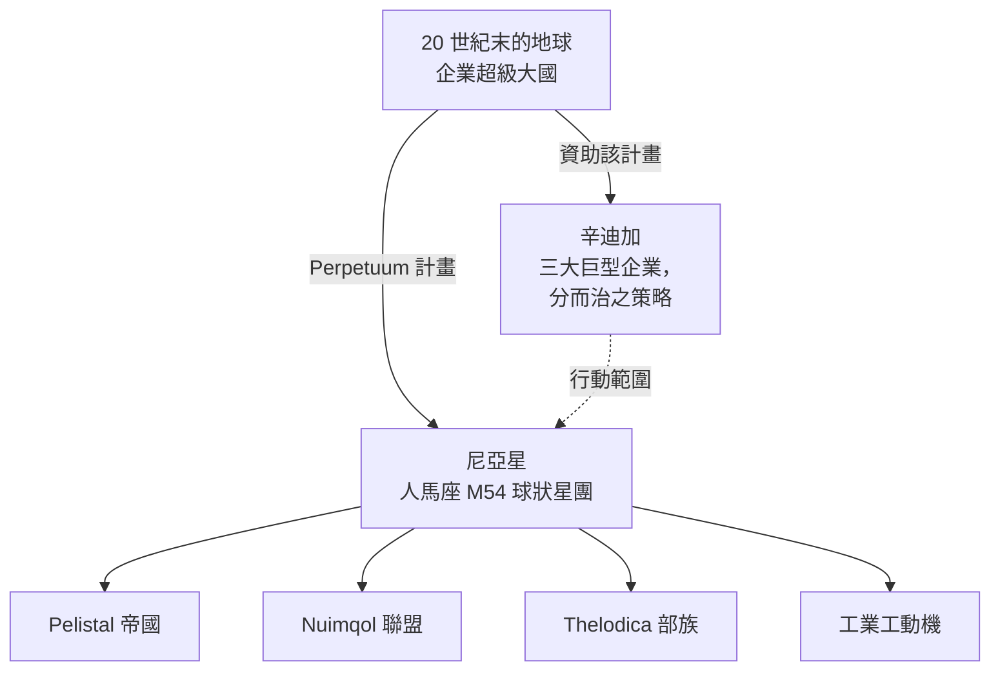

# 背景故事

## 尼亞星的發現

地球 20 世紀末的技術繁榮——網際網路、醫療 IT 融合、太空探索——打破了舊有的物理和心理邊界。通訊與貿易變得更加快捷廉價，各大企業巨頭成長為其所在區域事實上的政府。

在這樣的世界中，人類發現了人馬座 M54 球狀星團中的**尼亞星**（這也是該計畫標誌的來源）。尼亞星圍繞一對雙星中的一顆運行——是該恆星系統中的第四顆行星——且驚人地與地球相似：表面平均溫度約為 19 °C，大氣密度接近地球。但有兩個奇特之處使其與眾不同：其海洋對任何電力驅動的事物都是無法逾越的屏障——行星密集的地核與快速自轉使其始終帶有電荷——且地表僅約 17% 為陸地，快速的板塊構造運動不斷將其撕裂成島嶼。然而在這些陸地上，生命繁衍生息。

## 尼亞人

尼亞的居民顛覆了「生命形式」的常規概念：這是一種合成物種，其外形與我們的機器人並無二致，但組織成了各自獨立、技術高度發達的**社會**——每一個都擁有自己的工業、軍事和文化。對極度渴求能源的地球而言，最重要的成就是他們的**能源生產技術**。

三個外星種族在其領地的島鏈上為最終勝利而戰——**Pelistal 帝國**、**Nuimqol 聯盟**和 **Thelodica 部族**——其間夾雜著零星分佈的工動機**工業**人口（這正是你在遊戲中作為 [NPC](/zh-TW/features/npcs/) 遇到的四個群體）。

## 辛迪加

Perpetuum 計畫的主要投資者是**辛迪加**——由地球上最強大的三家巨型企業組成的聯盟，每家企業在地表營運各自的行動範圍：

| 企業 | 領地 |
|---|---|
| **Truhold-Markson** | 北美消費工業巨頭；正向日漸衰落的 **Pelistal** 領地推進。 |
| **ICS — 企業安全學會** | 歐洲-俄羅斯聯合會；在叛亂的 **Nuimqol** 領土內展開行動。 |
| **Asintec** | 亞洲工業霸主及其高科技鄰邦；正向 **Thelodica 部族** 發起全面進攻。 |

其策略正是古老的*分而治之*：保持三個領域的勢力平衡，讓外星力量互相攻伐而不是團結一致。人類「特工（Agent）」在地表工作——收割尼亞人的能源資源，研究他們的技術，並維持辛迪加所期望的秩序。

這正是你的用武之地。

<!--
開發者說明：2026 年根據正典設定以原創文字重新撰寫。
早期版本改寫自 Open Perpetuum 社群 wiki（perpetuum.miraheze.org: Discovery of Nia, Nia, Syndicate）；該文字已被完全替換，未被重用。
與後端的一致性：三個外星種族 + 工業與 NPC 種族相符（見 /zh-TW/features/npcs/）；企業名稱與區域縮寫相符（zone_ICS、zone_ASI、zone_TM —— /zones/ 中的 Beta 級區域以其巨型企業命名）。
-->
