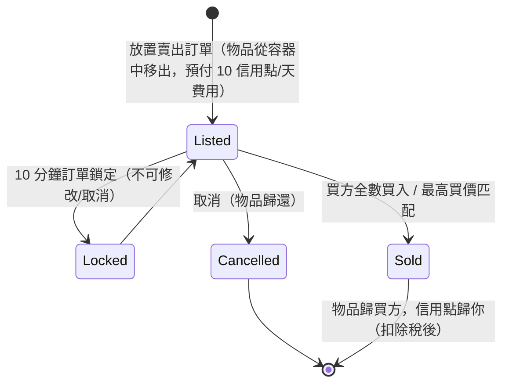

# 市場與交易

**市場**是你在基地中買賣物品的地方。所有市場操作均為**僅限停泊**（你在所停泊的基地進行交易）。

> 介面位置請參閱[客戶端介面概覽](/zh-TW/features/ui/)（頂部工具列的**市場**分類）。以下機制已與伺服器端確認。

## 市場訂單

你在目前基地的市場上放置兩種訂單：

### 賣出訂單
將物品上架出售。
- 選擇**物品**、**數量**、**單價**和**持續天數**（最少 1 天）。
- 物品會從你的容器中取出（若只出售堆疊中的一部分，則會拆開堆疊）。
- **上架費** — 你需預付 `10 信用點 × 持續天數`（可透過*市場交易費*擴充功能降低）；費用歸入基地的中央銀行（區域利潤池）。
- **價格保護** — 啟用時，你的價格必須落在該物品**14 天平均價格**的 **±30%** 範圍內；超出範圍的價格將被拒絕。*（此保護機制目前在該伺服器上已**停用**。)*
- **訂單鎖定** — 訂單放置後 **10 分鐘**內不可修改或取消。
- **訂單數量** — 你可同時持有 1 +（*市場賣出訂單專家*擴充功能）筆未完成的賣出訂單（買入訂單有獨立的計數器）。
- **限本公司** — 你可將賣出訂單限制為僅限本公司成員（僅適用於非預設公司）。
- 視情況從你的**個人**或**公司**錢包付款。

### 買入訂單
放置一個常駐訂單，以指定價格購買物品。
- 當市場出現匹配的賣出訂單時，系統將自動成交。

### 管理訂單
- **修改訂單** — 更改價格/數量/持續天數。
- **取消物品 / 訂單** — 撤回（物品歸還至你的容器）。
- **我的物品** — 查看你未完成的訂單。
- **最高買價匹配** — 賣出訂單可路由至現有的買入訂單。

## 直接購買

- **購買物品** — 立即購買市場上現有的物品（無需常駐訂單）。

## 瀏覽市場

- **物品列表 / 可用物品 / 範圍內物品** — 瀏覽在售物品。
- **市場資訊** — 關於該基地市場的詳細資訊。
- **平均價格** — 市場平均價、每定義平均價和**全球**平均價。這些是價格保護的依據。

## 市場稅

- **變更市場稅** — 設定市場的稅率。僅**PBS 基地市場**由玩家控制；其他地區適用固定預設值。
- **稅務日誌** — 檢視稅率變更記錄。

稅款從**賣方**在市場出售時收到的金額中扣除。預設稅率為**12%**（賣方獲得售價的 88%）；稅率可透過*市場交易稅*擴充功能降低，在玩家控制的市場上，也可由 PBS 擁有者設定自訂稅率。

## 玩家間直接交易

**交易**是兩個已停泊角色之間的點對點交換：

- **開始交易** — 與另一名玩家開始交易會話。
- **設定 / 撤回我的報價** — 在你的這邊放入物品/信用點。
- **接受** — 雙方都接受後，交換將原子性地完成。
- **取消** — 中止交易。
- **交易完成 / 狀態** — 完成狀態與目前狀態。

角色可以**封鎖交易**（見[入門指南](/zh-TW/features/getting-started/)）。

## 物品商店

**物品商店**是基地中的固定價格供應商（非玩家驅動）。完整目錄（所有物品、數量、各貨幣價格、聲望要求）生成於[物品商店](/content/shop/)。

- **列表** — 查看商店販售的物品。
- **購買** — 以信用點購買物品。

## 轉帳信用點

- **轉帳信用點** — 在你自己的角色之間轉帳（見[入門指南](/zh-TW/features/getting-started/)）。

## 實用提示

- **一切僅限停泊** — 你無法在區域中交易。
- **將 12% 稅率納入定價考量** — 賣方預設收到掛牌價格的 88%（高稅率 PBS 市場上更少）。
- **上架費為預付制** — 長時間上架即使第一天就賣出，費用也更高。
- **限公司訂單**是在公司內部調動物資而不公開曝光的方式。
- **交易具有原子性** — 雙方都必須接受，否則什麼都不動。
- **稅率變更影響實際成本** — 將市場稅率納入你的定價考量。

<!-- TODO: only the client UI remains (market and trade screen flows).
     Confirmed: MarketInfoService(0.3, 10, false) registered in
     PerpetuumBootstrapper.cs -> margin +-30% vs 14-day average (MARKET_AVERAGE_DAYSBACK
     14), fee 10 credits/day (Market.MARKET_FEE), CheckAveragePrice=false on this
     server; DEFAULT_MARKET_TAX = 0.12 (seller gets 88%), player-controlled tax only on
     PBSDockingBase markets (MarketTaxHelper); order modify/cancel locked 10 min after
     submit (MARKET_CANCEL_TIME); order count = 1 + expert extension bonus;
     fee paid up front to the base's central bank. -->
     Developer notes: Markets/MarketCreateSellOrder.cs (docked, price guard vs average
     price, corp-only, unstack, corp wallet), MarketCreateBuyOrder.cs,
     MarketModifyOrder.cs, MarketCancelItem.cs, MarketBuyItem.cs, MarketItemList.cs,
     MarketAvailableItems.cs, MarketItemsInRange.cs, MarketGetMyItems.cs,
     MarketGetAveragePrices.cs / MarketGetDefinitionAveragePrice.cs /
     MarketGlobalAveragePrices.cs, MarketTaxChange.cs / MarketTaxLogList.cs;
     Trade*.cs (begin/offer/accept/cancel, atomic); ItemShopList.cs / ItemShopBuy.cs;
     CharacterTransferCredit.cs. -->