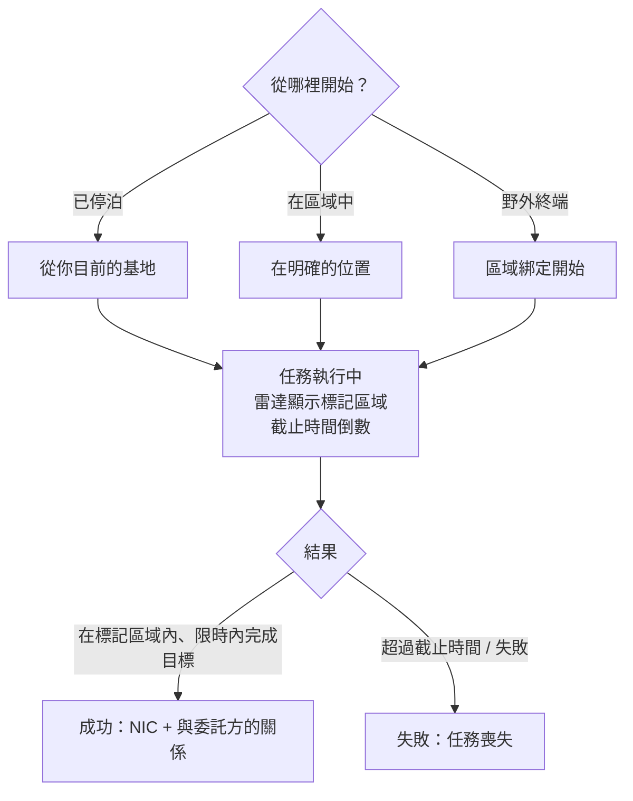

# 任務

**任務**是你在區域中接取的結構化目標——交付物品、擊中目標、使用結構。它們是你推進進度、獲得獎勵的方式，也是驅動大量區域內容的核心（警報、服務亭以及部分 PBS/運輸掛鉤均與任務相關）。

> UI 位置請參閱[客戶端 UI 概覽](/zh-TW/features/ui/)。以下機制已與伺服器端確認。

## 開始任務

你透過選擇一個**類別**和一個**等級**（等級會被限制在有效範圍內），在一個**位置**開始任務：

- 如果你**已停泊**，任務從你目前基地的位置開始。
- 如果你**在區域中**，你需要明確指定位置。
- 任務也可以直接**從區域**開始（區域綁定開始）或**從野外終端**開始。

並非每個類別/等級在所有地方都可用——可用性由內容驅動。完整的任務列表（類型、類別、等級、持續時間、獎勵費用及獎勵物品）生成於[任務](/content/missions/)。

## 任務的用途

任務同時服務兩個目的：支付 NIC，以及建立你與發出方（委託方）公司之間的**關係**。更好的關係是獲得該公司終端**更高設施比率**的關鍵因素——生產和其他設施運行對你來說會更便宜、更快。關係也可能*下降*：某些任務與另一家公司的利益衝突，任務簡報會標註何時會因此損失你的聲望。

- **訓練任務**——簡單，為新手標記高亮；全部完成，獎勵是早期不錯的注入。
- **常規任務**有三種類型：
  - *戰鬥*——偵察（掃描敵方機器人）、賞金獵殺（在標記圓圈內擊殺目標）、摧毀與回收（擊殺 + 取回 + 交付）、偵察與回收、特殊賞金（難以到達的目標）。
  - *工業*——地質勘探（用正確的電荷掃描礦物）、採集、礦物開採、專業開採（有守衛的挖掘點——帶武裝後援）。
  - *物流*——運輸（在終端之間交付包裹）和取回（一個大包裹穿越危險地帶——護衛它）。
- 不存在**安全任務**：如果你在路線上看到敵人且缺乏自衛裝備，在失去一切之前先求助。
- **目標只在標記區域內計數**——任務地圖會在雷達上以紅色圓圈標記；在其他地方的擊殺和掃描一概不計。超過截止時間，任務立即失敗。
- **私人運輸合約**——由辛迪加運作的系統（任務視窗的第二個分頁），玩家發布容器讓其他玩家在終端之間運輸，有固定獎勵和運輸者需押上的**抵押品**（成功退還，容器被毀則損失；中途中止僅退還一半）。保持容器足夠小，讓別人真的能搬得動。

## 任務資料與選項

- **任務資料**——任務的詳細資訊。
- **任務選項**——任務可用的選擇/變體。
- **任務補給**——任務涉及的補給品。
- **起始物品**——任務開始時持有的物品。

## 執行任務

- **列出進行中的任務**——你目前正在做的事情。
- **中止**——取消你正在執行的任務。
- **新增參與者**——將另一個角色加入任務（多人任務）。
- **任務日誌**——任務的事件日誌。

## 交付

- **交付**——完成一個交付目標。這可以**已停泊**時（在基地）或**在區域中**（在特定位置/eid）完成，取決於任務。

## 代理人

- **列出代理人**——可用的任務代理人（發布任務的 NPC/派系）。

## 野外終端

- **野外終端資訊**——檢查區域中的野外終端（一種可以開始或服務任務的結構）。

## 實用筆記

- **任務是連接組織**——警報、服務亭和部分結構都是任務物件（參見[採集](/zh-TW/features/gathering/)和[戰鬥](/zh-TW/features/combat/)）。
- **多人合作**——你可以新增參與者來合作完成任務。
- **交付情境很重要**——某些交付需要你已停泊，某些需要你在區域位置。
- **等級會被限制**——請求超出範圍的等級會被修正，不會報錯。
- **中止是你的退路**——如果任務變糟，中止它。

## 任務結構

任務透過**結構**錨定在區域中。伺服器實現了以下類型：

| 結構 | 功能 |
|---|---|
| **簡單開關** | 即時互動——靠近即完成任務目標 |
| **警報開關** | 計時任務——在範圍內停留一段時間（來自任務選項），每 2 秒檢查一次 |
| **物品供應** | 類似警報開關的計時，然後**將物品生成到你的機器人容器中** |
| **服務亭** | **物品提交**點——向任務交納所需物品 |

<!-- TODO: the full mission list, categories, level ranges and rewards are generated at
     /content/missions/. Verified: mission structure types
     (MissionEngine/MissionStructures: SimpleSwitch, AlarmSwitch, ItemSupply, Kiosk);
     verify the mission UI.
     Developer notes: Missions/MissionStart.cs (category, level clamp, docked vs zone
     location), Missions/MissionDeliver.cs (docked vs zone delivery), MissionAbort.cs,
     MissionData.cs / MissionGetOptions.cs / MissionGetSupply.cs / MissionStartItems.cs,
     MissionListRunning.cs / MissionListAgents.cs / MissionLogList.cs,
     MissionPlayerAddsParticipant.cs, FieldTerminalInfo.cs, MissionStartFromZone.cs;
     Services/MissionEngine/* (MissionProcessor, mission structures incl. AlarmSwitch,
     Kiosk). -->