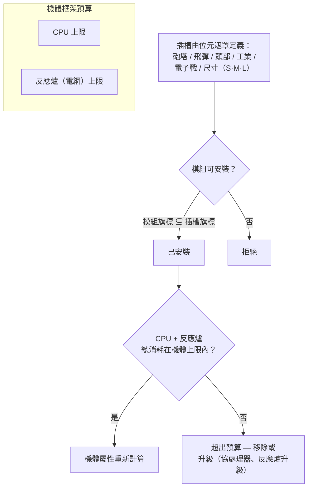

# 模組與配置

「買一台機器人只買到了機體。」用模組來武裝它，才是讓機器人成為你所需要的那個樣子的關鍵。*配置*（fitting）既指模組的載具搭配（「把你的配置發給我」），也指它所消耗的 CPU／反應爐預算。

## 插槽與資源

機器人的機體擁有一組固定的**插槽**，由其底盤定義。每個插槽由位元遮罩標記類型——砲塔、飛彈發射器、頭部、工業、電子戰／工程、尺寸（小型／中型／大型）——模組只有在自身類型遮罩是插槽遮罩的子集時才能安裝。因此，投射型機體上的砲塔插槽可接受小型、中型*或*大型砲塔模組，但飛彈發射器永遠無法裝入砲塔插槽。頭部模組（協處理器、調校模組）和機體／腿部模組（護甲板、框架）佔用各自專屬的插槽。

每個模組都會從機體抽取**CPU**和**反應爐**（電網）——所有已安裝模組的總消耗必須低於兩項上限，部分模組還會每循環抽取**蓄能器**（核心）。剩餘容量即為配置視窗中顯示的*可用輸出*。各級機體的大致規模（T1/T2/T3 範例）：

| 機體等級 | CPU | 反應爐 | 範例 |
|---|---:|---:|---|
| 小型爬行者 | ~250 | ~140 | Castel |
| 輕型機甲 | ~480 | ~300 | Waspish |
| 重型機甲 | ~1 100 | ~1 000 | Tyrannos |
| 步行者 | ~3 200+ | ~1 100+ | Gropho |

當容量不足時：**CPU**——協處理器模組（例如 T3 協處理器提供 +20% CPU）或 T2 模組變體（較低消耗）。**反應爐**——反應爐升級（例如 T3 提供 +20% 反應爐輸出）或反應爐密封（降低輻射，同時也能保護你免受能源戰傷害——見下文）。

## 模組家族

各型號的具體數值見[物品目錄](/content/)和[格式參考](/zh-TW/formats/)；以下是家族總覽。

### 武器與彈藥

四種武器技術，各有其彈藥和距離特性：

| 武器 | 彈藥 | 距離特性 | 備註 |
|---|---|---|---|
| **火器** | 子彈 | 短最佳射程，劇烈衰減 | 投射物*從不偏離*——但其「精度」作用為範圍半徑，因此小型目標在寬散佈下仍會受到減損傷害。 |
| **磁軌（軌道槍）** | 彈丸 | 中程，急劇衰減 | 高衝擊速度；大量能量消耗。 |
| **雷射** | 能量電池 | 遠程 | 能量消耗最高；集中光束。 |
| **飛彈** | 飛彈 | 遠程 | 命中或偏離由*機器人*的命中機率屬性決定，而非距離。傷害隨目標尺寸相對於爆炸半徑的比例縮放——大型飛彈對小型目標傷害大幅降低。 |

傷害隨距離沿平滑餘弦曲線衰減：最佳射程處為滿傷，最佳射程 + 衰減距離處歸零（見[傷害衰減](/zh-TW/features/combat/#shang-hai-lei-xing)）。

彈藥是調整傷害的關鍵：主傷害 + 副傷害類型可針對目標微調（見[傷害類型](/zh-TW/features/combat/#shang-hai-lei-xing)）——代價是總傷害略低於純主傷害彈藥。

砲塔分小型／中型／大型；**尺寸須與機器人匹配**（小型機器人裝小型模組，機甲和重型裝中型／大型）。

### 防禦

- **護甲板**——主要生命值池；護甲歸零時機器人爆炸。**LWF**（輕量框架）護甲板以耐久性換取速度：T2 LWF 護甲板將護甲乘以約 0.73，但提供 +19% 速度、−0.2 特徵值和 −0.2 質量。
- **護盾產生器**——由蓄能器供能的屏障，在護甲之前吸收傷害。護盾消耗*你自己的核心*來吸收：一記本應造成 100 傷害的攻擊，在 2× 護盾下消耗 50 核心而非 100 護甲。護盾激活期間你自己的武器無法開火。吸收品質隨護盾半徑相對於你的特徵值的比例縮放——大型護盾在小型機體上效果最佳。
- **護甲修復**——主動修復模組（小型／中型／大型）；**遠端護甲修復**可作用於已鎖定的目標（隊友或 PBS），但射程較短且循環時間較長。
- **護甲強化器**——被動抗性點，按傷害類型區分（化學／動能／熱能／爆炸變體）。
- **適應性合金**——被動模組，會*學習*所承受的傷害構成，並將固定池的抗性點重新分配至你被命中最多的類型。
- **迴避／機動**——特徵值降低模組和 NEXUS（見下文）使目標變小：減少範圍效果傷害，且更難被鎖定。

### 能源

- **反應爐**——持續輸出上限；反應爐升級提高上限，反應爐密封降低輻射（減少受到的能源戰傷害，代價是少量反應爐輸出）。
- **蓄能器（核心）**——爆發能量儲備，為模組循環供能。隨時間充能（機體 `core_recharge_time`，T1 爬行者約 120 ms）；**蓄能器充電器**加速充能。
- **能量注入器（核心增幅器）**——消耗一次充能立即補滿蓄能器。
- **能量傳輸器**——以光束將核心從你的機器人傳輸至已鎖定的隊友（玩家無法對 NPC 使用光束）。

### 電子

- **感測器增幅器**——被動，自身：縮短你的鎖定時間並延伸你的鎖定範圍。
- **遠端感測器增幅器**——主動，目標：將相同增幅施加於已鎖定的隊友，持續約 10.5 秒。
- **協處理器**——提高機體的 CPU 上限（T1 +10% … T3 +20%）。
- **武器穩定器**——提升武器精度（縮小有效範圍半徑）並略微減少質量。
- **調校模組**（頭部插槽）——對特定家族的固定加成：傷害調校（T3 時每武器家族 +25% 傷害）、採礦升級（T3 時 +10% 採礦和採集）、修復器升級（T3 時 +16% 修復、−8% 循環）。

### 電子戰（EWar）

讓敵人又盲又聾：

- **感測器衰減器**——遠程減益：延長目標的鎖定時間並削減其鎖定範圍，持續約 5.5 秒。僅在你的 ECM 強度勝過目標的（隨機化）感測器強度時生效。
- **感測器干擾器**——即時：在 ECM 判定成功時重置目標的*所有*鎖定。
- **ECCM（電子反反制）**——自身增益，持續 20 秒：提高感測器強度和鎖定抗性，並*解除*受 ECM 影響的減益（衰減器、網狀抑制）。
- **神經分析器**——重置**所有**在約 1.65 km 內玩家的鎖定。一個恐慌按鈕。

反制手段：感測器強度（機體）、ECCM，以及保持距離。

### 隱形與偵測

- **隱形模組**——約 10.5 秒隱形；消耗隨你的特徵值半徑縮放（機體越大，核心消耗越快）。
- **目標標記器**——約 10.5 秒減益，剝除目標的隱形強度。
- **偵測模組**——被動提升你的偵測強度。

偵測強度與隱形強度的對比決定你能否看到（並鎖定）隱形目標——見[偵測與遮蔽](/zh-TW/features/combat/#zhen-ce-yin-bi-yu-su-du)。

### 能源戰（EnWar）

抽取或切斷敵人的能量：

- **能量吸取器（能量吸血鬼）**——從已鎖定的目標抽取核心並加入你自己的蓄能器。
- **能量中和器**——相同機制，但被抽取的核心會被摧毀。
- 兩者都會被目標的**反應爐輻射**削弱——密封是真正的反制手段。
- **行動抑制器（網狀抑制）**——對目標造成約 5.5 秒的速度降低；效果隨目標質量縮放（重型機體減速較少），且對超出模組最佳射程的目標無效。
- **灼燒器**——一種*鏈式*電弧武器，最多鏈接 5 個目標，以穿透傷害同時命中護盾和護甲。

### 工業

- **鑽探器**（小型／大型）和**採集器**（小型／大型）——採集模組；產量、循環時間和蓄能器消耗是關鍵屬性。採礦可獲得 EP（有每日上限和液體懲罰）。
- **地質掃描器**——以探針精度掃描周圍的礦物場；結果是地下資源的地圖（見[採集](/zh-TW/features/gathering/)）。
- **開採器**——光環模組：提升附近單位的採礦／採集產量（T3：+50%），代價是隱形。
- **地形改造**（伽瑪區域）——地形鎖定，可抬升、降低或平整地面（最大半徑 5 m）並生長牆壁植物；見[區域章節](/zones/zone-gamma-z106/)。
- **遠端控制器**——拴在繩上的砲塔和無人機：每個控制器模組攜帶頻寬（數量）、作業範圍和無人機壽命（依等級 5–10 分鐘）。變體：戰術型（傷害／循環）、突擊型（傷害）、支援型（遠端修復）、工業型（採礦／採集無人機）、獵手型。**遠端指令轉譯器**模組可放大無人機傷害、護甲、採礦產量和修復輸出（T3：各 +7.5%），並可延伸控制器的頻寬。

### NEXUS

網路化擴展利用系統：**隊伍增益**。NEXUS 模組在自身機器人周圍發射光環，為光環半徑內的**隊伍成員**（及其砲塔／無人機）提供增益——預設 10 m，每 10 秒可刷新。規則：

- 一台機器人最多攜帶 **3 個 NEXUS 光環**，且每種類型最多**一個**；
- 光環僅作用於你**隊伍**中的單位，而非隨機隊友。

T3 類型列表（13 種）：速度、護甲、護盾、遠距鎖定（鎖定範圍）、鎖定增幅（鎖定時間）、暴擊、突擊（武器循環）、電子戰（EWar 範圍）、迴避（特徵值）、修復、工業（採集時蓄能器消耗）、快速採集（採集循環）、充能（核心充能）。每個 T3 模組大約提供其屬性的 +7.5%；例如速度 NEXUS 將 10 m 內每位隊友的最高速度乘以 1.075。

### NOX

邪教級反制手段：**否定器**模組，可*禁用*其半徑內的敵人模組——**護盾否定器**（削減護盾吸收約 90%）、**修復否定器**（削減修復輸出）和**傳送否定器**（阻斷傳送）。每次激活都會**消耗貨艙中的等離子體**，且在開放（非訓練）區域使用會**將你的角色標記為 PvP**。

### 特殊用途

- **圍城駭入模組**——主動 SAP 工具：5 秒循環，3 m 射程（見[前哨站](/zh-TW/features/outposts/)）。
- **自毀裝置**——啟動 8 秒倒數計時；光束在 600 m 內可見。最後手段的清理工具。
- **地雷偵測器**——延伸機體的地雷偵測範圍。
- **膠體發射器**——部署一個發射器擴散膠體場；發射調校模組可調整該場（見[戰鬥](/zh-TW/features/combat/)）。
- **PBS 建造**——用於在伽瑪區域放置 PBS 結構的模組。

## 經驗法則

1. **別混用武器。** 磁軌 + 雷射 + 飛彈裝在同一台機器人上通常三者皆不濟；短程和遠程混用很少有好結果。
2. **注意質量。** 每塊護甲板和護盾模組都會增加質量和特徵值——有時速度比防禦更重要。
3. **別什麼都做。** 一台同時採礦、掃描和射擊的機器人，每樣都做不過專精型。
4. **模組尺寸須與機器人匹配**，並預留少量 CPU／反應爐餘量給讓配置真正運作的調校模組。
5. ……是的，某些小眾配置打破以上所有規則卻依然有效。只要花點心思去想。

<!--
開發者註記：2026 年從後端來源重寫；未重用任何社群 wiki 文字。
已核對以下來源：
- src/Perpetuum/Robots/RobotComponent.cs（插槽位元遮罩配置：moduleFlagMask & slotFlagMask）
- src/Perpetuum/Modules/SlotFlags.cs（12 個插槽旗標位）
- src/Perpetuum/Modules/Weapons/WeaponModule.cs + FirearmWeaponModule.cs +
  MissileWeaponModule.cs（精度：火器從不偏離，爆炸半徑來自 Accuracy；飛彈使用
  ParentRobot.MissileHitChance）
- src/Perpetuum/Modules/Weapons/Damage.cs（餘弦衰減，暴擊 1.75x ±10%，
  爆炸縮放 signature/explosionRadius 限制於 [0,1]）
- src/Perpetuum/Units/Unit.cs GetResistByDamageType（resist/(resist+100)）
- src/Perpetuum/Zones/DamageProcessors/DamageProcessor.cs（護盾消耗核心，
  電弧 = 穿透）
- src/Perpetuum/Modules/EffectModules/ShieldGeneratorModule.cs（吸收修正值 =
  shieldRadius 比例 / shieldAbsorbtion；WeaponModule.cs:112 在 HasShieldEffect
  時阻斷開火）
- src/Perpetuum/Modules/EffectModules/{Webber,SensorDampener,SensorBooster,
  Stealth,TargetPainter,Eccm,Detection,AdaptiveAlloy}.cs（持續時間來自
  effects 表：衰減器／網狀抑制 5.5s，隱形／標記／遠端增幅 10.5s，ECCM 20s）
- src/Perpetuum/Modules/SensorJammerModule.cs + Neuralyzer.cs（鎖定重置，
  NEURALYZER_RANGE=1650）
- src/Perpetuum/Modules/{EnergyVampire,EnergyNeutralizer,Scorcher,
  CoreBooster,EnergyTransferer}.cs（能源戰，反應爐輻射修正值，鏈式）
- src/Perpetuum/Modules/GangModule.cs + Zones/Effects/GangEffect.cs +
  EntitiesModule.cs:532-544（13 種光環類型，僅限隊伍成員，effects 表
  auraradius=10）
- src/Perpetuum/Modules/NoxModule.cs（等離子體消耗，PvP 標記）
- src/Perpetuum/Modules/RemoteControl/*（頻寬／範圍／壽命，轉譯器放大）
- entitydefaults 行：named1-3 護甲板／強化器，護盾產生器
  （absorbtion 2.0-2.3，radius 5-33），LWF（mass_reductor），cpu/powergrid
  升級，傷害／採礦／修復調校，NEXUS named3 數值，NOX 邪教數值，圍城駭入
  （5s/3m），機體 core_max/powergrid_max。
與原始頁面的修正：NEXUS 光環僅作用於隊伍成員（非「所有友方單位」）；
不存在「共反應爐」模組（反應爐升級／密封承擔此功能）；行動抑制器效果
隨目標質量縮放，無「抗性屬性」；感測器抑制器 = 感測器衰減器（5.5s 減益）。
-->