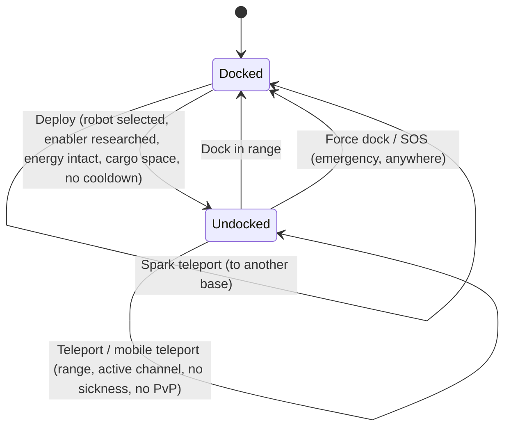

# 移動與區域

你始終處於兩種狀態之一：**停泊**在基地，或**未停泊**在區域中遠程操控你的活躍機器人。本頁所有內容都是關於在這兩種狀態之間以及不同區域之間移動。

> UI 位置請參閱[客戶端 UI 概覽](/zh-TW/features/ui/)：**部署/停泊按鈕**是頂部工具欄中央的切換按鈕。以下機制已與伺服器端確認。

## 停泊與未停泊

- **停泊** — 你位於基地中。你的機器人和物品存放在容器內。你無法操控機器人、使用傳送或掃描，但可以進行製造、交易、研究以及使用基地設施。
- **未停泊** — 你處於區域中，正在操控你的活躍機器人。你可以移動、掃描、戰鬥並與區域物件互動，但大多數僅限基地的活動會被鎖定。

## 出港（未停泊）

按下**部署**（頂部工具欄中央）。伺服器將檢查以下所有條件：

1. 你已選擇一個**活躍機器人**。
2. 該機器人的類別所需的**啟用擴展**已在你的角色上研究完成（參見[研究](/zh-TW/features/research/)）。
3. 該機器人的**能量系統完好無損**。
4. 該機器人的**容器有空餘容量**。
5. 你不在**出港冷卻**中（某些事件後的短暫計時器）。

如果任何檢查未通過，出港將被拒絕。

## 返回停泊

- **停泊** — 當你在基地的停泊範圍內時，可以停泊。
- **強制停泊** — 緊急操作：它會將你從區域中拉出並立即停泊在主基地（TMA），即使在戰鬥中也是如此。在戰鬥失利時使用。
- **SOS** — 區域求助操作，將你停泊在當前基地並標記該事件。

## 區域進入排隊

某些區域較為繁忙，在你出港/進入時會使用**進入排隊**：

- 查看排隊狀態（`zoneGetQueueInfo`）。
- 設定你偏好的排隊長度（`zoneSetQueueLength`）。
- 改變主意時取消等待（`zoneCancelEnterQueue`）。

## 傳送

**傳送**是區域內的結構。使用條件如下：

- 你必須**在傳送的範圍內**。
- **頻道**（目的地）必須**處於激活**且有效狀態。
- 你必須**未處於** *傳送暈眩* 狀態 — 任何傳送後的短暫冷卻，期間無法再次傳送。
- 某些效果（例如 *Nox* 否定）或處於 **PvP 戰鬥**中可能阻擋傳送。

傳送頻道分為三種類型：

| 類型 | 效果 |
|---|---|
| **區域內** | 將你移動到同一區域的隨機點 |
| **其他區域** | 將你移動到不同區域的隨機點 |
| **訓練出口** | 退出訓練區域（可選擇獎勵等級） |

**移動傳送**是*所有權*傳送物品（例如移動堡壘/世界傳送）。額外規則如下：

- 只有**所有者或所有者幫派成員**可以使用。
- **PvP 期間無法使用**。
- 每次使用都會對該傳送施加**冷卻**。

你可以列出傳送及其頻道，並查詢全球頻道。

## 火花傳送

**火花傳送**是基地之間的快速旅行系統：

- 你在一個基地**設定**火花目的地，然後（在停泊狀態下）**使用**它瞬間跳轉到另一個基地。
- 你可以**列出、設定、使用和刪除**你的火花傳送。
- 目標基地必須**允許你停泊**。
- 到達時，伺服器會為你選擇一個合適的機器人（即你已研究其啟用擴展的機器人）。
- **你可持有的火花傳送數量**受擴展限制（參見[研究](/zh-TW/features/research/)）；超出上限將被拒絕。

## 閘門

**閘門**是區域結構，可從任何位置使用（不像傳送有範圍限制）。基地所有者可以**重新命名**其閘門。

## 基地資訊

你可以檢視任何基地：

- **資訊** — 它是什麼以及在哪裡。
- **所有權** — 誰擁有它。
- **設施** — 它提供什麼（生產、市場、商店……）。
- **我的物品** — 你儲存在該基地的物品。
- **停泊權限** — 基地所有者可以設定誰可以在該處停泊。

## 可能出現的問題

| 症狀 | 可能原因 |
|---|---|
| 出港被拒絕 | 無活躍機器人、缺少啟用擴展、能量系統損壞、機器人容器已满、或出港冷卻中 |
| 傳送被拒絕 | 超出範圍、頻道未激活、傳送暈眩、Nox 效果、或處於 PvP 中 |
| 移動傳送被拒絕 | 非所有者/幫派成員，或處於 PvP 中 |
| 火花傳送被拒絕 | 目標基地禁止停泊、無有效機器人可選、或達到火花傳送上限 |
| 卡在區域入口 | 區域排隊 — 查看排隊狀態或取消 |

<!-- TODO(Phase 1): verify client UI flow (dock/undock buttons, teleport screen).
     Developer notes: Dock.cs / Undock.cs / ForceDock.cs (TMA = baseEid 561) /
     ZoneSOS.cs; Zone/TeleportUse.cs (TeleportPlayerValidator, three
     TeleportDescriptionType strategies, mobile-teleport gang/PVP rules);
     Sparks/SparkTeleportUse.cs (docked-only, extension-count limit);
     Zone/ZoneCancelEnterQueue.cs + ZoneEnterQueueService; GateSetName.cs. -->