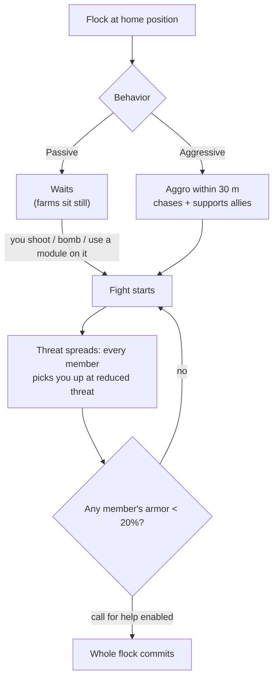

# NPC 與 PVE 狩獵

NPC 是遊戲中主要的[反應堆等離子體](/content/ores/)、
[核心](/zh-TW/features/research/)和模組來源，也是任何等級下獲取拓展點
的可靠方式。它們以**群組**形式存在：共享一個家
位置、活動範圍、重生時間和行為模式的群體。

## 有哪些 NPC

NPC 分為四個種族——**Nuimqol、Pelistal、Thelodica 和工業**——
每個種族有多種機器人類型（奔跑者、爬行者、機甲、重機甲）和
1–5 級，等級越高屬性和掉落越好。除了常規等級外：

- **哥布林** — 保護島上的 EWar 守衛。脆弱，但他們的
  鎖定修正極端（鎖定速度比正常快約 5 倍，鎖定距離遠約 2 倍）：哥布林營地會讓你附近戰鬥或採礦變得痛苦。
- **精英** — 常規等級 NPC 的稀有變體，基礎屬性約翻倍，
  掉落更好。
- **觀察者** — 巡邏型、主動攻擊的 NPC（Arbalest、Baphomet、Waspish、
  Tyrannos、Artemis、Kain、Gropho、Sequer、Seth、Mesmer…）。它們巡邏島嶼的
  大部分區域，比同類型的常規等級 NPC 明顯更難——保護島上的*大型*觀察者及其開放島
  變體是最強的常規狩獵目標。
- **頭目** — 稀有、個別配置的 NPC。它們從不逃跑，可以
  全伺服器廣播，有些與前哨站綁定（擊殺它們會移動
  [前哨站穩定度](/zh-TW/features/outposts/)）或擊殺時生成遺跡裂隙。較弱的頭目可在保護島上單人擊殺；最強的
  需要專門的團隊。
- **辛迪加生成** — 一個特殊陣營（辛迪加，擁有自己
  命名的 NPC），運營自己的靜態農場，通常在保護島和
  淺層開放島上。

## 被動與主動

- **被動群組**從不主動攻擊——你必須先對它們開火、投彈或
  使用主動模組。大多數經典靜態農場都是被動的。
- **主動群組**在你進入 **30 米**範圍內時會主動攻擊，
  追擊你，並支援正在戰鬥的盟友。所有觀察者、大多數巡邏
  生成和前哨站守衛/入侵者都是主動的。

戰鬥開始時，**威脅會在群組中傳播**：每個成員都會以降低的威脅值
鎖定你，如果任何成員的護甲低於 **20%**，
整個群體都會全力對付你（對於啟用了呼叫支援的群組）。假設你
在第一個機器人開火的那一刻就在與整個生成群戰鬥。

## 生成與重生

- **靜態生成**固定在一個家位置，有活動範圍；成員
  **各自獨立**按自己的計時器重生。被大量狩獵的群組
  重生更快；新的群組重生更慢。
- **巡邏生成**在島嶼上移動——它們是觀察者和
  護衛隊型群組，通常為主動型。
- **採礦點增援** — 在資源節點工作的工業 NPC
  有預配置的增援波次：戰鬥持續越久，
  更多波次會到達節點。頭目受損時也會呼叫增援。
  所以一個「單機器人」農場可能變成群體戰鬥；在投入前
  先檢查周圍區域。

## 掉落物品

掉落按 NPC 類型配置：**島嶼種族的反應堆等離子體**、
**核心**（普通、高科技、工業和種族專屬）、模組組件
以及較少見的打包模組。更高等級和特殊類型掉落更多。

每次擊殺也會獲得**拓展點**，按 NPC 類型配置——
在開放（Beta 級）島嶼上翻倍。

## 區域等級獎勵

島嶼分為三個等級——保護（Alpha）、開放 PvE（Beta）和開放
PvP（Gamma）。狩獵會更危險，但獎勵也更豐厚，越深入越明顯：

- **死亡爆炸** — 在保護島上，機器人死亡*不會*
  爆炸。在開放島嶼（Beta 和 Gamma）上，每個被摧毀的機器人——玩家
  或 NPC——都會爆炸並造成範圍傷害。連鎖爆炸讓狩獵
  效率更高，伏擊點更致命。
- **翻倍 EP** — 所有活動的基礎 EP 獎勵在 Beta 級
  島嶼上翻倍。
- **更好的任務** — 更高級的任務在開放島嶼上，
  其任務 EP 也翻倍。
- **陣營任務硬幣** — 開放島嶼上的任務支付該種族的
  任務硬幣（Nuimqol / Pelistal / Thelodica 硬幣）而非通用
  硬幣。陣營硬幣也可以在開放島嶼終端機直接兌換，
  通用硬幣可以在陣營硬幣無法購買的地方購買。

## 實用提示

- **交戰前先檢查群組** — 數成員數量、注意等級和
  生成是否為主動型；你走進去的一個被動農場可能
  有五個機器人。
- **保持距離** — 靜態生成留在活動範圍內；選擇
  清晰的遠距離射擊位置通常是成本最低的勝利方式。
- **資源點是陷阱** — 採礦點增援意味著
  你戰鬥越久，對手越多。
- **移動中的觀察者** — 如果你在探索、收集遺跡或進行
  長途運輸，路徑上的一個主動觀察者意味著一場戰鬥或繞路。

<!--
根據伺服器後端重新撰寫，2026-09-27：
Zones/NpcSystem/Flocks/（Flock.cs、NormalFlock.cs — 群組重生、適應性
重生倍率）、AI/Behaviors/（被動 vs 主動；SmartCreature.cs 中 50% 威脅傳播、
20% 護甲時呼叫支援）、AI/BodyPullThreatHelper.cs
（30 米攻擊範圍、僅主動型身體拉拽）、Reinforcements/ + npcreinforcements
（採礦點和頭目在 HP 閾值時的波次）、NpcSpecialType + npcbossinfo
（頭目重生噪聲、前哨站穩定度連結、全伺服器廣播）、
entitydefaults（rank1-5 + dps/interceptor/scout/miniboss/elite 變體，30
個精英定義，約 2 倍修正；13 個 def_npc_roaming_* 觀察者；哥布林
長矛兵/鯊魚，5 倍鎖定時間 / 2 倍鎖定距離修正）、
npcloot（26k 行：種族等離子體、普通/高科技/工業/種族核心、
模組）、NpcEp.cs + GetNpcKillEp（每個 NPC 的 EP，Beta 上 x2）、
Unit.DoExplosion（保護區域死亡 AoE 被抑制，Beta/Gamma 上啟用；
半徑來自簽名，傷害來自剩餘核心）、
MissionLocation.cs（種族專屬任務硬幣；保護區域通用硬幣）、ZoneConfiguration（IsAlpha/IsBeta/IsGamma）。
此頁面的早期版本改編自 Open Perpetuum
社群 wiki（perpetuum.miraheze.org），已完全從
後端來源重新撰寫；未重用任何文字。
已移除「TAP」部分：此後端中不存在傳送吸引器概念
（無定義、程式碼或表格）。
-->