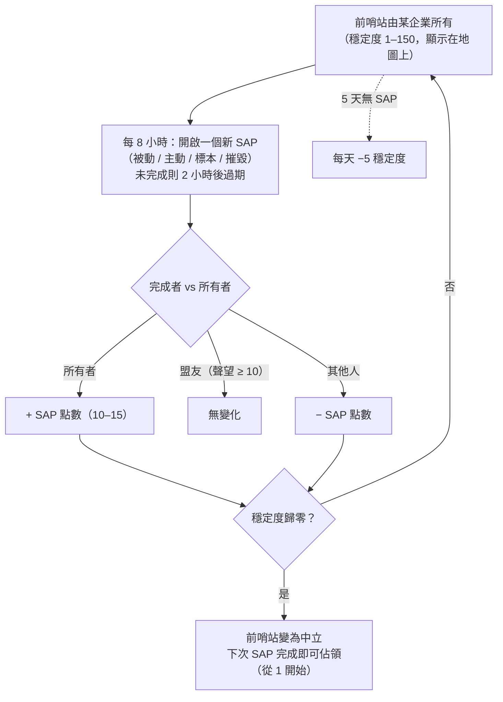

# 前哨站與 SAP

在開放 PvP 島嶼上，**前哨站可由玩家企業所有**。
控制權由一個 **穩定度** 計量表（0–150）衡量，顯示在地圖視圖中前哨站上方。**SAP**（服務存取點）系統就是這個計量表變化的方式——也是前哨站易主的機制。

## 規則

- 當**所有**企業完成一個 SAP 時，穩定度**上升**該 SAP 的點數值。
- 當**與所有者結盟的企業**（雙向聲望 +10 或以上）完成時，穩定度**不變**。
- 當**其他人**完成時，穩定度**下降**相同數值。
- 穩定度歸**零**時，前哨站失去所有權並變為中立。在中立前哨站上完成任何 SAP 即可**佔領**它（完成的企業成為所有者，穩定度從 1 開始）。
- **衰減**：若 **5 天**內沒有任何 SAP 被完成，前哨站開始**每天失去 5 點穩定度**，直到有 SAP 被完成（或前哨站被失去）。

## 四種 SAP 類型

每 8 小時前哨站會開啟一個新的 SAP——四種類型之一。每種類型有自己的點數值和完成方式：

| 類型 | 完成方式 | 點數 | 獎勵特色 |
|---|---|---|---|
| **被動** | 站在 SAP 光束內 **8 分鐘**。進度為個人制（每位玩家各自在光束中的連續時間）；個人進度最高者完成。 | +10 | 陣營等離子體（隨穩定度縮放）、研究套件、EP 增益器。 |
| **主動** | 鎖定 SAP 並持續運行一個 **SAP 駭客模組**——約 120 個模組週期（每個 5 秒），即約 10 分鐘。停止或離開後進度保留；個人制。 | +15 | 等離子體、核心、研究套件，以及**反應堆核心**（機器人生產）。 |
| **標本** | 將**標本物品**帶到 SAP 旁（7 公尺內）並提交它要求的 5–6 件。每次提交有 90 秒冷卻；進度為個人制。 | +15 | 等離子體、核心、研究套件。 |
| **摧毀** | 將其擊毀：**30,000 護甲**、**對四種傷害類型各 150 點抗性**（60% 減傷）、**6 公尺特徵值**——小型武器效果最佳。傷害進度為**企業制而非個人制**，因此整個艦隊可以同時輸出；SAP 被擊毀時傷害最高的企業決定結果。 | ±15 | 陣營 **PvP 彈藥**、等離子體、核心。 |

所有四種 SAP 都會**向附近所有人廣播目前排名最高的前 10 名**，若未在 **2 小時**內完成則**過期**。

### 阻斷敵人

由於摧毀進度是企業制，且穩定度變化的方向取決於誰獲勝，一種常見戰術是**造成足夠的傷害登上排行榜榜首，但不足以完成 SAP**：如果所有者自己的成員隨後完成它，*你的*企業仍然是獲勝方，穩定度變化將對所有者不利。

## 觀測與預測

- 地質掃描器中的**入侵掃描器電荷**，在前哨站附近啟動後，會報告範圍內前哨站的**距離下一個 SAP 的時間**（在開放 PvP 島嶼上，同一電荷改為報告 NPC 增援狀態）。
- SAP 會在開啟前短時間向附近玩家發出公告。
- SAP 的排名廣播意味著你可以**即時觀測一個爭奪中的 SAP**，並決定是否參與爭奪。

## 穩定度變化的其他方式

- **SAP 遺跡**——生成於前哨站 90–350 公尺處的遺跡物件（4 小時重生，最長存活 12 小時）。擊破一個會**立即施加 ±1 穩定度**（對你的企業），標記你為 PvP 狀態，並給予 EP 加上一個等離子體容器。
- **守護者與入侵者**——前哨站的 NPC 首領：
  - **守護** NPC 緊貼前哨站（約 35 公尺）。擊殺一個**必定降低**穩定度 3 點，無論誰擊殺；約 6 小時重生。
  - **入侵者** NPC 巡邏至約 300 公尺。擊殺一個會為擊殺企業**提升**穩定度 2 點；約 6 小時重生。

## 前哨站的重要性

擁有前哨站可為企業提供其加成（生產、防禦設施、效果），是開放 PvP 領土玩法的骨幹——請參閱 [PBS](/zh-TW/features/pbs/) 了解使前哨站成為實際作戰基地的結構。

<!--
Written from scratch against the server backend, 2026-09-27:
Zones/Intrusion/Outpost.cs (stability 0-150, capture at 1, ally threshold
+10, EP to participants), OutpostDecay.cs (5-day grace, -5/day), SAP.cs +
PassiveHackingSAP.cs / ActiveHackingSAP.cs / SpecimenProcessingSAP.cs /
DestructionSAP.cs (8-min passive, 120x5s active, 5-6 specimen items with 90s
cooldown, corporate destruction score, 2h expiry, top-10 broadcast),
entitydefaults options (#increase=n10/n15), siegeitems (def_specimen_sap_item
2-3 x 5-6), def_sap_destruction stats (30k armor, 150 res all types, 6m
signature), def_siege_hack_module (5s cycle), intrusionsitestabilitythreshold
+ intrusionsaps, intrusionloot (plasma/kernels/research kits/cores/PvP ammo
by stability tier), npcbossinfo + npcflock (guard -3 @ ~35m, invader +2 @
~300m, 6h respawn), OutpostRelicManager.cs + SAPRelic.cs (90-350m spawn,
4h respawn, 12h lifespan, +1 stability, PvP flag), Scanner.Intrusion.cs
(next-SAP-time scan), EntitiesModule.cs (8h SAP interval).
An earlier version of this page was adapted from the Open Perpetuum
community wiki (perpetuum.miraheze.org) and has been fully rewritten from
backend sources; no text was reused.
Note: the ingested text had several numbers this server contradicts (3-day
decay vs 5-day, 10-min passive vs 8-min, "no resistances" vs 150 all types,
3 km invader range vs 300 m).
-->