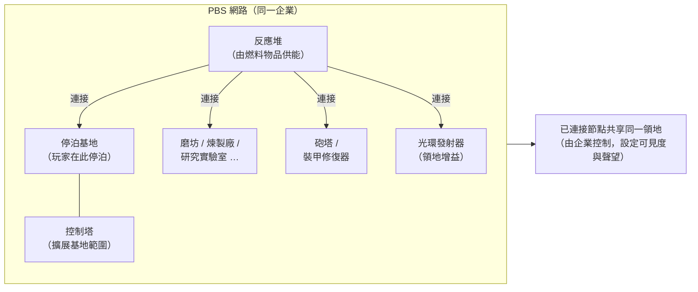
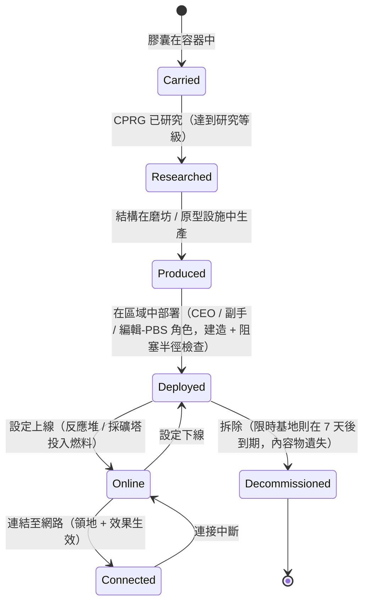

# 電力基地站（PBS）

一個 **PBS**（電力基地站）是區域中可放置的結構。PBS 物件可以被**連接**成一個**網路**，該網路定義**領地**並啟用**效果**。
這是企業/結構活動——大多數操作需要正確的企業角色。

> UI 位置請參閱[客戶端 UI 概覽](/zh-TW/features/ui/)。客戶端中「PBS」的名稱應予以確認。以下機制已與伺服器端確認。

## PBS 的功能

- 它是 PBS **網路**中的一個**節點**。
- 已連接的節點形成一個由擁有企業控制的共享**領地**。
- 一個網路可以在其領地上投射**效果**（增益/控制）。
- 某些 PBS 結構可以**投入**物品（燃料）來運作。

## 結構家族

每個 PBS 結構都有**小型 / 中型 / 大型**等級。你攜帶**膠囊**、研究該物品（CPRG），然後**部署**該物件——部署受權限限制（見下文）。各家族如下：

| 家族 | 結構 | 角色 |
|---|---|---|
| 電力 | 反應堆、能量井、核心電池、核心傳輸器 | 產生、儲存並分配一切運作所依賴的**核心能量** |
| 停泊 | 停泊基地、限時停泊基地、控制塔 | 玩家停泊之處；控制塔擴展基地的範圍 |
| 生產 | 磨坊、煉製廠、再處理器、修復、原型製造器、研究實驗室、校準（CPRG）鍛造、研究套件鍛造、生產升級 | 區域中的[生產](/zh-TW/features/production/)設施，而非在家用基地 |
| 防禦 | 砲塔（雷射 / 軌道 / 飛彈 / 電子戰）、裝甲修復器 | 領地的自動防禦 |
| 效果 | 光環發射器、效果供應器、Maskertower、採礦塔 | 投射領地的效果加成；採礦塔自動開採礦石 |
| 運輸 | 高速公路節點 | 連結至區域的**高速公路**（快速旅行線路） |
| 建造 | 建造模組 | 放置其他結構的建造器 |

### 光環發射器效果

光環發射器是主要的領地增益。每個等級投射三種**等級縮放的基礎加成**之一：

- **小型** — 感測器 lvl1 / 工程 lvl1 / 工業 lvl1
- **中型** — 同樣三項於 lvl2
- **大型** — 同樣三項於 lvl3

感測器擴展掃描/偵察範圍，工程加速建造，工業加速生產。

### 限時停泊基地

一種特殊的 PBS 基地，具有固定的**7 天壽命**（內容中為 168 小時）。它**無法被拆除**——它只會**到期或被摧毀**。剩餘壽命會由遊戲內廣播員公告（基地頻道主題、郵件及 MOTD）；當時間耗盡時，基地會被摧毀且其內容物將遺失。這是 PBS 停泊的「租賃」模式：你不需要付租金，而是獲得一個時間限制。

## 部署

- **檢查部署** — 在放置之前，驗證 PBS 是否可以在該位置部署
  （坡度、阻塞及權限檢查）。這需要企業角色
  （**CEO / 副手 / 編輯-PBS**）。
- 部署使用結構的**建造半徑**和**阻塞半徑**。

## 網路與連接

- **取得網路** — 查看你所屬的 PBS 網路。
- **節點資訊** — PBS 節點的詳細資訊。
- **重新命名節點**。
- **建立連接** — 連結兩個 PBS 節點。（連接到已有停泊基地的網路會觸發特定的所有權轉移案例。）
- **斷開連接** — 取消兩個節點之間的連結。
- **設定連接權重** — 調整連接的強度/優先級。

## 控制與狀態

- **設定上線** — 將節點上線/下線。
- **設定效果** — 設定節點投射的效果。
- **設定基地拆除** — 標記基地為待拆除。

## 領地

- **取得領地** — 列出你的網路所控制的領地。
- **設定領地可見度** — 控制領地是否對他人可見。
- **設定聲望限制** — 以聲望限制存取。
- **設定補強偏移** — 調整補強行為。

## 供能

- **可供能資訊** — PBS 所需物品及其目前供能狀態。
- **投入物品** — 提交物品以為 PBS 供能/運作。

可供能的結構是**反應堆**和**採礦塔**。供能將具有能量值的物品（每件的 `corecalories`）轉換為節點的核心能量緩衝區，直至其最大值——範圍內的任何玩家都可以為節點供能。你可以燃燒的物品：

| 燃料 | 每件核心能量 |
|---|---|
| 反應堆增強劑 C 級 | 8,000,000 |
| 反應堆增強劑 B 級 | 4,000,000 |
| 反應堆增強劑 A 級 | 2,000,000 |
| SAP 標本（入侵） | 600,000（flux 變體：28,000） |
| 伽瑪能量塊 | 2,000 |
| 核心增強彈藥 | 1,000 |
| 原礦（espitium） | 400 |
| 原礦（vitricyl / prilumium / chollonin） | 300 |
| 原礦（axicol） | 40 |

增強劑是高效的燃料；原礦是廉價的備選方案。

## 報銷

- **取得 / 設定報銷資訊** — 設定 PBS 相關成本的報銷。

## 日誌

- **PBS 日誌** — 檢視 PBS 活動（連接、部署等）。

## 實務注意事項

- **這是官員活動** — 部署和大多數控制需要企業角色。
- **連接定義領地** — 你建立的網路就是你控制的範圍。
- **先檢查部署** — 它會在你提交之前告訴你放置會失敗的原因（坡度、阻塞、
  權限）。
- **供能維持運作** — 反應堆和採礦塔燃燒燃料物品（增強劑
  或原礦）以維持其核心緩衝區。
- **限時基地是你的時間限制** — 7 天，無法拆除；為摧毀做好規劃。
- **領地可見度與聲望**讓你可以對他人開放或關閉你的區域。

## 防禦砲塔

非玩家可控——作為 PBS 防禦結構部署。砲塔與其他機器人一樣由零件組裝而成，但它們被鎖定在 PBS 平台上且無法駕駛。

| 砲塔 | 角色 |
|---|---|
| PBS 砲塔 | 通用 PBS 防禦 |
| PBS 電子戰砲塔 | 能量戰（護盾/裝甲干擾） |
| PBS 雷射砲塔 | 光束武器防禦 |
| PBS 飛彈砲塔 | 飛彈防禦 |
| PBS 軌道砲塔 | 彈丸（EM）防禦 |
| 警察衛兵塔 | 區域 NPC 警察防禦 |

零件層級的詳細資訊請參閱[機器人參考](/content/robots/)。

<!-- TODO: only the in-client name for PBS and the UI remain (structure list, network
     editor, feeding screen).
     Confirmed: 416 def_pbs_* definitions, S/M/L tiers with capsule/cprg/pr/object
     variants; aura emitter #effect=N93..101 = pbs sensors/engineering/industry lvl1-3
     (EffectType enum); feedable = reactor + mining tower (IPBSFeedable), fuel =
     definitionconfig.corecalories (boosters A/B/C 2/4/8M, SAP 600k/28k, gamma block
     2k, ore espitium 400 / vitricyl+prilumium+chollonin 300 / axicol 40);
     ExpiringPBSDockingBase: lifetime 168 h from definitionconfig.lifetime, no
     deconstruction, announcer channel topic + mail, kill on expiry. -->
     開發者備註：Zone/PBS/PBSCheckDeployment.cs（建造/阻塞半徑，
     CEO/副手/editPBS 角色），PBSMakeConnection.cs / PBSBreakConnection.cs，
     PBSSetConnectionWeight.cs，PBSSetOnline.cs，PBSSetEffect.cs，PBSSetBaseDeconstruct.cs，
     PBSGetNetwork.cs，PBSNodeInfo.cs，PBSRenameNode.cs，PBSGetTerritories.cs，
     PBSSetTerritoryVisibility.cs，PBSSetStandingLimit.cs，PBSSetReinforceOffset.cs，
     PBSFeedableInfo.cs / PBSFeedItemsHander.cs，PBSGetReimburseInfo.cs /
     PBSSetReimburseInfo.cs，PbsGetLog.cs；Zones/PBS/*（IPBSObject, ConnectionHandler）。-->