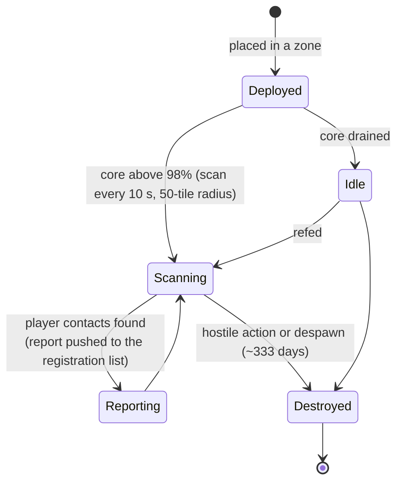

# 近接探測器

探測器分為兩大類：

- **可見性（近接）探測器** — 部署在區域中用於**監視特定範圍**的小型裝置。供電期間會掃描周圍的玩家單位，並將報告推送給已註冊的角色。這是一種監控／偵察工具。
- **採礦探測器** — 安裝在機器人上的**模組**（等級從 *新手* 到 *標準*、*工業*、*命名*、*精英* 再到 *神器*），搭配**每種礦物的探測彈藥**（每種礦物各有磁格／方向／區域變體）。發射後會產生該礦物在該區域的掃描結果，並按角色儲存（請參閱
  [採集 → 掃描](/zh-TW/features/gathering/)）。

> 介面位置請參閱[客戶端介面總覽](/zh-TW/features/ui/)。以下機制已與伺服器端確認。

## 管理您的探測器

- **列出**探測器 — 查看您擁有的探測器。
- **註冊資訊** — 查看探測器的註冊狀態／資訊。
- **設定註冊** — 將角色綁定到探測器的報告清單。
- **設定名稱** — 為探測器設定標籤。
- **移除**探測器的註冊（在區域中）— 停止其監視／清除註冊。

### 可見性探測器的運作方式

- 它由**核心供電**：僅當核心接近滿值（超過 `core_max` 的 98%）時才會掃描；核心耗盡的探測器會進入待機狀態。
- 運作期間會**每 10 秒**掃描一次其**偵測半徑（50 格）**內的玩家機器人，並將報告（每個接觸目標的角色 ID 與座標）推送給註冊清單上的所有人。
- **註冊**是企業活動：您只能註冊**自己企業的成員**，且**執行長與副執行長會自動列入清單**。清單有最大容量限制。
- **壽命**：已部署的探測器在其內容定義的 `despawn_time` 到期後（可見性探測器設定為約 333 天）會消失，或被摧毀。

## 生命週期事件

伺服器會在探測器生命週期事件發生時即時報告：
- **created**（建立）、**updated**（更新）、**dead**（消滅）— 探測器被部署、發出報告或被摧毀。

這些事件以推送方式到達；您不需要發送它們，只需對它們做出反應。

## 實務要點

- **先註冊再讀取** — 探測器只會向已註冊的角色報告。
- **探測器會消亡** — 敵對行動或到期都可能摧毀探測器；請留意生命週期事件。
- **為它們命名** — 當野外有多個探測器時，標籤能幫助您保持頭腦清醒。
- **偵察而非戰鬥** — 探測器負責收集情報；它們不會戰鬥。

<!-- TODO: only the UI remains (probe list, registration picker).
     Confirmed: visibility probe (def_visibility_probe): core_max 50, active only at
     core>98%, 10 s scan interval (ProximityDevice.cs _probingInterval), detection via
     blob_emission 10 / blob_emission_radius 50, report = characterID + x/y per contact
     pushed to registered characters (ProximityProbe.OnUnitsFound); registration =
     own-corp members only, CEO+Deputy always included, max count
     (ProximityProbeRegisterSet.cs); despawn_time 28,800,000 s (~333 d) on the capsule;
     stealth_strength 275 / detection_strength 45. Mining probes: tiered modules
     (noob/standard/industrial1-2/named1-3/elite t2-t4/artifact) + per-ore tile/
     direction/area ammo (79 def_*probe* definitions).
     Developer notes: ProximityProbeList.cs / ProximityProbeGetRegistrationInfo.cs /
     ProximityProbeRegisterSet.cs / ProximityProbeSetName.cs; Zone/ProximityProbeRemove.cs;
     Zones/ProximityProbes/ProximityProbe.cs + ProximityProbeDeployer.cs +
     ProximityDevice.cs; Zones/Blobs/* (blob emission/stealth); lifecycle events via
     ProximityProbeCreated/Update/Dead/Info commands. -->
     Developer notes: ProximityProbeList.cs / ProximityProbeGetRegistrationInfo.cs /
     ProximityProbeRegisterSet.cs / ProximityProbeSetName.cs; Zone/ProximityProbeRemove.cs;
     Zones/ProximityProbes/ProximityProbe.cs + ProximityProbeDeployer.cs; lifecycle
     events via ProximityProbeCreated/Update/Dead/Info commands. -->