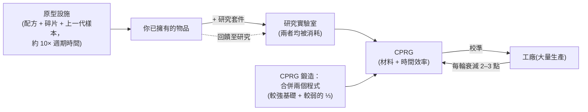

# 生產

生產是將原始資源和組件轉化為可用物品的過程。它發生在你停泊基地的**生產設施**（即「工廠」）中。以下所有內容均為**僅限停泊**操作。

> 介面位置請參閱[客戶端介面總覽](/zh-TW/features/ui/)（頂部工具列的**提煉 / 回收 / 修復 / 保險**分類）。以下機制已與伺服器端驗證確認。

## 生產線

**生產線**是一組已儲存的配方：它定義了你要生產什麼以及使用哪些原料。所有可製作物品的完整組件清單（含研究等級）已在[配方](/content/recipes/)中生成。你以**輪次**為單位執行生產線。

- **列出生產線** — 查看你可用的生產線。
- **啟動生產線** — 在設施中執行指定輪次（最少 1 輪）。
  - 你可以從**個人錢包**或**公司錢包**支付。
  - 來源組件可從你的**庫存**或你的**機器人**中搜尋。
- **校準生產線** — 調整生產線的設定。
- **設定輪次** — 選擇要執行的輪次數量。
- **查詢下一輪** — 預覽下一輪將消耗/產出什麼。
- **取消** — 停止進行中的生產。
- **刪除生產線** — 移除已儲存的生產線。

執行生產線會消耗組件（和信用點），並在各輪次中逐步產出目標物品。

## 一次性操作

這些是單次操作而非多輪生產線。每種操作都有**查詢**變體，可在確認前預覽成本/產出。

- **提煉** — 原始材料 → 商品，使用物品的配方（參見[配方](/content/recipes/)）。
  你選擇要製作多少目標物品；配方的名義輸入量會按材料倍率 `1 + 50/(加成 + 100)` 縮放，其中*加成*是你的提煉技能
  （擴充 + 設施點 + 聲望點）。無加成時消耗名義配方的 **150%**；最大加成時趨近 **100%**。
- **回收 / 再加工** — 將物品分解回其配方組件（反向配方）。產出量為 `名義量 × (1 − 75/(加成 + 100)) × 物品的健康值比例` —
  無技能加成時基礎為 **25%**，可提升至 100%，且**受損物品產出按比例減少**（如有價值請先修復）。僅整數「批次」
  （完整預設數量）會被回收；剩餘部分保留。任務物品會被刪除，而非回收。
- **修復** — 將受損物品/機器人恢復至滿健康值。價格為
  `(缺失健康值 %) × 物品的材料價值 × 75/(加成 + 100)`。「材料
  價值」是遞迴計算的：物品的配方被分解為原始材料，並按**世界市場均價**計價，因此修復成本隨市場浮動。
  技能倍率在無加成時起始為 **75%**，最大加成時趨近 0。
- **研究組件** — 生產研究組件（查詢 + 執行）。

## 物品生命週期（循環過程）

物品製作是三個互聯設施的循環：

1. **研究（逆向工程）** — 將你想生產的物品的樣本，加上等級達到該物品研究等級的
   **研究套件**（套件等級為 0–10），投入研究實驗室。兩項輸入均被**消耗**，
   任務產出該物品的一個 **CPRG**。所得程式的效率起始值來自物品的逐物品基礎值（大多數物品為 50，彈藥較高，
   炮塔最高 90），並由*套件等級超出需求等級的差值 × 5*
   加上你的研究技能加成（最高 +50）提升。因此，一個比物品等級高幾級的套件
   — 加上適當的生產擴充 — 就能將一個全新的 50/50 程式轉化為有競爭力的程式。這是新物品進入你
   生產庫的途徑。
2. **工廠（大量生產）** — 從程式進行大量生產。每輪
   **衰減**生產線的效率（每輪每物品類別 2–3 點；
   參見[CPRG](#cprg-xiao-zhun-cheng-shi)）— 當廢棄率過高時，校準一個新程式到生產線上。原型物品還需要
   **上一代的樣本**作為組件（製作 T2 原型需要一個標準模組，製作 T3 需要一個 T2），
   該樣本在過程中被消耗。
3. **原型設施** — 直接生產物品的**原型**：
   配方的材料加上機器人碎片*以及*上一代樣本，時間約為**工廠週期時間的 10 倍**
   （加上常規時間倍率）。你只能原型化科技樹中已解鎖的物品。
   原型的成本遠高於其標準版本；其主要用途是**研究為高品質程式**
   （研究原型物品是解鎖下一等級的方式）— 或在物品過於稀有無法掉落且市場價格過高時用於機器人。

## 等級 progression

大多數模組和機器人分為 **T1 → T4 等級**（客戶端的等級徽章；
`standard → named1 → named2 → named3` 定義行，然後是 `elitet4`/
`artifact` 特殊行）。規則如下：

- **每個等級是獨立的物品，擁有自己的科技樹節點。** 解鎖
  節點需要研究點（從核心研究獲得），且需要
  **父節點** — 因此等級必須按順序解鎖。你只能
  **原型化**（或大量生產）節點已解鎖的物品：
  沒有研究就無法製作更高等級。
- **每個更高等級消耗一個上一等級的樣本**作為
  組件（加上材料和機器人碎片）。因此 T1 物品永遠無法
  「兌換」為 T3 — T3 原型需要一個 **T2** 物品，且
  樣本被**消耗**，而非轉換：產出是一個全新的物品。
- 每個物品頁面都顯示其**等級鏈** — 完整的 `T1 → T2 → T3 → T4`
  鏈以連結形式呈現 — 且[科技樹節點頁面](/content/techtree/)顯示
  每個等級的父/下一節點及點數價格。

範例，小型礦工模組線：[標準小型礦工 (T1)](/content/items/standard-small-driller/) →
[Biroter 5050 小型礦工模組 (T2)](/content/items/named1-small-driller/) →
[Sublimator Low-D 小型礦工模組 (T3)](/content/items/named2-small-driller/) →
[Scraper-990 小型礦工模組 (T4)](/content/items/named3-small-driller/) —
每個模組/機器人家族都是相同的模式。

## 原型與研究套件

- **原型** — 生產原型物品（啟動 + 查詢）。每個槽位一個原型；
  更多並行原型任務來自生產擴充。
- **合併研究套件** — 將多個研究套件合併為更高級的
  （執行 + 查詢）。更高級的套件既能縮短研究時間，也能提升
  所得程式的效率。

## CPRG（校準程式）

**CPRG**（校準程式）是生產線執行的對象 — 每個物品一個程式，
具有**材料效率**和**時間效率**點數（各 0–100）。你通過
**在研究實驗室研究該物品**獲得一個（研究等級決定你能否
生產該物品），或通過激活**校準膠囊**獲得。

- 新研究的 CPRG 起始為 **50/50** 點。
- **鍛造 CPRG**：在校準程式鍛造爐中合併同一物品的兩個 CPRG；
  結果保留較強程式的點數作為基礎，並加上較弱程式的三分之一。鍛造需要時間並消耗信用點（時間 × 設施的每秒價格）。
- **用 CPRG 校準生產線**以設定其效率。每個生產輪次
  **衰減**生產線的效率（逐物品的去校準值），因此生產線會隨時間
  逐漸下降 — 長時間生產前請重新計算。

效率值代入工廠的公式（每個生產週期）：

- **消耗材料** = 配方 × `1 + 50/(材料點數 + 技能 + 100 + 工廠加成)`
  — 一個無技能、無科技樹大量生產加成的全新 50 點 CPRG 消耗
  約 **133%** 的名義配方。
- **生產時間** = 設施基礎時間（工廠每週期 3,600 秒）×
  `1 + 100/(時間點數 + 技能 + 100)` × 物品的持續時間修正 — 無技能的新 CPRG
  每件物品約需 **1 小時 40 分鐘**。
- **價格** = 生產時間 × 設施的每秒價格（PBS 工廠為 7 信用點/秒，
  大型/中型 PBS 研究實驗室為 3）× 物品的價格修正（1–10）。
- 任務相關 CPRG 免費且固定為 10 秒。

## 保險

保險設施為**你的機器人**投保，而非你的生產產出：

- **購買**機器人的保單（必須未受損、未解包、且非新手機器人），
  **列出**你的保單，**查詢**保單，**刪除**保單。
- 保單有效期為 **15 天**（+ 擴充加成天數）；你可持有
  1 +（擴充加成）個機器人的保單。
- 每個機器人有內容定義的**費用**和**賠付**（`insuranceprices` 表，
  67 個機器人定義）；費用可通過費用擴充加成折減，且可從公司錢包支付。
- 若被保險的機器人被摧毀，**賠付以信用點支付**（機器人
  仍然喪失）— 參見[戰鬥](/zh-TW/features/combat/)。

## 設施與狀態

- **設施資訊 / 描述** — 生產設施提供什麼。
- **進行中（我的 / 公司的）** — 目前正在生產什麼。
- **生產歷史** — 你過去的生產記錄。
- **組件清單** — 可用的生產組件。
- **伺服器資訊** — 生產伺服器狀態。

## 實用提示

- **你必須停泊在擁有生產設施的基地。**
- **執行前先查詢** — 查詢變體會顯示成本和產出，避免因錯誤而浪費組件。
- **公司錢包** — 如果允許，你可以使用公司資金進行生產。
- **組件也可來自機器人** — 生產線可以從你裝備的機器人中調取來源組件，不僅限於你的庫存。
- **滿健康值時回收** — 受損物品產出較少；再加工前先修復昂貴物品。
- **技能倍率才是真正的經濟槓桿** — 提煉/回收/修復/工廠
  加成都以相同方式縮放；投資生產擴充會在每次生產中帶來
  材料節省。
- **保險是機器人的安全網** — 在深空 PvP 前為昂貴的裝備購買保險。
- **研究套件是門檻** — 物品的研究等級（1–9）決定哪些
  套件能解碼它，且使用比物品等級高幾級的套件是
  提升所得程式效率最便宜的方式。

<!--
Developer notes: rewritten 2026 from backend sources; no community-wiki text reused.
Verified against:
- refine = 1 output per unit, input = nominal x (1+50/(bonus+100)) (Refinery.cs);
- recycle = reverse recipe x (1-75/(bonus+100)) x healthRatio, whole batches only,
  mission items deleted (ReprocessSessionMember.cs);
- repair price = (1-healthRatio) x PriceCalculator world-market value x
  75/(bonus+100) (Repair.cs + PriceCalculator.cs);
- ResearchLab.cs (StartResearch/EndResearch: source item + research kit both
  consumed; kit level must be >= itemresearchlevels.researchlevel (1-9);
  efficiency = per-item base + levelDifference*5 + (1-100/(100+skill))*50);
- itemresearchlevels (1101 rows, levels 1-9), research kits def_research_kit_0..10
  (#level option), RandomResearchKit (mission kits, fake 100/100);
- calibrationdefaults (per-CPRG base efficiencies 50-90; default fallback 50/50;
  CalibrationProgram.OnInsertToDb sets 50/50);
- PBSFacilities.cs CalculateResultingPoints (forge = better base + weak/3 +
  (1-100/(100+skill))*25);
- productiondecalibration (2-3 points decrease per round per category,
  distorsion 0.5-1%);
- Prototyper.cs (StartPrototype: components include previous-gen specimen via the
  components table — e.g. T2 NEXUS consumes 1x standard module, T3 consumes 1x T2;
  time = 10x cycle x multiplier; tech-tree unlock check in
  ProductionPrototypeStart.cs);
- prototypes table (339 rows, standard->prototype mapping);
- Mill.cs (CalculateFinalMaterialMultiplier 1+50/(pts+skill+100+millBonus) with
  tech-tree mass-production bonus; CalculateFinalTimeMultiplier;
  productionduration table);
- Insurance: InsuraceFacility.cs (15d + time-extension bonus, 1+slot-extension
  policies, noob bot excluded, must be single+unpacked), InsuranceDescription.cs
  (payout in credits via central bank), insuranceprices (67 robot definitions,
  payout = 80x fee except noob/arkhe2 at 4x).
- Facility options (entitydefaults): def_pbs_facility_mill #perSecondPrice=7
  #productionTime=3600; refinery #materialEfficiency=0.95;
  calibration_program_forge #perSecondPrice=7; def_production_public_factory
  #materialEfficiency=0.6 #manufactureTime=3600 #perSecondPrice=3.
Developer files: Production/ProductionLineStart.cs (PrepareProductionForPublicContainer,
LineStartInMill, corp wallet, search-in-robots, rounds); Production/ProductionLine*.cs;
Production/ProductionRefine*.cs, ProductionReprocess*.cs, ProductionRepair*.cs,
ProductionResearch*.cs (query+run pairs); Production/ProductionPrototype*.cs,
ProductionMergeResearchKitsMulti*.cs; Production/ProductionCPRG*.cs,
ProductionGetCPRGFromLine*.cs; Production/ProductionInsurance*.cs;
Production/ProductionFacility*.cs, ProductionInProgress*.cs, ProductionHistory.cs;
Services/ProductionEngine/Facilities/*.cs; Services/ProductionEngine/PBSFacilities.cs;
Services/ProductionEngine/ResearchKits/*.cs; Services/ProductionEngine/CalibrationPrograms/*;
Services/Insurance/InsuranceHelper.cs; Items/PriceCalculator.cs.
Corrections vs ingested page: no "decoder" item exists (research kits are the
level-gated inputs); the "researched to 100%" claim is wrong (tech-tree unlock is
the gate; research levels run 1-9); prototype time is 10x the mill cycle; specimen
consumption verified from the components table; insurance payout is 80x the fee.
-->