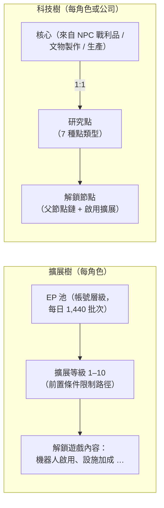

# 研究

遊戲中有**兩套獨立的進度系統**。兩者都僅限停泊時使用。

> 介面位置請參閱[客戶端介面總覽](/zh-TW/features/ui/)（角色視窗 → 擴展；科技樹有獨立的視窗）。以下機制已與伺服器端確認。

## 擴展樹（角色技能）

擴展是每角色的技能等級，用於解鎖遊戲內容——最重要的是**啟用擴展**，它讓你能夠駕駛特定類別的機器人（離港並選擇機器人的必要條件，請參閱[移動](/zh-TW/features/movement/)和[機器人](/zh-TW/features/robots/)）。

### 學習方式

- 必須**停泊**才能學習。
- 每個擴展可提升至**等級 1–10**（等級 10 為上限）。
- **等級 1 消耗信用點**（該擴展的 `price`），從你的錢包中扣除。
- **每個等級消耗擴展點（EP）**，依據固定的排名 × 等級表計算——
  等級 1–5 的費用為 `60 × 排名 × 等級`；等級 6–10 則跳升至
  `排名 × (1440, 2520, 3840, 5400, 12000)`。排名 1 的擴展十個等級共消耗
  60 → 6,000 EP，總計 13,500；排名 10 的擴展每個等級的費用為其十倍。
- **前置條件**必須已學習才能學習該擴展
  （即「prerequire」清單）。
- EP 是**帳號層級的池**：在你所有角色之間共享，並隨時間累積
  （見下方「EP 來源」）。

### 擴展管理

- **分類清單 / 全部取得 / 已學習清單 / 前置條件清單** — 瀏覽樹狀結構及你已擁有的項目。
- **可用點數** — 查看你目前的 EP 池。
- **移除一級** — 降低某個擴展的一個等級。
- **重設角色擴展** — 重設某角色的整棵擴展樹。
- **釋放鎖定 EP** — 釋放被鎖定的 EP（例如移除等級後）。
- **購買 EP 加速** — 付費加速器，可增加 EP 獲取量。
- **EP 活動日誌** — 查看你從遊戲中賺取了多少 EP。

### EP 來源

EP 不是可購買的消費貨幣——它以**每日批次**累積：

- 每個帳號每天獲得 **1,440 EP**（每天發放一次，在伺服器時間 08:00 至
  11:00 之間，由 `extensionPointsAdd` 程序執行）。程式碼中也定義了
  付費訂閱帳號的雙倍 **2,880 EP** 批次，但目前的程序對所有帳號
  發放基礎批次。
- **付費加速**（EP 加速購買）會在此基礎上額外增加。
- 你的**可用 EP** = 所有已接收的每日批次 − 懲罰 − 遊戲中已消耗的 EP。
  （EP 活動日誌顯示每日賺取明細。）

**完整目錄** — 所有擴展（排名、等級 1 價格、加成、前置條件）見
[擴展](/content/extensions/)，所有科技樹節點（解鎖項目、啟用
擴展、點數價格）見[科技樹](/content/techtree/)。

## 科技樹（解鎖項目）

科技樹是一個由**節點**組成的圖，你透過消耗**研究點**來解鎖。與
EP（帳號池）不同，科技樹點數是**透過消耗「核心」獲得的**——即你
研究後提交的物品。

### 運作方式

- **研究核心** — 從容器中提交核心物品。每個核心以
  **1:1** 的比例轉換為特定**點類型**的研究點；核心會被消耗。
  共有七種核心類型，每種對應一個點類型：Theodica、Pelistal、Nüimqol、
  Industrial、Common、HiTech 和 NewTech。
- **解鎖節點** — 消耗所需的研究點。節點只有在以下條件滿足時才能解鎖：
  - 其所有**父節點**已解鎖，且
  - 你的角色已學習該節點的**啟用擴展**。
- **公司解鎖** — 擁有適當的公司角色時，節點可以**為公司**解鎖
  （共享）。公司解鎖費用更高（適用公司價格倍率），且從公司的點數中支付。
- **捐贈** — 捐贈研究點（例如捐給你的公司）。
- **資訊 / 日誌** — 查看節點詳細資訊及你的解鎖/研究歷史。

### 為什麼重要

已解鎖的科技樹節點控制著更高階內容和功能的使用權限。在消耗點數前，
請先確認節點的前置條件（父節點鏈 + 啟用擴展）。

## 實用提示

- **啟用擴展控制機器人** — 你無法駕駛未研究的機器人類別
  （這與阻止離港/選擇的檢查相同）。
- **等級 1 是擴展樹中唯一的信用點消耗**；此後全部使用 EP。
- **科技樹不可逆轉** — 用於解鎖的點數一旦消耗即無法取回；請規劃好路徑。
- **公司科技是團隊合作** — 使用共享點數和價格倍率。

<!-- TODO: only the research UI remains (window layout, point display).
     Confirmed: EP earn = 1440/day flat via dbo.extensionPointsAdd (08:00-11:00 window,
     once per day; 2880 bonus constant exists in GiveExtensionPointsService for paid
     subscriptions but the current SP pays base to all); available = batches -
     penalties - spent (extensionPointsAvailable fn); EP cost table in
     Services/ExtensionService/ExtensionPoints.cs (60*rank*level for levels 1-5, then
     rank*(1440,2520,3840,5400,12000)); kernels convert 1:1 (TechTreeResearch.cs), 7
     kernel definitions -> point types n1..n7 (Theodica/Pelistal/Nuimqol/Industrial/
     Common/HiTech/NewTech).
     Developer notes: Extensions/ExtensionBuyForPoints.cs (docked, prereq, level cap 10,
     level-1 credit price, EP by rank/level, account pool, training-char free);
     Extensions/ExtensionGetAvailablePoints.cs; Extensions/ExtensionBuyEpBoost.cs,
     ExtensionFreeLockedEp.cs, ExtensionRemoveLevel.cs, ExtensionResetCharacter.cs;
     EpForActivityDailyLog.cs; TechTree/TechTreeResearch.cs (kernels → points);
     TechTree/TechTreeUnlock.cs (parent chain + enabler extension, corp multiplier);
     TechTree/TechTreeDonate.cs; Services/ExtensionService/GiveExtensionPointsService.cs;
     Services/ExtensionService/ExtensionPoints.cs. -->
     Developer notes: Extensions/ExtensionBuyForPoints.cs (docked, prereq, level cap 10,
     level-1 credit price, EP by rank/level, account pool, training-char free);
     Extensions/ExtensionGetAvailablePoints.cs; Extensions/ExtensionBuyEpBoost.cs,
     ExtensionFreeLockedEp.cs, ExtensionRemoveLevel.cs, ExtensionResetCharacter.cs;
     EpForActivityDailyLog.cs; TechTree/TechTreeResearch.cs (kernels → points);
     TechTree/TechTreeUnlock.cs (parent chain + enabler extension, corp multiplier);
     TechTree/TechTreeDonate.cs. -->