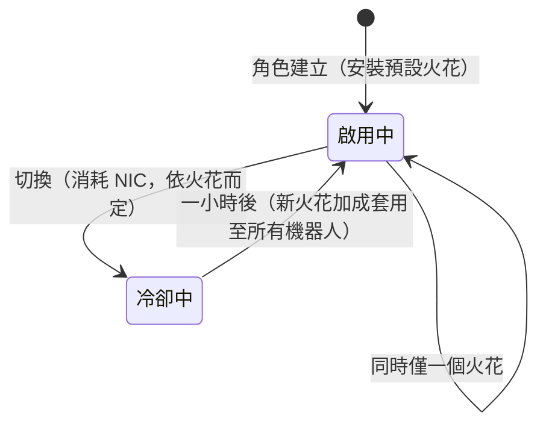

# 火花

**火花**是安裝在角色上的奈米機器人特化模組。當其處於啟用狀態時，其加成會套用至你駕駛的每一台機器人——例如，某陣營的戰鬥線火花會逐級提升武器傷害與暴擊率，而工業線則會提升核心容量與採礦產量。

每個角色在建立時會獲得一個**預設火花**。除此之外，火花分為數個家族——基礎預設線、各陣營的戰鬥／工業／社交線（各三級）、付費辛迪加線，以及特殊限定線——而每種火花的具體加成只是一組固定的技能等級組合，可在[擴展頁面](/content/extensions/)上查看。[下方的家族總覽](#huo-hua-jia-zu)可直接跳轉至各家族的火花。

## 解鎖（授權）火花

安裝尚未擁有的火花需要先**解鎖**（僅限泊船狀態）。根據火花類型，伺服器會檢查：

- **價格**（以 NIC 計——付費線，例如辛迪加實用火花與限定特殊火花），
- 與開發巨型企業的**聲望**（各陣營線需要與該陣營巨型企业達到最低聲望，透過完成其[任務](/zh-TW/features/missions/)來累積），
- 或從你的物品欄中取用的**物品**（某些特殊火花需要鑰匙物品來解鎖）。

解鎖為一次性操作：一旦解鎖，火花將永久保留在你的收藏中。

## 切換火花

- 同時只能有**一個啟用中的火花**；安裝另一個會替換當前火花。
- 每次切換**消耗 NIC**——金額依火花而異（通用線為 10k，付費特殊線最高達 1M）。
- 切換之間有**一小時冷卻時間**：伺服器會追蹤你當前火花的啟用時間，在時間未到前拒絕新的切換請求。

由於切換總是消耗 NIC 且需要一小時，請選擇與你花費最多時間的活動相匹配的火花，並將重新特化視為偶爾的決策，而非每次登入時的常規操作。
<!-- sparkfamilies:generated -->

## 火花家族

6 個家族共 47 種火花一覽：每個家族一個方框（火花數量、解鎖方式），按線加入順序排列（從左到右、從上到下）。**點擊方框可跳轉至下方該家族的火花。** **將滑鼠懸停在圖表上可縮放**，拖曳可平移，使用 ⟲ 按鈕可重置。

<button type="button" class="zoommap-reset" title="重置縮放">⟲</button>
<svg class="zoommap" xmlns="http://www.w3.org/2000/svg" viewBox="0 0 1008 278" width="960" height="264" role="img" aria-label="火花家族：6 個家族，47 種火花；點擊家族可跳轉至下方其火花">
  <rect x="0" y="0" width="1008" height="278" fill="#10151f" stroke="#39445a" stroke-width="1"/>
  <g><title>活動與特殊：9 種火花，免費解鎖</title><a href="#family-special"><rect x="24" y="40" width="300" height="84" rx="10" fill="#10151f" stroke="#c8d2e0" stroke-width="1.5"/><text x="174" y="68" text-anchor="middle" fill="#e8eefc" font-size="15" font-weight="700">活動與特殊</text><text x="174" y="92" text-anchor="middle" fill="#c8d2e0" font-size="12">9 種火花 · 免費</text></a></g>
  <g><title>TM（Truhold-Markson）：9 種火花，需 TM 聲望解鎖</title><a href="#family-tm"><rect x="354" y="40" width="300" height="84" rx="10" fill="#10151f" stroke="#41d3ff" stroke-width="1.5"/><text x="504" y="68" text-anchor="middle" fill="#e8eefc" font-size="15" font-weight="700">TM（Truhold-Markson）</text><text x="504" y="92" text-anchor="middle" fill="#41d3ff" font-size="12">9 種火花 · TM 聲望</text></a></g>
  <g><title>ICS：9 種火花，需 ICS 聲望解鎖</title><a href="#family-ics"><rect x="684" y="40" width="300" height="84" rx="10" fill="#10151f" stroke="#6ee7a0" stroke-width="1.5"/><text x="834" y="68" text-anchor="middle" fill="#e8eefc" font-size="15" font-weight="700">ICS</text><text x="834" y="92" text-anchor="middle" fill="#6ee7a0" font-size="12">9 種火花 · ICS 聲望</text></a></g>
  <g><title>ASI：9 種火花，需 ASI 聲望解鎖</title><a href="#family-asi"><rect x="24" y="154" width="300" height="84" rx="10" fill="#10151f" stroke="#f5a05a" stroke-width="1.5"/><text x="174" y="182" text-anchor="middle" fill="#e8eefc" font-size="15" font-weight="700">ASI</text><text x="174" y="206" text-anchor="middle" fill="#f5a05a" font-size="12">9 種火花 · ASI 聲望</text></a></g>
  <g><title>Syndicate（NIC）：5 種火花，需 NIC 價格解鎖</title><a href="#family-syndicate"><rect x="354" y="154" width="300" height="84" rx="10" fill="#10151f" stroke="#a78bfa" stroke-width="1.5"/><text x="504" y="182" text-anchor="middle" fill="#e8eefc" font-size="15" font-weight="700">Syndicate（NIC）</text><text x="504" y="206" text-anchor="middle" fill="#a78bfa" font-size="12">5 種火花 · NIC 價格</text></a></g>
  <g><title>限定：6 種火花，需 NIC 價格解鎖</title><a href="#family-limited"><rect x="684" y="154" width="300" height="84" rx="10" fill="#10151f" stroke="#f472b6" stroke-width="1.5"/><text x="834" y="182" text-anchor="middle" fill="#e8eefc" font-size="15" font-weight="700">限定</text><text x="834" y="206" text-anchor="middle" fill="#f472b6" font-size="12">6 種火花 · NIC 價格</text></a></g>
</svg>

### 活動與特殊（9）

解鎖：無——這些是基礎預設線。每次切換消耗 NIC（金額依火花而異，請參閱卡片）並有一小時冷卻時間——請參閱上方[切換火花](#qie-huan-huo-hua)。

ww

解鎖 免費 · 切換 10k NIC

預設火花——角色建立時安裝

wi

解鎖 免費 · 切換 10k NIC

預設火花——角色建立時安裝

ws

解鎖 免費 · 切換 10k NIC

預設火花——角色建立時安裝

iw

解鎖 免費 · 切換 10k NIC

預設火花——角色建立時安裝

ii

解鎖 免費 · 切換 10k NIC

預設火花——角色建立時安裝

is

解鎖 免費 · 切換 10k NIC

預設火花——角色建立時安裝

sw

解鎖 免費 · 切換 10k NIC

預設火花——角色建立時安裝

si

解鎖 免費 · 切換 10k NIC

預設火花——角色建立時安裝

ss

解鎖 免費 · 切換 10k NIC

預設火花——角色建立時安裝

### TM（Truhold-Markson）（9）

解鎖：與 TM 巨型企業的聲望（依等級 2 → 4 → 6）。每次切換消耗 NIC（金額依火花而異，請參閱卡片）並有一小時冷卻時間——請參閱上方[切換火花](#qie-huan-huo-hua)。

戰鬥 Lv1

解鎖 TM 聲望 2 · 切換 10k NIC

包含 2 個擴展等級

戰鬥 Lv2

解鎖 TM 聲望 4 · 切換 100k NIC

包含 3 個擴展等級

戰鬥 Lv3

解鎖 TM 聲望 6 · 切換 1M NIC

包含 3 個擴展等級

工業 Lv1

解鎖 TM 聲望 2 · 切換 10k NIC

包含 2 個擴展等級

工業 Lv2

解鎖 TM 聲望 4 · 切換 100k NIC

包含 3 個擴展等級

工業 Lv3

解鎖 TM 聲望 6 · 切換 1M NIC

包含 3 個擴展等級

社交 Lv1

解鎖 TM 聲望 2 · 切換 10k NIC

包含 2 個擴展等級

社交 Lv2

解鎖 TM 聲望 4 · 切換 100k NIC

包含 3 個擴展等級

社交 Lv3

解鎖 TM 聲望 6 · 切換 1M NIC

包含 3 個擴展等級

### ICS（9）

解鎖：與 ICS 巨型企業的聲望（依等級 2 → 4 → 6）。每次切換消耗 NIC（金額依火花而異，請參閱卡片）並有一小時冷卻時間——請參閱上方[切換火花](#qie-huan-huo-hua)。

戰鬥 Lv1

解鎖 ICS 聲望 2 · 切換 10k NIC

包含 2 個擴展等級

戰鬥 Lv2

解鎖 ICS 聲望 4 · 切換 100k NIC

包含 3 個擴展等級

戰鬥 Lv3

解鎖 ICS 聲望 6 · 切換 1M NIC

包含 3 個擴展等級

工業 Lv1

解鎖 ICS 聲望 2 · 切換 10k NIC

包含 2 個擴展等級

工業 Lv2

解鎖 ICS 聲望 4 · 切換 100k NIC

包含 3 個擴展等級

工業 Lv3

解鎖 ICS 聲望 6 · 切換 1M NIC

包含 3 個擴展等級

社交 Lv1

解鎖 ICS 聲望 2 · 切換 10k NIC

包含 2 個擴展等級

社交 Lv2

解鎖 ICS 聲望 4 · 切換 100k NIC

包含 3 個擴展等級

社交 Lv3

解鎖 ICS 聲望 6 · 切換 1M NIC

包含 3 個擴展等級

### ASI（9）

解鎖：與 ASI 巨型企業的聲望（依等級 2 → 4 → 6）。每次切換消耗 NIC（金額依火花而異，請參閱卡片）並有一小時冷卻時間——請參閱上方[切換火花](#qie-huan-huo-hua)。

戰鬥 Lv1

解鎖 ASI 聲望 2 · 切換 10k NIC

包含 2 個擴展等級

戰鬥 Lv2

解鎖 ASI 聲望 4 · 切換 100k NIC

包含 3 個擴展等級

戰鬥 Lv3

解鎖 ASI 聲望 6 · 切換 1M NIC

包含 3 個擴展等級

工業 Lv1

解鎖 ASI 聲望 2 · 切換 10k NIC

包含 2 個擴展等級

工業 Lv2

解鎖 ASI 聲望 4 · 切換 100k NIC

包含 3 個擴展等級

工業 Lv3

解鎖 ASI 聲望 6 · 切換 1M NIC

包含 3 個擴展等級

社交 Lv1

解鎖 ASI 聲望 2 · 切換 10k NIC

包含 5 個擴展等級

社交 Lv2

解鎖 ASI 聲望 4 · 切換 100k NIC

包含 6 個擴展等級

社交 Lv3

解鎖 ASI 聲望 6 · 切換 1M NIC

包含 6 個擴展等級

### Syndicate（NIC）（5）

解鎖：NIC 價格（每種火花 1M）。每次切換消耗 NIC（金額依火花而異，請參閱卡片）並有一小時冷卻時間——請參閱上方[切換火花](#qie-huan-huo-hua)。

Syndicate NIC 戰鬥

解鎖 1M NIC · 切換 100k NIC

包含 2 個擴展等級

Syndicate NIC 偵察

解鎖 1M NIC · 切換 100k NIC

包含 2 個擴展等級

Syndicate NIC 核心增強

解鎖 1M NIC · 切換 100k NIC

包含 2 個擴展等級

Syndicate NIC 全抗性

解鎖 1M NIC · 切換 100k NIC

包含 4 個擴展等級

Syndicate NIC 體能增強

解鎖 1M NIC · 切換 100k NIC

包含 2 個擴展等級

### 限定（6）

解鎖：NIC 價格（每種火花 25–50M）。每次切換消耗 NIC（金額依火花而異，請參閱卡片）並有一小時冷卻時間——請參閱上方[切換火花](#qie-huan-huo-hua)。

週年紀念 戰鬥

解鎖 25M NIC · 切換 1M NIC

包含 6 個擴展等級

週年紀念 物流

解鎖 25M NIC · 切換 1M NIC

包含 6 個擴展等級

Amazon c1 戰鬥

解鎖 25M NIC · 切換 1M NIC

包含 2 個擴展等級

Amazon c1 工業

解鎖 25M NIC · 切換 1M NIC

包含 2 個擴展等級

Steam a

解鎖 50M NIC · 切換 1M NIC

包含 2 個擴展等級

Steam b

解鎖 50M NIC · 切換 1M NIC

包含 2 個擴展等級

<!--
本頁面於 2026-09-27 完全依據伺服器後端重新撰寫：
RequestHandlers/Sparks/SparkUnlock.cs（解鎖規則：價格、聲望、物品）、
RequestHandlers/Sparks/SparkChange.cs + Services/Sparks/SparkHelper.cs
（60 分鐘切換冷卻、依火花的切換價格）、
Services/Sparks/Spark.cs、sparks + sparkextensions 資料表（47 種火花、各線加成組合）。
本頁面的早期版本曾改編自 Open Perpetuum 社群 wiki（perpetuum.miraheze.org），現已完全依據後端來源重寫；未沿用任何原文。
-->