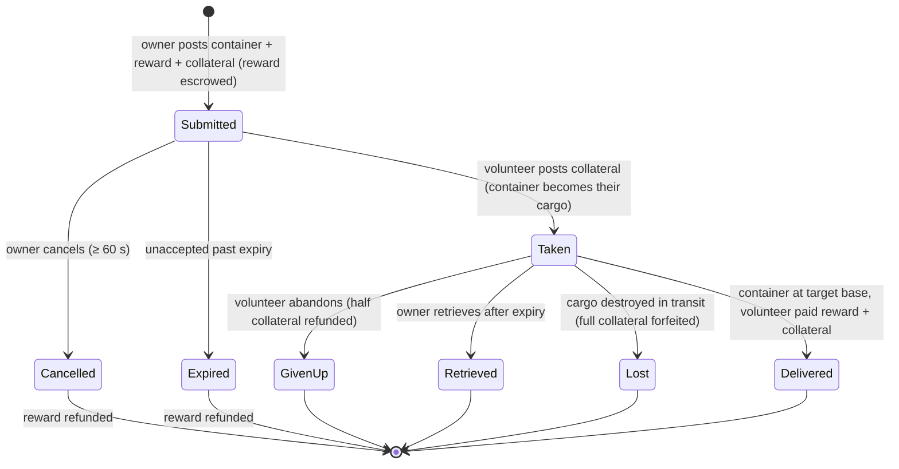

# 運輸（物品運輸）

**運輸任務**將一個裝有物品的容器從一個基地運送到另一個基地，由一名**志願承運者**負責運輸並獲得報酬。這是一個雙邊市場：**委託方**發布運輸訂單，**志願者**接取並完成交付。

> 介面位置請參閱[客戶端介面總覽](/zh-TW/features/ui/)（頂部工具列的**任務**分類）。以下機制已與伺服器端確認。

## 雙方角色

- **委託方（所有者）** — 發布運輸訂單：指定一個要運送的容器，從**起始基地**到**目標基地**，設定**獎勵**、**保證金**及**期限**。
- **志願者（承運者）** — 接取任務、攜帶容器並完成交付。

## 發布運輸（委託方）

**提交運輸訂單**需設定：
- 要運送的**容器**（容量包裝器），
- 交付時支付的**獎勵**，
- **保證金**（承運者需繳納的押金），
- **起始基地**與**目標基地**，
- **期限**（天數），即任務保持開放的時間。

提交時，**獎勵將從你的錢包中託管**（escrow）。

## 接取運輸（志願者）

- **接取**任務 — 你需繳納**保證金**作為押金，容器即成為你負責運送的貨物。

## 交付與取回

- **交付** — 將容器帶到目標基地。交付完成後，**志願者獲得獎勵＋保證金**，委託方收到貨物。
- **取回** — 委託方（或志願者，視情況而定）將容器取回至基地；取回時**保證金歸還**，**獎勵退還**給委託方。

## 取消／放棄

- **取消** — 取消任務。
- **放棄** — 志願者放棄任務。放棄會觸發**保證金罰則**：僅退還**一半**保證金（其餘沒收）— 罰則常數為 `TransportAssignment.cs` 中的 0.5。

## 檢視

- **列出**運輸訂單、**列出內容**、**容器資訊**、**是否運行中？**，以及**運輸日誌**。

## 資金流向（概覽）

**獎勵**是委託方的付款，提交時託管，僅在交付時支付。**保證金**是志願者的押金：接取時支付給委託方，運輸期間由系統持有，交付時（連同獎勵）一併支付給志願者。

| 事件 | 條件 | 委託方 | 志願者 | 容器 |
|---|---|---|---|---|
| 提交 | — | 獎勵託管 | — | 移至運輸儲存區 |
| 接取 | 未被接取 | 收到保證金押金 | 支付保證金 | 成為志願者的貨物 |
| 交付 | 到達目標基地 | 收到貨物 | 獲得**獎勵＋保證金** | 已交付 |
| 取消 | 未被接取，提交後 ≥ 60 秒 | 獎勵退還 | — | 返回起始基地 |
| 放棄 | 已接取 | 獎勵退還 | 退還**一半**保證金（0.5 罰則） | 返回起始基地 |
| 過期 | 未被接取，超過期限 | 獎勵退還 | — | 返回起始基地 |
| 取回 | 已接取**且**超過期限 | 獎勵退還 | — | 返回起始基地（若承運者已靠泊則立即執行，否則於承運者下次靠泊時執行） |
| 貨物毀損 | 運輸途中 | 獎勵退還**＋全部保證金** | 全部保證金沒收 | 遺失 |

## 實務要點

- **無手續費** — 唯一流動的資金是獎勵和保證金。
- **獎勵為託管狀態** — 委託方在運輸解決前無法使用該筆資金。
- **保證金是承運者的押金** — 繳納保證金是你接取運輸的條件；運輸途中貨物遺失將沒收**全部**保證金。
- **放棄有代價** — 放棄運輸將沒收一半保證金。
- **期限僅在未接取時有效** — 提交時設定的過期時間僅自動關閉無人接取的任務（伺服器每小時清理一次過期且未接取的任務）。**已接取**的任務不會自行過期；委託方的逃生機制是**取回**，當過期時間到達後即可使用，將貨物（及獎勵）召回起始基地 — 若承運者已靠泊則立即執行，否則於承運者下次靠泊時自動執行。
- **接取前先檢查內容** — 檢視容器內的物品及路線。

<!-- TODO: 僅剩客戶端介面（任務畫面佈局）待完成。
     資金模型已確認：提交時託管獎勵（CashInOnSubmit），志願者接取時支付保證金
     （TakeCollateral -> PayCollateralToPrincipal），交付時支付志願者獎勵＋保證金
     （PayOutReward）；取消需建立後 60 秒；過期 = 提交時間 + 客戶端期限天數
     （<=0 -> 1），由 MissionProcessor 每小時清理（_transportAssignmentInterval 1h），
     僅清理 taken=0 的任務；取回需過期已過 + 已接取，下次靠泊時自動完成；
     貨物毀損時退還獎勵並沒收全部保證金歸委託方。
     開發者備註：TransportAssignments/TransportAssignmentSubmit.cs；
     Services/MissionEngine/TransportAssignments/TransportAssignment.cs（獎勵／保證金
     託管、PayOutReward = 獎勵＋保證金、PaybackCollateral、PaybackHalfCollateral
     = 放棄時的 COLLATERAL_PENALTY、RetrieveToBasePublicContainer、過期）；
     TransportAssignmentTake/Deliver/Retrieve/Cancel/GiveUp/List/ListContent/
     ContainerInfo/Running/Log。 -->